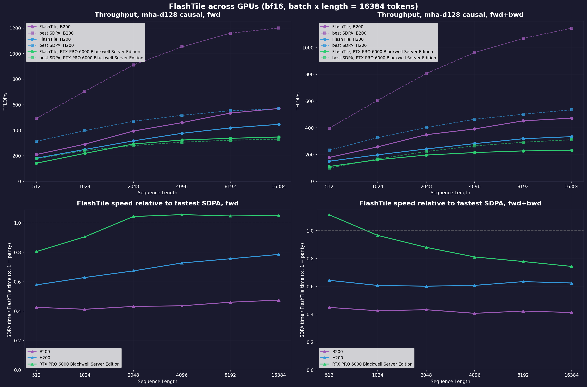
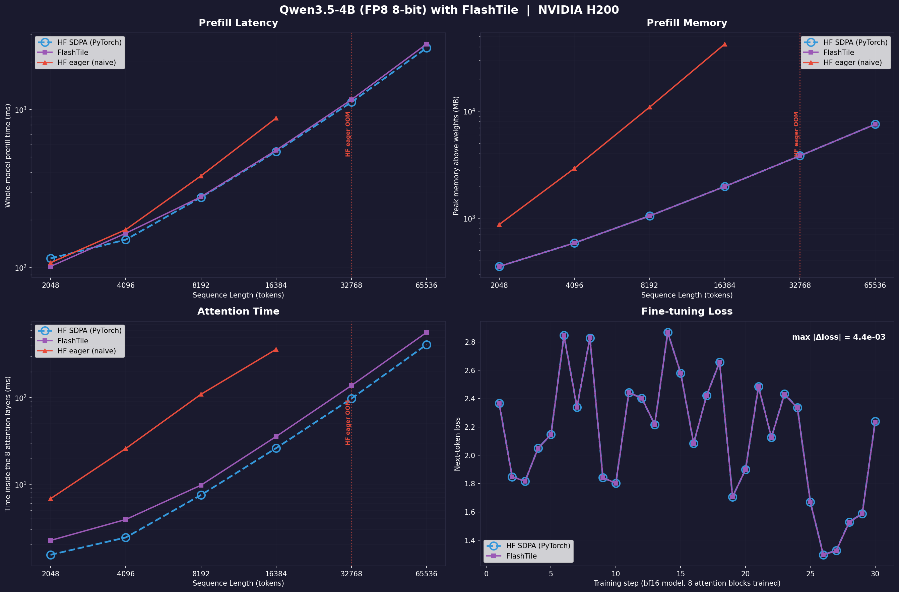
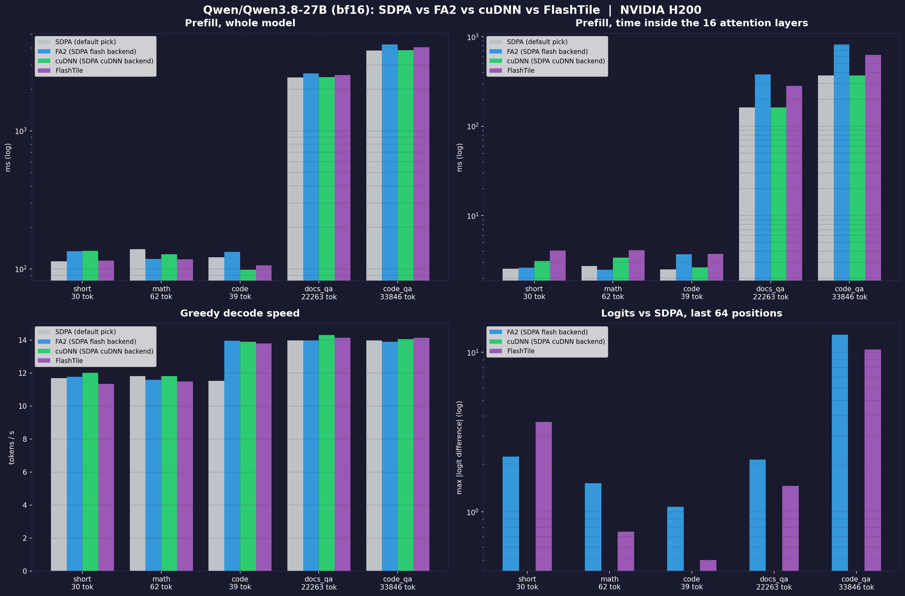

# FlashTile

[](LICENSE)
[](https://python.org)
[](https://pytorch.org)
[](https://github.com/iamrahulreddy/FlashTile/actions)

**FlashTile** is exact attention (FlashAttention-2 style) written three times: a dense fp64 reference,
a readable tiled PyTorch version, and fused Triton kernels for forward and backward. All three follow
the same rules and every test checks them against each other. v2 also runs inside real models
through Hugging Face transformers: Qwen3.5-4B in 8-bit and Qwen3.8-27B in bf16.

It's tested and benchmarked on three GPUs:
- NVIDIA H200 (Hopper)
- NVIDIA B200 (datacenter Blackwell)
- RTX PRO 6000 (workstation Blackwell)



### Overview
- **Triton kernels, forward and backward**: GQA/MQA without copying K/V, causal with position
  offsets (prefill, decode, chunked prefill), any head dim up to 256, gradients through the
  returned LSE. About 430 lines of kernel code.
- **Checked against an fp64 oracle**: 158/158 tests pass on each of the three GPUs. Every benchmark
  row is checked for correctness before it's timed (990 rows, zero parity failures).
- **Faster than PyTorch's FlashAttention-2 path** in the forward pass at long context on all three
  GPUs (1.04-1.67x at 16K, d=128).
- **Half the training memory** of PyTorch's FA2 path, and a third with GQA.
- **Real models**: drop-in attention for Qwen3.5-4B via `attn_implementation`, measured for
  precision, long-context prefill, generation and fine-tuning. Qwen3.8-27B on H200 against
  PyTorch's FA2 and cuDNN on the same five prompts.

## What changed since v1

v1 (0.2.2) was mostly about understanding the algorithm. It had readable PyTorch modules
(`FlashAttentionV1`, `FlashAttentionV2`, GQA/MQA, sliding window) and a forward-only Triton kernel,
tested on A100 and H100. v2 is a rewrite aimed at making the fast path real and proving it's
correct.

| | v1 (0.2.2) | v2 (2.0.0) |
|---|---|---|
| Triton kernel | forward only | forward + backward |
| GQA/MQA backward | standard autograd, O(N²) memory | in-kernel, O(N), no K/V copies |
| API | `nn.Module` classes with projections, input `(batch, seq, embed)` | `attention(q, k, v)` on `[B, H, L, d]` tensors |
| Causal | square only | position offsets: prefill, decode, chunked prefill |
| Head dims (Triton) | powers of two only | any d <= 256 (24, 72, 80 are tested) |
| Correctness | V1/V2 vs naive | three implementations vs an fp64 oracle, incl. all gradients and LSE |
| Benchmarked against | naive attention | naive + PyTorch FA2, cuDNN and mem-efficient backends |
| GPUs | A100 (H100 cross-check) | H200, B200, RTX PRO 6000 |
| Real model | none | Qwen3.5-4B FP8 and Qwen3.8-27B bf16 through transformers |

On the same kind of comparison v1 made: the v2 Triton forward is about **42x** faster than naive
attention at 8K on H200 (v1: 11.8x on A100, with different shapes, so take it loosely). A training step at 8K uses **56.5 MB** of attention
memory against naive's 8.1 GB.

Dropped in v2:
- the separate sliding-window and masked modules (arbitrary masks still work, on the tiled path)
- the `torch.compile` test
- the Colab/gradio demo

The v1 code and its A100/H100 results are the 0.2.2 release and stay in the git history.

## Performance Results

bf16, batch x length = 16,384 tokens, L = 16K. TFLOP/s, higher is better:

| Workload | H200: FlashTile / FA2 / cuDNN | B200 | RTX PRO 6000 |
|---|---|---|---|
| causal forward, d=128 | 446 / 319 / 568 | 570 / 341 / 1202 | 347 / 315 / 330 |
| causal fwd+bwd, d=128 | 334 / 311 / 535 | 472 / 326 / 1146 | 231 / 311 / 288 |
| GQA forward (32q / 8kv) | 454 / 337 / 584 | 581 / 367 / 1261 | 350 / 326 / 342 |
| Qwen3.5 shape forward (16q / 4kv, d=256) | 461 / 309 / 630 | 435 / 376 / 1496 | 207 / 322 / n/a* |
| Qwen3.5 shape fwd+bwd | 226 / 268 / 411 | 289 / 307 / 1004 | 141 / 236 / n/a* |

> \* PyTorch's cuDNN backend refuses head dim 256 on RTX PRO 6000 ("head_dim should be no more than 128").

Training-step attention memory, mha-d128:

| | FlashTile | PyTorch FA2 | cuDNN |
|---|---|---|---|
| MHA | 258 MB | 514 MB | 387 MB (515 on RTX) |
| GQA | 324 MB | 1092 MB | 836 MB (1092 on RTX) |

What stands out:
- **On B200** the same Triton source is 1.26-1.67x faster than PyTorch's FA2 path. Triton compiles
  it for B200's newer tensor cores, while the prebuilt FA2 kernel doesn't use them.
- **On RTX PRO 6000** FlashTile has the fastest forward of all backends for long causal and GQA
  attention, cuDNN included.
- **Compared with the first v2 run** (Nov 15, older kernels), H200 got 17-55% faster at 16K. cuDNN
  stayed flat over the same runs, so that's the kernel changes plus the Triton upgrade.

Every configuration, all lengths: [docs/PERFORMANCE.md](docs/PERFORMANCE.md). Raw logs, dashboards
and JSON are in `flashtile_results_<GPU>/`.

### About all those result files

There are close to 200 files across the three `flashtile_results_<GPU>/` folders. Nobody needs to
read them all. They're receipts: boring until someone asks where a number came from. If you only
open a few:

- **Tests**, what passed:
  [H200](flashtile_results_H200/tests/summary.txt) ·
  [B200](flashtile_results_B200/tests/summary.txt) ·
  [RTX PRO 6000](flashtile_results_RTX-PRO-6000/tests/summary.txt)
- **Benchmarks**, every table and dashboard:
  [H200](flashtile_results_H200/benchmarks/REPORT.md) ·
  [B200](flashtile_results_B200/benchmarks/REPORT.md) ·
  [RTX PRO 6000](flashtile_results_RTX-PRO-6000/benchmarks/REPORT.md)
- **Qwen3.5-4B answers**, SDPA vs FlashTile:
  [H200](flashtile_results_H200/llm/generations.md) ·
  [B200](flashtile_results_B200/llm/generations.md) ·
  [RTX PRO 6000](flashtile_results_RTX-PRO-6000/llm/generations.md)
- **Qwen3.8-27B answers**, all four attention paths:
  [H200](flashtile_results_H200/qwen3.8-27b/generations.md)

## Where it falls short

> [!IMPORTANT]
> FlashTile isn't the fastest attention on datacenter GPUs. PyTorch's cuDNN backend beats it on
> H200 and B200, so for production serving or training use PyTorch's SDPA (or flash-attn).
> FlashTile is the readable, fully checked option.

These are measured too, they're in the same result folders:

- **cuDNN is much faster on datacenter GPUs.**
  - B200: 1.6-3.5x faster than FlashTile depending on the shape, 2.1-2.5x for d=128 at 16K
    (roughly 66% of peak vs 26%).
  - H200: FlashTile's forward reaches 73-88% of cuDNN at long context, its training step 55-69%.

  Closing that gap needs Hopper/Blackwell-specific data movement (TMA, warp specialization, tensor
  memory), not more tuning.
- **Head dim 256 is the weakest case**, and that's Qwen3.5's own shape. Inside the model at 65K
  tokens, attention takes 1.38x cuDNN's time on H200, 3.65x on B200 and 1.81x FA2's on RTX PRO 6000.
  The whole model ends up 6% / 24% / 16% slower. In Qwen3.8-27B on H200 it's 1.7x cuDNN's attention
  time at 22-34K tokens.
- **The backward lags the forward.** At 16K it's 0.55-0.69x cuDNN on H200 and 0.60-0.85x FA2 on
  RTX PRO 6000.
- **Long-context decoding barely uses the GPU.** At batch 1 only `batch x kv_heads` programs run (4
  for Qwen3.5). There's no split-KV decode kernel yet. On RTX PRO 6000, decoding over a 39K-token
  context ran at 11.7 tok/s vs SDPA's 19.7. In Qwen3.8-27B on H200, attention per decoded token took
  9.4 ms at 22K and 12.6 ms at 34K, against 2.2-2.4 ms for FA2 and cuDNN. Tokens per second came out
  the same there only because HF's own per-token overhead is bigger.
- **The single-pass backward with atomic dQ didn't pay off.** It's faster only on a few shapes (d=64
  on B200, d=256 at long L on RTX), so the two-kernel backward stays the default.
- **Missing features:**
  - padding masks run on the slow tiled PyTorch path
  - no variable-length packing, paged KV cache, sliding window, dropout or FP8 attention
- **The first call per shape is slow.** It's JIT compiled and autotuned; the full test suite takes
  12-26 minutes per GPU, mostly because of that.
- **One unexplained dip.** d=64 at L=4096 is slower than at its neighbors, on both H200 and B200,
  with the same autotune pick both times. Haven't tracked it down yet.
- **Training equivalence is from one seed.** The loss curves track SDPA's (max gap 4.4e-3 on H200,
  2.7e-3 on RTX), but B200 had a few steps with gaps up to 1.7e-2, and it's a single seed so far.

> [!WARNING]
> Batched generation with padding falls off the fast path. Every attention call with a padding mask
> runs on the tiled PyTorch path: exact, but much slower. Batch-1 generation and unpadded batches
> stay on Triton.

## Installation

```bash
git clone https://github.com/iamrahulreddy/FlashTile.git
cd FlashTile
pip install -e .            # add ".[hf]" for the transformers integration
```

The Triton path needs an NVIDIA GPU. Everything else (oracle, tiled path, tests) runs on CPU.
Tested with torch 2.15 and Triton 3.9.

## Quick Start

```python
import torch
from flashtile import attention, select_backend

q = torch.randn(2, 32, 4096, 128, device="cuda", dtype=torch.bfloat16)   # [B, Hq, L, d]
k = torch.randn(2, 8, 4096, 128, device="cuda", dtype=torch.bfloat16)    # [B, Hkv, L, d], GQA
v = torch.randn(2, 8, 4096, 128, device="cuda", dtype=torch.bfloat16)

out = attention(q, k, v, causal=True)                   # triton on CUDA, tiled elsewhere
out, lse = attention(q, k, v, causal=True, return_lse=True)
print(select_backend(q, k, v, causal=True))             # ('triton', 'supported')

# decode: one new query at position 4096 over 4097 cached keys (CPU positions, no GPU sync)
q1 = torch.randn(2, 32, 1, 128, device="cuda", dtype=torch.bfloat16)
kv = torch.randn(2, 8, 4097, 128, device="cuda", dtype=torch.bfloat16)
o1 = attention(q1, kv, kv, causal=True, q_pos=torch.arange(4096, 4097), k_pos=torch.arange(4097))
```

With Hugging Face transformers (5.x), as the attention of a whole model:

```python
import torch
import flashtile.hf
from transformers import AutoModelForCausalLM

flashtile.hf.register()
model = AutoModelForCausalLM.from_pretrained(
    "Qwen/Qwen2.5-1.5B-Instruct", dtype=torch.bfloat16, device_map="cuda",
    attn_implementation=flashtile.hf.NAME,
)
# generate / train as usual; flashtile.hf.stats shows which path each attention call took
```

The registered name is `"ftile"`, not `"flashtile"`. transformers treats any name containing "flash"
as a FlashAttention kernel and tries to download one.

More in **[docs/USAGE.md](docs/USAGE.md)**:
- the full API
- generation, fine-tuning, Qwen3.5 and Qwen3.8 with transformers
- decode, chunked prefill, masks and the LSE
- what happens with padding, sliding windows and dropout
- troubleshooting

## Qwen3.5-4B

Qwen3.5-4B mixes 24 Gated-DeltaNet layers with 8 softmax-attention layers (16 query heads, 4 KV
heads, head dim 256). FlashTile replaces those 8 and nothing else.

Inference uses
[`RedHatAI/Qwen3.5-4B-FP8-dynamic`](https://huggingface.co/RedHatAI/Qwen3.5-4B-FP8-dynamic),
training uses the bf16 original. Per GPU, `flashtile_results_<GPU>/llm/` has:

- **Precision on real activations and real training gradients**, per layer, vs an fp64 oracle.
  FlashTile's error is equal to or lower than SDPA's in 110 of 120 comparisons; for dV it's never
  higher and often 2-4x lower.
- **Prefill up to 65K tokens** against HF eager and SDPA. Eager runs out of memory at 32K and needs
  41 GB at 16K, where FlashTile needs 2 GB.
- **Greedy generation** (`generations.md`). On H200 a 141-token code answer came out identical to
  SDPA's, and a question about a 39K-token document was answered correctly on all three GPUs. The
  other outputs drift apart after 5-52 tokens. FP8 activation quantization amplifies tiny
  differences, and HF eager drifts from SDPA just as much.
- **Fine-tuning** the 8 attention blocks for 30 steps, from the same weights, with SDPA and with
  FlashTile.

>Something I found while profiling: transformers runs this FP8 checkpoint as quantize-dequantize
>with bf16 matmuls. So 8-bit saves memory (6.1 vs 9.0 GB) but not time. That's why attention time is
>reported separately from whole-model time.



## Qwen3.8-27B

A bigger check of the same idea: [`Qwen/Qwen3.8-27B`](https://huggingface.co/Qwen/Qwen3.8-27B) in
bf16 on one H200. It has 64 layers, 16 of them softmax attention (24 query heads, 4 KV heads, head
dim 256). The same five prompts went through four attention paths, greedy, thinking off:

- **SDPA**, PyTorch's own pick. The profiler shows it's cuDNN on H200, and its outputs were
  bit-identical to forced cuDNN.
- **FA2**, SDPA forced to its built-in FlashAttention-2 kernel. The `flash-attn` package has no
  wheels for torch 2.15 / CUDA 13, so `attn_implementation="flash_attention_2"` wasn't an option.
- **cuDNN**, SDPA forced to cuDNN.
- **FlashTile**.

Prefill, time spent inside the 16 attention layers:

| Prompt | Tokens | cuDNN (= SDPA) | FA2 | FlashTile |
|---|---:|---:|---:|---:|
| docs question (README, USAGE, PERFORMANCE, ...) | 22,263 | 162 ms | 380 ms | 282 ms |
| code question (`flashtile/`, `benchmark/`) | 33,846 | 371 ms | 819 ms | 627 ms |
| three short prompts | 30-62 | 2.5-3.4 ms | 2.5-3.7 ms | 3.7-4.1 ms |

- **At long context FlashTile is 1.3x faster than FA2 and 1.7x slower than cuDNN.** Whole-model
  prefill differs by under 10% (2.4-2.6 s and 3.8-4.2 s), since the other 48 layers and
  the MLPs do most of the work.
- **Short prompts are a loss.** A few ms of attention is mostly fixed per-call cost.
- **Decode is the weak spot.** At 22-34K context FlashTile spends 9.4-12.6 ms per token in attention
  vs about 2.2-2.4 ms for FA2 and cuDNN, the split-KV gap from the list above. All four paths still
  decode at 11.4-14.3 tok/s, because HF's own per-token overhead is bigger.
- **Outputs.** The math answer (256 tokens) is identical on all four paths. On the short and the
  code prompt FlashTile's answer is token-for-token FA2's, and both split from cuDNN's at token 67
  and 79. On the long prompts every path drifts at some point. On the docs question FlashTile
  splits from the others at token 30, but its answer is just as correct. Its prefill logits are as
  close to SDPA's as FA2's are, or closer (KL 5.7e-4 vs 1.0e-3 at 34K), with the same top-1 token
  at 98-100% of the checked positions.
- **cuDNN wasn't repeatable at 22K+.** The same prompt twice gave different answers, and even SDPA
  and forced cuDNN (same kernel) split at token 80 and 35. FA2 and FlashTile were repeatable.

Logs, JSON, all answers and the dashboard are in
[`flashtile_results_H200/qwen3.8-27b/`](flashtile_results_H200/qwen3.8-27b/). `causal_conv1d`
wasn't installed, so the Gated-DeltaNet layers used transformers' slower fallback on every path.
That inflates whole-model times, not the attention ones.



## Reproduce

CPU tests:

```bash
pip install -e ".[dev]"
pytest -v
```

GPU tests, validation, the kernel benchmark and the Qwen3.5 run use [Modal](https://modal.com):

```bash
pip install modal
modal run modal_app.py --gpus H200                    # everything on one GPU, ~65 min
modal run modal_app.py --gpus H200,B200,RTX-PRO-6000  # all three in parallel
modal run modal_app.py --gpus H200 --skip-llm --pytest-args "tests/test_triton.py"
modal run modal_app.py --qwen27b                      # Qwen3.8-27B comparison, H200 (else H100/B200)
```

New runs land in `results/<timestamp>/flashtile_results_<GPU>/` (the 27B one in
`results/<timestamp>/qwen3.8-27b_<GPU>/`). The Qwen3.5 run reads its text from a
local `corpus/` folder that isn't in the repo. Put a few long English `.md` files there (names are in
`modal_app.py`), or pass `--skip-llm`. The 27B run needs no corpus, its long prompts are this repo's
own docs and source. Its first run downloads about 55 GB of weights into a Modal volume. An optional
Modal secret named `huggingface` with `HF_TOKEN` speeds up downloads.

## Project Structure

```
flashtile/
├── contract.py         # input checks, shapes, mask polarity
├── reference.py        # dense fp64 oracle
├── tiled.py            # tiled PyTorch forward/backward
├── triton_kernels.py   # fused Triton forward/backward
├── api.py              # attention(), backend selection
├── hf.py               # transformers integration
└── __init__.py

tests/                  # test_attention (CPU), test_cuda, test_triton, test_hf (GPU)
benchmark/              # kernel benchmark, validation, Qwen3.5 eval, Qwen3.8-27B comparison, plots
docs/                   # USAGE.md, PERFORMANCE.md, cross-GPU dashboard
flashtile_results_*/    # results per GPU (tests, validation, benchmarks, llm; qwen3.8-27b on H200)
modal_app.py            # runs everything on Modal
```

## Coming soon

Plans, not promises. Roughly in this order:

- **Split-KV decode.** The biggest gap measured so far. Spread a long KV cache over many programs
  and merge the pieces with the LSE the kernels already return.
- **Custom kernels for small open-weight models.** Kernels shaped for the exact layouts of small
  open-weight models, starting with the Qwen3.5 family: head dim 256, a fixed GQA ratio, the output
  gate fused into the attention epilogue, and the Gated-DeltaNet layers next to it. The target is a
  single GPU, workstation cards included, since that's where FlashTile already holds its own.
- **Hopper and Blackwell data movement** (TMA, warp specialization), to go after the cuDNN gap.
- **Padding and variable-length batches on the Triton path**, so batched generation stays fast.
- **Paged KV cache and sliding window**, the two things a serving stack asks for first.
- **FP8 attention** on the GPUs that have it.
- **Loose ends**: more seeds for the training comparison, and the d=64 dip at L=4096.

If one of these matters to you, open an issue. It helps decide what comes first.

## Comparison with Other Libraries

| Library | Implementation | Backward | Notes |
|---------|---------------|----------|-------|
| [flash-attn](https://github.com/Dao-AILab/flash-attention) | CUDA | yes | the reference for speed |
| PyTorch `F.scaled_dot_product_attention` | FA2 / cuDNN / mem-efficient | yes | built in, picks a backend for you |
| [FlexAttention](https://pytorch.org/blog/flexattention/) | Triton, generated | yes | custom masks and score mods |
| **FlashTile** | Triton + PyTorch | yes | small, readable, checked against an fp64 oracle |

For production, use PyTorch's SDPA or flash-attn. FlashTile is a readable implementation that turned
out to be competitive in a lot of places, and the numbers above show where it isn't.

## References

1. **FlashAttention: Fast and Memory-Efficient Exact Attention with IO-Awareness**,
   Tri Dao, Daniel Y. Fu, Stefano Ermon, Atri Rudra, Christopher Ré. NeurIPS 2022.
   [arXiv:2205.14135](https://arxiv.org/abs/2205.14135)
2. **FlashAttention-2: Faster Attention with Better Parallelism and Work Partitioning**,
   Tri Dao. ICLR 2024. [arXiv:2307.08691](https://arxiv.org/abs/2307.08691)
3. **GQA: Training Generalized Multi-Query Transformer Models from Multi-Head Checkpoints**,
   Joshua Ainslie et al. EMNLP 2023. [arXiv:2305.13245](https://arxiv.org/abs/2305.13245)
4. **Triton: An Intermediate Language and Compiler for Tiled Neural Network Computations**,
   Philippe Tillet, H.T. Kung, David Cox. MAPL 2019. [triton-lang.org](https://triton-lang.org/)

## Author

**Muskula Rahul** ([@iamrahulreddy](https://github.com/iamrahulreddy))

## License

MIT, see [LICENSE](LICENSE).
