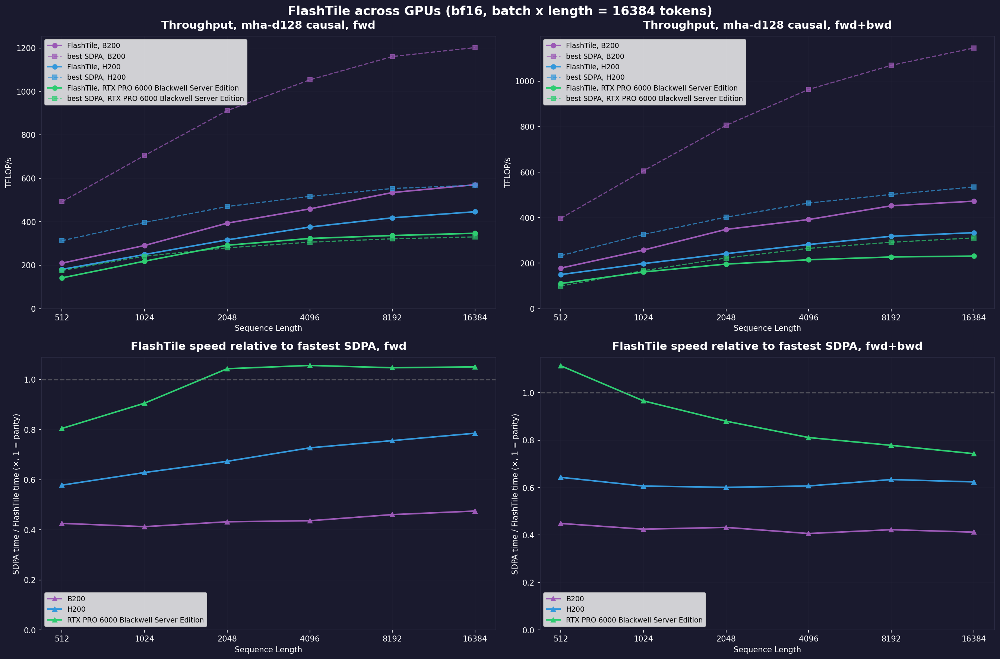

# FlashTile results across GPUs

Every configuration from the final H200, B200 and RTX PRO 6000 runs (generated by `benchmark/report.py`).
"ratio" is FlashTile's time divided by the fastest PyTorch SDPA backend's time on the same inputs, so below 1.0 means
FlashTile was faster. bf16, batch x length = 16,384 tokens.

## NVIDIA B200

| workload | causal | mode | L | FlashTile TFLOP/s | best SDPA | SDPA TFLOP/s | ratio | vs sdpa-flash | atomic-dQ TFLOP/s | atomic-dQ ratio |
|---|---|---|---:|---:|---|---:|---:|---:|---:|---:|
| mha-d128 | True | fwd | 512 | 209.5 | sdpa-cudnn | 492.4 | 2.35 | 0.92 | - | - |
| mha-d128 | True | fwd | 1024 | 290.8 | sdpa-cudnn | 705.1 | 2.42 | 0.91 | - | - |
| mha-d128 | True | fwd | 2048 | 393.6 | sdpa-cudnn | 911.4 | 2.32 | 0.77 | - | - |
| mha-d128 | True | fwd | 4096 | 459.3 | sdpa-cudnn | 1053.1 | 2.29 | 0.71 | - | - |
| mha-d128 | True | fwd | 8192 | 534.5 | sdpa-cudnn | 1160.5 | 2.17 | 0.63 | - | - |
| mha-d128 | True | fwd | 16384 | 570.5 | sdpa-cudnn | 1201.5 | 2.11 | 0.60 | - | - |
| mha-d128 | True | fwd+bwd | 512 | 178.3 | sdpa-cudnn | 397.1 | 2.23 | 0.78 | 148.3 | 2.68 |
| mha-d128 | True | fwd+bwd | 1024 | 257.4 | sdpa-cudnn | 605.8 | 2.35 | 0.77 | 191.7 | 3.16 |
| mha-d128 | True | fwd+bwd | 2048 | 348.4 | sdpa-cudnn | 805.7 | 2.31 | 0.71 | 239.4 | 3.37 |
| mha-d128 | True | fwd+bwd | 4096 | 391.7 | sdpa-cudnn | 963.3 | 2.46 | 0.72 | 277.8 | 3.47 |
| mha-d128 | True | fwd+bwd | 8192 | 452.1 | sdpa-cudnn | 1069.3 | 2.36 | 0.68 | 309.3 | 3.46 |
| mha-d128 | True | fwd+bwd | 16384 | 472.4 | sdpa-cudnn | 1145.6 | 2.42 | 0.69 | 319.2 | 3.59 |
| mha-d128 | False | fwd | 512 | 316.3 | sdpa-cudnn | 875.9 | 2.77 | 1.07 | - | - |
| mha-d128 | False | fwd | 1024 | 396.2 | sdpa-cudnn | 1067.2 | 2.69 | 0.92 | - | - |
| mha-d128 | False | fwd | 2048 | 452.5 | sdpa-cudnn | 1200.9 | 2.65 | 0.84 | - | - |
| mha-d128 | False | fwd | 4096 | 514.4 | sdpa-cudnn | 1275.9 | 2.48 | 0.76 | - | - |
| mha-d128 | False | fwd | 8192 | 540.4 | sdpa-cudnn | 1302.5 | 2.41 | 0.73 | - | - |
| mha-d128 | False | fwd | 16384 | 566.5 | sdpa-cudnn | 1361.5 | 2.40 | 0.70 | - | - |
| mha-d128 | False | fwd+bwd | 512 | 273.2 | sdpa-cudnn | 664.7 | 2.43 | 0.86 | 207.0 | 3.21 |
| mha-d128 | False | fwd+bwd | 1024 | 348.1 | sdpa-cudnn | 862.5 | 2.48 | 0.84 | 255.6 | 3.37 |
| mha-d128 | False | fwd+bwd | 2048 | 390.2 | sdpa-cudnn | 1009.9 | 2.59 | 0.84 | 282.3 | 3.58 |
| mha-d128 | False | fwd+bwd | 4096 | 435.3 | sdpa-cudnn | 1113.8 | 2.56 | 0.81 | 304.9 | 3.65 |
| mha-d128 | False | fwd+bwd | 8192 | 460.0 | sdpa-cudnn | 1161.6 | 2.53 | 0.79 | 316.7 | 3.67 |
| mha-d128 | False | fwd+bwd | 16384 | 470.8 | sdpa-cudnn | 1188.2 | 2.52 | 0.79 | 322.5 | 3.68 |
| mha-d64 | True | fwd | 512 | 189.0 | sdpa-cudnn | 354.9 | 1.88 | 0.86 | - | - |
| mha-d64 | True | fwd | 1024 | 282.8 | sdpa-cudnn | 499.8 | 1.77 | 0.82 | - | - |
| mha-d64 | True | fwd | 2048 | 381.5 | sdpa-cudnn | 638.5 | 1.67 | 0.76 | - | - |
| mha-d64 | True | fwd | 4096 | 341.3 | sdpa-cudnn | 741.9 | 2.17 | 0.92 | - | - |
| mha-d64 | True | fwd | 8192 | 500.1 | sdpa-cudnn | 809.7 | 1.62 | 0.66 | - | - |
| mha-d64 | True | fwd | 16384 | 523.6 | sdpa-cudnn | 851.7 | 1.63 | 0.64 | - | - |
| mha-d64 | True | fwd+bwd | 512 | 152.4 | sdpa-cudnn | 325.1 | 2.13 | 0.86 | 152.9 | 2.13 |
| mha-d64 | True | fwd+bwd | 1024 | 216.0 | sdpa-cudnn | 472.8 | 2.19 | 0.86 | 212.0 | 2.23 |
| mha-d64 | True | fwd+bwd | 2048 | 274.5 | sdpa-cudnn | 614.5 | 2.24 | 0.86 | 276.1 | 2.23 |
| mha-d64 | True | fwd+bwd | 4096 | 265.2 | sdpa-cudnn | 711.9 | 2.68 | 1.02 | 299.5 | 2.38 |
| mha-d64 | True | fwd+bwd | 8192 | 330.9 | sdpa-cudnn | 774.0 | 2.34 | 0.89 | 352.7 | 2.19 |
| mha-d64 | True | fwd+bwd | 16384 | 360.4 | sdpa-cudnn | 813.6 | 2.26 | 0.86 | 372.7 | 2.18 |
| gqa4-d128 | True | fwd | 512 | 230.4 | sdpa-cudnn | 558.6 | 2.42 | 0.88 | - | - |
| gqa4-d128 | True | fwd | 1024 | 337.9 | sdpa-cudnn | 781.4 | 2.31 | 0.84 | - | - |
| gqa4-d128 | True | fwd | 2048 | 445.1 | sdpa-cudnn | 977.5 | 2.20 | 0.74 | - | - |
| gqa4-d128 | True | fwd | 4096 | 514.2 | sdpa-cudnn | 1110.0 | 2.16 | 0.68 | - | - |
| gqa4-d128 | True | fwd | 8192 | 566.1 | sdpa-cudnn | 1201.8 | 2.12 | 0.63 | - | - |
| gqa4-d128 | True | fwd | 16384 | 580.8 | sdpa-cudnn | 1261.3 | 2.17 | 0.63 | - | - |
| gqa4-d128 | True | fwd+bwd | 512 | 223.2 | sdpa-cudnn | 388.0 | 1.74 | 0.60 | 180.4 | 2.15 |
| gqa4-d128 | True | fwd+bwd | 1024 | 309.1 | sdpa-cudnn | 589.4 | 1.91 | 0.63 | 229.1 | 2.57 |
| gqa4-d128 | True | fwd+bwd | 2048 | 376.1 | sdpa-cudnn | 786.3 | 2.09 | 0.66 | 275.3 | 2.86 |
| gqa4-d128 | True | fwd+bwd | 4096 | 437.7 | sdpa-cudnn | 965.8 | 2.21 | 0.67 | 305.0 | 3.17 |
| gqa4-d128 | True | fwd+bwd | 8192 | 478.7 | sdpa-cudnn | 1076.5 | 2.25 | 0.67 | 323.2 | 3.33 |
| gqa4-d128 | True | fwd+bwd | 16384 | 492.4 | sdpa-cudnn | 1140.3 | 2.32 | 0.68 | 329.5 | 3.46 |
| qwen3.5-d256 | True | fwd | 512 | 168.7 | sdpa-cudnn | 584.5 | 3.46 | 1.61 | - | - |
| qwen3.5-d256 | True | fwd | 1024 | 246.7 | sdpa-cudnn | 831.5 | 3.37 | 1.28 | - | - |
| qwen3.5-d256 | True | fwd | 2048 | 320.9 | sdpa-cudnn | 1085.5 | 3.38 | 1.07 | - | - |
| qwen3.5-d256 | True | fwd | 4096 | 375.9 | sdpa-cudnn | 1276.6 | 3.40 | 0.96 | - | - |
| qwen3.5-d256 | True | fwd | 8192 | 407.0 | sdpa-cudnn | 1390.7 | 3.42 | 0.91 | - | - |
| qwen3.5-d256 | True | fwd | 16384 | 435.2 | sdpa-cudnn | 1495.7 | 3.44 | 0.86 | - | - |
| qwen3.5-d256 | True | fwd+bwd | 512 | 147.5 | sdpa-cudnn | 342.8 | 2.32 | 0.93 | 138.2 | 2.48 |
| qwen3.5-d256 | True | fwd+bwd | 1024 | 196.6 | sdpa-cudnn | 514.3 | 2.62 | 0.96 | 173.4 | 2.97 |
| qwen3.5-d256 | True | fwd+bwd | 2048 | 235.9 | sdpa-cudnn | 693.9 | 2.94 | 0.99 | 202.8 | 3.42 |
| qwen3.5-d256 | True | fwd+bwd | 4096 | 262.9 | sdpa-cudnn | 837.1 | 3.18 | 1.02 | 221.4 | 3.78 |
| qwen3.5-d256 | True | fwd+bwd | 8192 | 279.1 | sdpa-cudnn | 926.1 | 3.32 | 1.04 | 232.3 | 3.99 |
| qwen3.5-d256 | True | fwd+bwd | 16384 | 288.7 | sdpa-cudnn | 1004.1 | 3.48 | 1.06 | 239.4 | 4.19 |

## NVIDIA H200

| workload | causal | mode | L | FlashTile TFLOP/s | best SDPA | SDPA TFLOP/s | ratio | vs sdpa-flash | atomic-dQ TFLOP/s | atomic-dQ ratio |
|---|---|---|---:|---:|---|---:|---:|---:|---:|---:|
| mha-d128 | True | fwd | 512 | 180.9 | sdpa-cudnn | 312.8 | 1.73 | 1.01 | - | - |
| mha-d128 | True | fwd | 1024 | 249.4 | sdpa-cudnn | 396.8 | 1.59 | 0.97 | - | - |
| mha-d128 | True | fwd | 2048 | 316.6 | sdpa-cudnn | 470.2 | 1.49 | 0.88 | - | - |
| mha-d128 | True | fwd | 4096 | 375.8 | sdpa-cudnn | 516.8 | 1.38 | 0.80 | - | - |
| mha-d128 | True | fwd | 8192 | 418.2 | sdpa-cudnn | 553.2 | 1.32 | 0.75 | - | - |
| mha-d128 | True | fwd | 16384 | 446.1 | sdpa-cudnn | 568.1 | 1.27 | 0.71 | - | - |
| mha-d128 | True | fwd+bwd | 512 | 149.9 | sdpa-cudnn | 233.0 | 1.55 | 0.86 | 123.4 | 1.89 |
| mha-d128 | True | fwd+bwd | 1024 | 198.0 | sdpa-cudnn | 326.3 | 1.65 | 0.93 | 160.8 | 2.03 |
| mha-d128 | True | fwd+bwd | 2048 | 241.8 | sdpa-cudnn | 402.1 | 1.66 | 0.94 | 206.6 | 1.95 |
| mha-d128 | True | fwd+bwd | 4096 | 281.8 | sdpa-cudnn | 464.2 | 1.65 | 0.94 | 236.8 | 1.96 |
| mha-d128 | True | fwd+bwd | 8192 | 318.2 | sdpa-cudnn | 501.8 | 1.58 | 0.91 | 264.4 | 1.90 |
| mha-d128 | True | fwd+bwd | 16384 | 333.9 | sdpa-cudnn | 534.9 | 1.60 | 0.93 | 281.2 | 1.90 |
| mha-d128 | False | fwd | 512 | 287.8 | sdpa-cudnn | 470.0 | 1.63 | 1.01 | - | - |
| mha-d128 | False | fwd | 1024 | 328.7 | sdpa-cudnn | 533.0 | 1.62 | 0.96 | - | - |
| mha-d128 | False | fwd | 2048 | 364.0 | sdpa-cudnn | 576.9 | 1.58 | 0.90 | - | - |
| mha-d128 | False | fwd | 4096 | 408.9 | sdpa-cudnn | 594.4 | 1.45 | 0.83 | - | - |
| mha-d128 | False | fwd | 8192 | 435.8 | sdpa-cudnn | 602.6 | 1.38 | 0.79 | - | - |
| mha-d128 | False | fwd | 16384 | 458.0 | sdpa-cudnn | 607.4 | 1.33 | 0.76 | - | - |
| mha-d128 | False | fwd+bwd | 512 | 215.2 | sdpa-cudnn | 358.2 | 1.66 | 0.93 | 170.6 | 2.10 |
| mha-d128 | False | fwd+bwd | 1024 | 243.8 | sdpa-cudnn | 439.4 | 1.80 | 1.01 | 189.1 | 2.32 |
| mha-d128 | False | fwd+bwd | 2048 | 269.4 | sdpa-cudnn | 498.9 | 1.85 | 1.04 | 218.4 | 2.28 |
| mha-d128 | False | fwd+bwd | 4096 | 305.9 | sdpa-cudnn | 529.4 | 1.73 | 0.98 | 249.3 | 2.12 |
| mha-d128 | False | fwd+bwd | 8192 | 324.8 | sdpa-cudnn | 546.3 | 1.68 | 0.96 | 269.7 | 2.03 |
| mha-d128 | False | fwd+bwd | 16384 | 334.7 | sdpa-cudnn | 556.2 | 1.66 | 0.95 | 249.9 | 2.23 |
| mha-d64 | True | fwd | 512 | 181.8 | sdpa-cudnn | 248.7 | 1.37 | 0.83 | - | - |
| mha-d64 | True | fwd | 1024 | 236.8 | sdpa-cudnn | 321.2 | 1.36 | 0.90 | - | - |
| mha-d64 | True | fwd | 2048 | 287.6 | sdpa-cudnn | 371.1 | 1.29 | 0.89 | - | - |
| mha-d64 | True | fwd | 4096 | 281.1 | sdpa-cudnn | 403.3 | 1.43 | 0.99 | - | - |
| mha-d64 | True | fwd | 8192 | 361.1 | sdpa-cudnn | 427.5 | 1.18 | 0.80 | - | - |
| mha-d64 | True | fwd | 16384 | 388.2 | sdpa-cudnn | 439.8 | 1.13 | 0.76 | - | - |
| mha-d64 | True | fwd+bwd | 512 | 148.6 | sdpa-cudnn | 185.4 | 1.25 | 0.78 | 128.9 | 1.44 |
| mha-d64 | True | fwd+bwd | 1024 | 186.3 | sdpa-cudnn | 266.6 | 1.43 | 0.90 | 164.9 | 1.62 |
| mha-d64 | True | fwd+bwd | 2048 | 217.5 | sdpa-cudnn | 332.3 | 1.53 | 0.96 | 186.3 | 1.78 |
| mha-d64 | True | fwd+bwd | 4096 | 241.8 | sdpa-cudnn | 372.0 | 1.54 | 1.00 | 229.8 | 1.62 |
| mha-d64 | True | fwd+bwd | 8192 | 278.1 | sdpa-cudnn | 409.1 | 1.47 | 0.94 | 270.0 | 1.52 |
| mha-d64 | True | fwd+bwd | 16384 | 296.1 | sdpa-cudnn | 428.9 | 1.45 | 0.95 | 283.7 | 1.51 |
| gqa4-d128 | True | fwd | 512 | 233.1 | sdpa-cudnn | 340.8 | 1.46 | 0.83 | - | - |
| gqa4-d128 | True | fwd | 1024 | 287.5 | sdpa-cudnn | 428.1 | 1.49 | 0.90 | - | - |
| gqa4-d128 | True | fwd | 2048 | 349.7 | sdpa-cudnn | 494.4 | 1.41 | 0.85 | - | - |
| gqa4-d128 | True | fwd | 4096 | 397.7 | sdpa-cudnn | 539.5 | 1.36 | 0.80 | - | - |
| gqa4-d128 | True | fwd | 8192 | 430.0 | sdpa-cudnn | 567.8 | 1.32 | 0.77 | - | - |
| gqa4-d128 | True | fwd | 16384 | 453.5 | sdpa-cudnn | 583.6 | 1.29 | 0.74 | - | - |
| gqa4-d128 | True | fwd+bwd | 512 | 187.4 | sdpa-cudnn | 227.1 | 1.21 | 0.65 | 145.0 | 1.57 |
| gqa4-d128 | True | fwd+bwd | 1024 | 238.7 | sdpa-cudnn | 324.2 | 1.36 | 0.75 | 190.3 | 1.70 |
| gqa4-d128 | True | fwd+bwd | 2048 | 277.0 | sdpa-cudnn | 404.0 | 1.46 | 0.83 | 226.0 | 1.79 |
| gqa4-d128 | True | fwd+bwd | 4096 | 312.3 | sdpa-cudnn | 466.6 | 1.49 | 0.86 | 254.5 | 1.83 |
| gqa4-d128 | True | fwd+bwd | 8192 | 334.8 | sdpa-cudnn | 510.8 | 1.53 | 0.87 | 277.9 | 1.84 |
| gqa4-d128 | True | fwd+bwd | 16384 | 347.6 | sdpa-cudnn | 534.9 | 1.54 | 0.91 | 288.4 | 1.85 |
| qwen3.5-d256 | True | fwd | 512 | 223.9 | sdpa-cudnn | 367.0 | 1.64 | 0.98 | - | - |
| qwen3.5-d256 | True | fwd | 1024 | 278.0 | sdpa-cudnn | 463.5 | 1.67 | 0.92 | - | - |
| qwen3.5-d256 | True | fwd | 2048 | 342.3 | sdpa-cudnn | 533.3 | 1.56 | 0.81 | - | - |
| qwen3.5-d256 | True | fwd | 4096 | 394.0 | sdpa-cudnn | 582.1 | 1.48 | 0.74 | - | - |
| qwen3.5-d256 | True | fwd | 8192 | 431.1 | sdpa-cudnn | 609.7 | 1.41 | 0.70 | - | - |
| qwen3.5-d256 | True | fwd | 16384 | 460.7 | sdpa-cudnn | 630.0 | 1.37 | 0.67 | - | - |
| qwen3.5-d256 | True | fwd+bwd | 512 | 144.4 | sdpa-cudnn | 190.4 | 1.32 | 0.82 | 114.0 | 1.67 |
| qwen3.5-d256 | True | fwd+bwd | 1024 | 169.2 | sdpa-cudnn | 266.6 | 1.58 | 0.98 | 140.7 | 1.89 |
| qwen3.5-d256 | True | fwd+bwd | 2048 | 193.8 | sdpa-cudnn | 331.7 | 1.71 | 1.07 | 161.0 | 2.06 |
| qwen3.5-d256 | True | fwd+bwd | 4096 | 211.0 | sdpa-cudnn | 378.9 | 1.80 | 1.13 | 172.5 | 2.20 |
| qwen3.5-d256 | True | fwd+bwd | 8192 | 221.2 | sdpa-cudnn | 410.2 | 1.85 | 1.16 | 179.3 | 2.29 |
| qwen3.5-d256 | True | fwd+bwd | 16384 | 226.3 | sdpa-cudnn | 411.3 | 1.82 | 1.19 | 182.6 | 2.25 |

## NVIDIA RTX PRO 6000 Blackwell Server Edition

| workload | causal | mode | L | FlashTile TFLOP/s | best SDPA | SDPA TFLOP/s | ratio | vs sdpa-flash | atomic-dQ TFLOP/s | atomic-dQ ratio |
|---|---|---|---:|---:|---|---:|---:|---:|---:|---:|
| mha-d128 | True | fwd | 512 | 141.7 | sdpa-cudnn | 176.2 | 1.24 | 1.20 | - | - |
| mha-d128 | True | fwd | 1024 | 218.6 | sdpa-cudnn | 241.4 | 1.10 | 1.04 | - | - |
| mha-d128 | True | fwd | 2048 | 292.0 | sdpa-cudnn | 280.0 | 0.96 | 0.91 | - | - |
| mha-d128 | True | fwd | 4096 | 323.2 | sdpa-cudnn | 306.1 | 0.95 | 0.90 | - | - |
| mha-d128 | True | fwd | 8192 | 336.7 | sdpa-cudnn | 321.6 | 0.96 | 0.91 | - | - |
| mha-d128 | True | fwd | 16384 | 347.0 | sdpa-cudnn | 330.3 | 0.95 | 0.91 | - | - |
| mha-d128 | True | fwd+bwd | 512 | 110.5 | sdpa-flash | 99.2 | 0.90 | 0.90 | 64.4 | 1.54 |
| mha-d128 | True | fwd+bwd | 1024 | 161.2 | sdpa-flash | 166.9 | 1.04 | 1.04 | 85.1 | 1.96 |
| mha-d128 | True | fwd+bwd | 2048 | 195.9 | sdpa-flash | 222.6 | 1.14 | 1.14 | 129.1 | 1.72 |
| mha-d128 | True | fwd+bwd | 4096 | 214.9 | sdpa-flash | 264.9 | 1.23 | 1.23 | 185.6 | 1.43 |
| mha-d128 | True | fwd+bwd | 8192 | 227.2 | sdpa-flash | 291.9 | 1.28 | 1.28 | 208.8 | 1.40 |
| mha-d128 | True | fwd+bwd | 16384 | 231.1 | sdpa-flash | 311.0 | 1.35 | 1.35 | 222.8 | 1.40 |
| mha-d128 | False | fwd | 512 | 167.7 | sdpa-cudnn | 272.4 | 1.62 | 1.47 | - | - |
| mha-d128 | False | fwd | 1024 | 260.2 | sdpa-cudnn | 314.2 | 1.21 | 1.12 | - | - |
| mha-d128 | False | fwd | 2048 | 310.4 | sdpa-cudnn | 336.7 | 1.08 | 1.01 | - | - |
| mha-d128 | False | fwd | 4096 | 328.1 | sdpa-cudnn | 344.7 | 1.05 | 1.00 | - | - |
| mha-d128 | False | fwd | 8192 | 340.6 | sdpa-cudnn | 350.3 | 1.03 | 0.98 | - | - |
| mha-d128 | False | fwd | 16384 | 348.5 | sdpa-cudnn | 353.7 | 1.01 | 0.97 | - | - |
| mha-d128 | False | fwd+bwd | 512 | 129.9 | sdpa-flash | 169.4 | 1.30 | 1.30 | 76.0 | 2.23 |
| mha-d128 | False | fwd+bwd | 1024 | 178.0 | sdpa-flash | 231.9 | 1.30 | 1.30 | 87.0 | 2.67 |
| mha-d128 | False | fwd+bwd | 2048 | 202.0 | sdpa-flash | 278.6 | 1.38 | 1.38 | 129.4 | 2.15 |
| mha-d128 | False | fwd+bwd | 4096 | 216.7 | sdpa-flash | 307.1 | 1.42 | 1.42 | 196.9 | 1.56 |
| mha-d128 | False | fwd+bwd | 8192 | 226.0 | sdpa-flash | 321.0 | 1.42 | 1.42 | 213.8 | 1.50 |
| mha-d128 | False | fwd+bwd | 16384 | 230.6 | sdpa-flash | 329.1 | 1.43 | 1.43 | 221.6 | 1.49 |
| mha-d64 | True | fwd | 512 | 152.2 | sdpa-flash | 173.4 | 1.14 | 1.14 | - | - |
| mha-d64 | True | fwd | 1024 | 219.8 | sdpa-flash | 251.2 | 1.14 | 1.14 | - | - |
| mha-d64 | True | fwd | 2048 | 279.5 | sdpa-flash | 286.0 | 1.02 | 1.02 | - | - |
| mha-d64 | True | fwd | 4096 | 286.4 | sdpa-flash | 310.3 | 1.08 | 1.08 | - | - |
| mha-d64 | True | fwd | 8192 | 302.7 | sdpa-flash | 323.7 | 1.07 | 1.07 | - | - |
| mha-d64 | True | fwd | 16384 | 348.1 | sdpa-flash | 331.7 | 0.95 | 0.95 | - | - |
| mha-d64 | True | fwd+bwd | 512 | 116.4 | sdpa-flash | 100.2 | 0.86 | 0.86 | 85.3 | 1.18 |
| mha-d64 | True | fwd+bwd | 1024 | 179.1 | sdpa-flash | 168.2 | 0.94 | 0.94 | 124.5 | 1.35 |
| mha-d64 | True | fwd+bwd | 2048 | 220.4 | sdpa-flash | 225.6 | 1.02 | 1.02 | 162.1 | 1.39 |
| mha-d64 | True | fwd+bwd | 4096 | 239.9 | sdpa-flash | 268.8 | 1.12 | 1.12 | 210.7 | 1.28 |
| mha-d64 | True | fwd+bwd | 8192 | 255.0 | sdpa-flash | 297.7 | 1.17 | 1.17 | 253.8 | 1.17 |
| mha-d64 | True | fwd+bwd | 16384 | 268.8 | sdpa-flash | 316.1 | 1.18 | 1.18 | 280.0 | 1.13 |
| gqa4-d128 | True | fwd | 512 | 205.5 | sdpa-cudnn | 209.6 | 1.02 | 0.97 | - | - |
| gqa4-d128 | True | fwd | 1024 | 264.1 | sdpa-cudnn | 257.8 | 0.98 | 0.95 | - | - |
| gqa4-d128 | True | fwd | 2048 | 305.3 | sdpa-cudnn | 295.9 | 0.97 | 0.93 | - | - |
| gqa4-d128 | True | fwd | 4096 | 330.7 | sdpa-cudnn | 317.5 | 0.96 | 0.93 | - | - |
| gqa4-d128 | True | fwd | 8192 | 342.9 | sdpa-cudnn | 333.0 | 0.97 | 0.93 | - | - |
| gqa4-d128 | True | fwd | 16384 | 350.1 | sdpa-cudnn | 341.7 | 0.98 | 0.93 | - | - |
| gqa4-d128 | True | fwd+bwd | 512 | 127.2 | sdpa-cudnn | 96.0 | 0.75 | 0.74 | 69.2 | 1.39 |
| gqa4-d128 | True | fwd+bwd | 1024 | 174.3 | sdpa-flash | 156.2 | 0.90 | 0.90 | 108.9 | 1.44 |
| gqa4-d128 | True | fwd+bwd | 2048 | 201.5 | sdpa-flash | 216.0 | 1.07 | 1.07 | 169.2 | 1.28 |
| gqa4-d128 | True | fwd+bwd | 4096 | 218.1 | sdpa-flash | 262.5 | 1.20 | 1.20 | 202.5 | 1.30 |
| gqa4-d128 | True | fwd+bwd | 8192 | 227.8 | sdpa-flash | 293.4 | 1.29 | 1.29 | 218.3 | 1.34 |
| gqa4-d128 | True | fwd+bwd | 16384 | 232.6 | sdpa-flash | 311.4 | 1.34 | 1.34 | 226.7 | 1.37 |
| qwen3.5-d256 | True | fwd | 512 | 143.2 | sdpa-flash | 208.4 | 1.46 | 1.46 | - | - |
| qwen3.5-d256 | True | fwd | 1024 | 169.8 | sdpa-flash | 256.5 | 1.51 | 1.51 | - | - |
| qwen3.5-d256 | True | fwd | 2048 | 184.8 | sdpa-flash | 286.6 | 1.55 | 1.55 | - | - |
| qwen3.5-d256 | True | fwd | 4096 | 195.7 | sdpa-flash | 305.6 | 1.56 | 1.56 | - | - |
| qwen3.5-d256 | True | fwd | 8192 | 203.5 | sdpa-flash | 315.9 | 1.55 | 1.55 | - | - |
| qwen3.5-d256 | True | fwd | 16384 | 206.7 | sdpa-flash | 322.2 | 1.56 | 1.56 | - | - |
| qwen3.5-d256 | True | fwd+bwd | 512 | 95.3 | sdpa-flash | 86.8 | 0.91 | 0.91 | 53.9 | 1.61 |
| qwen3.5-d256 | True | fwd+bwd | 1024 | 117.4 | sdpa-flash | 131.2 | 1.12 | 1.12 | 94.8 | 1.38 |
| qwen3.5-d256 | True | fwd+bwd | 2048 | 129.2 | sdpa-flash | 173.5 | 1.34 | 1.34 | 130.8 | 1.33 |
| qwen3.5-d256 | True | fwd+bwd | 4096 | 135.7 | sdpa-flash | 205.9 | 1.52 | 1.52 | 151.7 | 1.36 |
| qwen3.5-d256 | True | fwd+bwd | 8192 | 139.4 | sdpa-flash | 225.7 | 1.62 | 1.62 | 163.5 | 1.38 |
| qwen3.5-d256 | True | fwd+bwd | 16384 | 141.3 | sdpa-flash | 235.5 | 1.67 | 1.67 | 168.2 | 1.40 |

## Inside a real model: Qwen3.8-27B on H200

Not generated by `report.py`. These are times inside the 16 softmax-attention layers of
Qwen3.8-27B (24 q / 4 kv heads, d=256, bf16, batch 1), one prefill, median of 3. Same "ratio" as
above: FlashTile's time over the fastest SDPA backend's, which was cuDNN.

| prompt tokens | cuDNN | FA2 | FlashTile | ratio | vs FA2 |
|---:|---:|---:|---:|---:|---:|
| 22,263 | 161.8 ms | 380.1 ms | 281.8 ms | 1.74 | 0.74 |
| 33,846 | 370.8 ms | 819.1 ms | 627.1 ms | 1.69 | 0.77 |

Decode attention per token at those lengths: FlashTile 9.37 / 12.62 ms, FA2 2.16 / 2.25 ms, cuDNN
2.42 / 2.44 ms. Full results: [`flashtile_results_H200/qwen3.8-27b/`](../flashtile_results_H200/qwen3.8-27b/).
