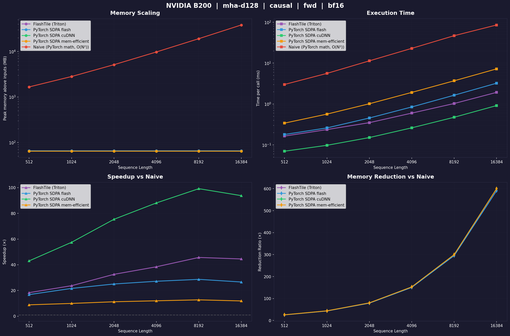
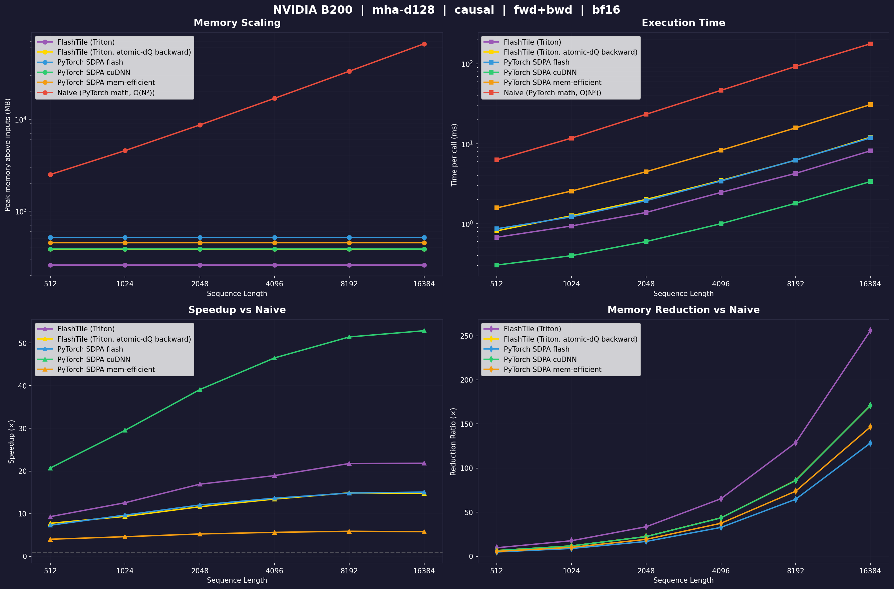
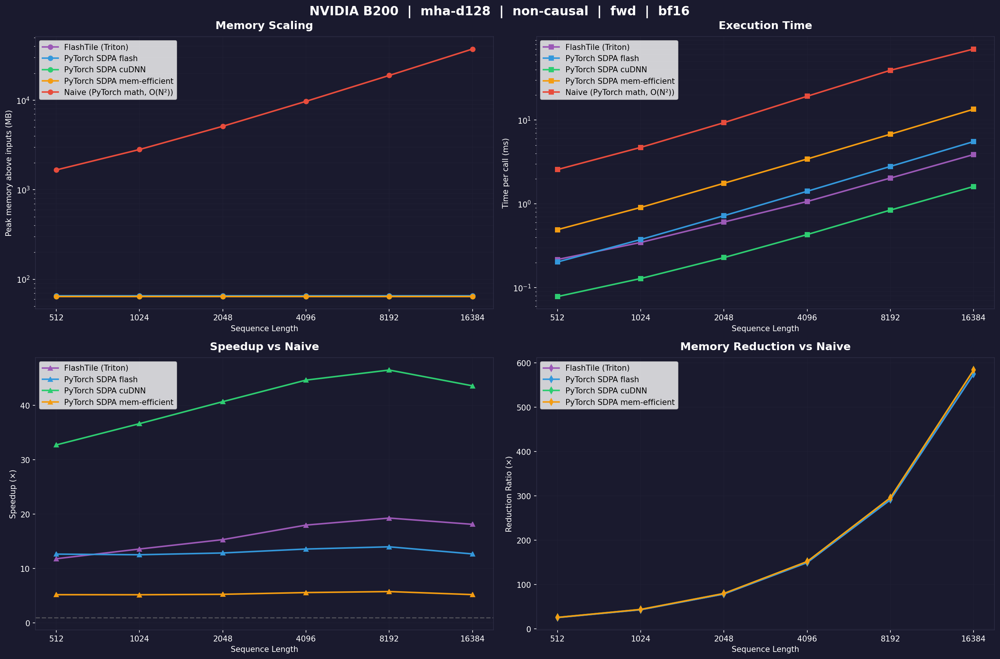
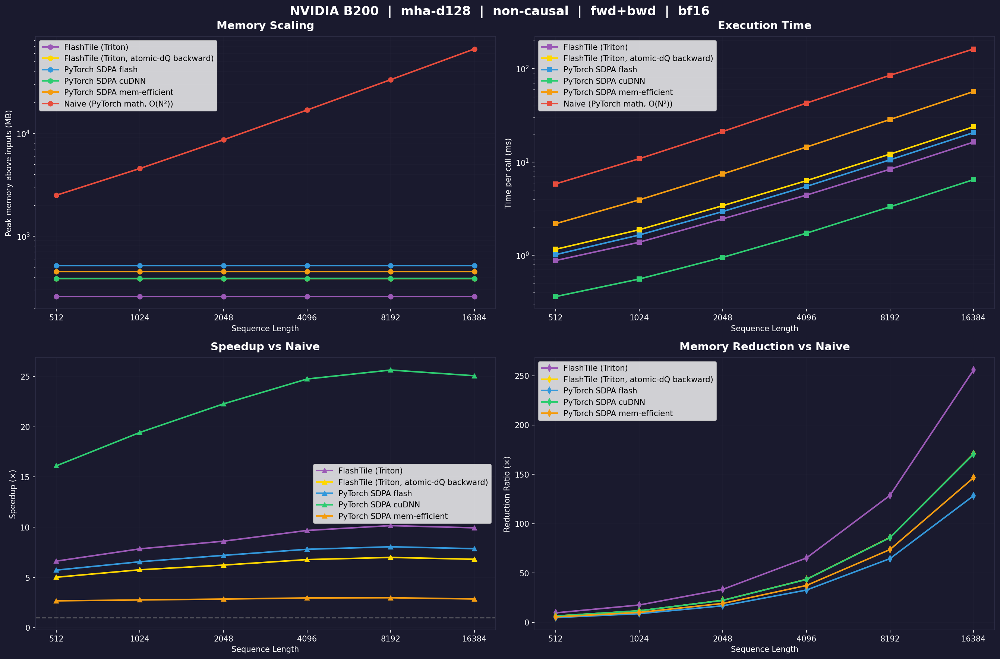
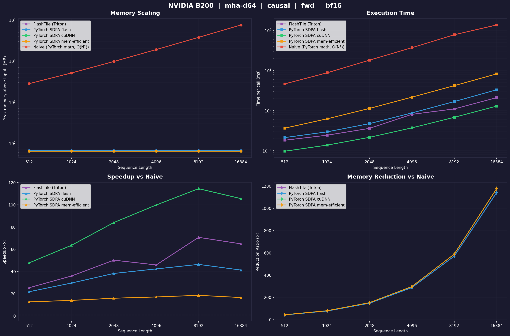
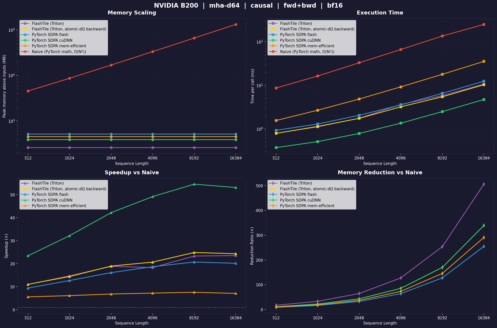
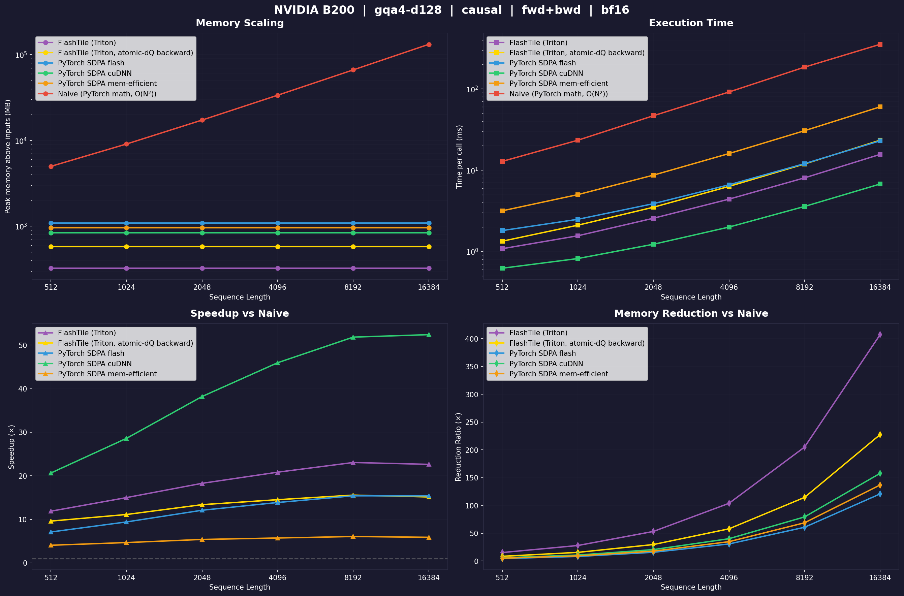
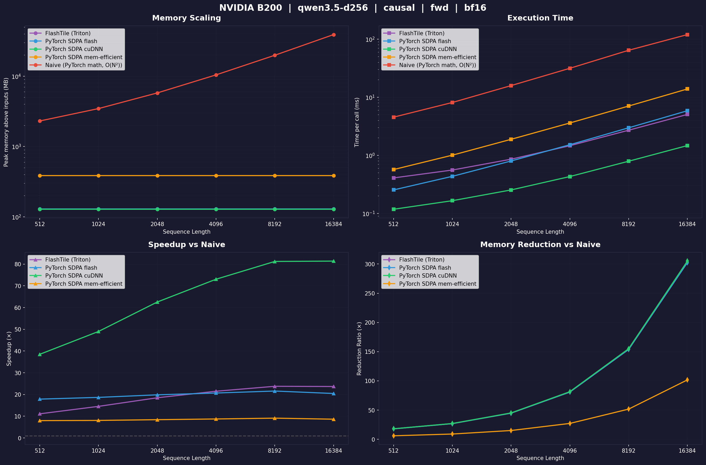
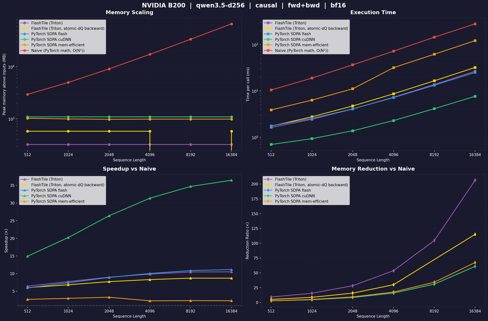

# FlashTile benchmark: NVIDIA B200

- date_utc: 2026-11-17 14:58:06
- gpu: NVIDIA B200
- compute_capability: sm_100
- gpu_memory_gib: 178.3
- sm_count: 148
- python: 3.12.10
- torch: 2.15.0+cu132
- cuda_runtime: 13.2
- cudnn: 92600
- triton: 3.9.0
- provider: Modal
- quick: False

All numbers are measured on this GPU, bf16 inputs, batch x length = 16384 tokens.
Each row passed a parity check against the fp32 dense oracle before it was timed.
Times are per-call medians of >= 20 samples; each sample is >= 2 ms of back-to-back calls between CUDA events.
TFLOP/s uses 4*B*H*L^2*d for the forward (halved, plus the diagonal, for causal) and 3.5x that for fwd+bwd.
`naive` is PyTorch's SDPA MATH backend, which materialises the L x L score table.

## mha-d128, causal=True, fwd

TFLOP/s:

| backend | L=512 | L=1024 | L=2048 | L=4096 | L=8192 | L=16384 |
|---|---:|---:|---:|---:|---:|---:|
| flashtile-triton | 209.5 | 290.8 | 393.6 | 459.3 | 534.5 | 570.5 |
| sdpa-flash | 192.1 | 264.8 | 302.8 | 324.7 | 335.2 | 340.7 |
| sdpa-cudnn | 492.4 | 705.1 | 911.4 | 1053.1 | 1160.5 | 1201.5 |
| sdpa-efficient | 101.1 | 121.7 | 135.6 | 143.1 | 148.7 | 152.0 |
| naive | 11.4 | 12.3 | 12.1 | 12.0 | 11.7 | 12.8 |

Median ms per call:

| backend | L=512 | L=1024 | L=2048 | L=4096 | L=8192 | L=16384 |
|---|---:|---:|---:|---:|---:|---:|
| flashtile-triton | 0.164 | 0.237 | 0.349 | 0.599 | 1.029 | 1.927 |
| sdpa-flash | 0.179 | 0.260 | 0.454 | 0.847 | 1.640 | 3.228 |
| sdpa-cudnn | 0.070 | 0.098 | 0.151 | 0.261 | 0.474 | 0.915 |
| sdpa-efficient | 0.340 | 0.565 | 1.014 | 1.921 | 3.698 | 7.236 |
| naive | 3.008 | 5.608 | 11.372 | 23.003 | 46.996 | 85.818 |

Peak memory above inputs, MiB:

| backend | L=512 | L=1024 | L=2048 | L=4096 | L=8192 | L=16384 |
|---|---:|---:|---:|---:|---:|---:|
| flashtile-triton | 65.0 | 65.0 | 65.0 | 65.0 | 65.0 | 65.0 |
| sdpa-flash | 65.0 | 65.0 | 65.0 | 65.0 | 65.0 | 65.0 |
| sdpa-cudnn | 64.0 | 64.0 | 64.0 | 64.0 | 64.0 | 64.0 |
| sdpa-efficient | 64.0 | 64.0 | 64.0 | 64.0 | 64.0 | 64.0 |
| naive | 1665.3 | 2820.3 | 5136.3 | 9792.3 | 19200.3 | 38400.3 |

Autotuner choice (FlashTile):

- L=512: fwd: `BLOCK_M: 128, BLOCK_N: 32, num_warps: 4, num_ctas: 1, num_stages: 2, maxnreg: None, ir_override: None`
- L=1024: fwd: `BLOCK_M: 64, BLOCK_N: 64, num_warps: 4, num_ctas: 1, num_stages: 3, maxnreg: None, ir_override: None`
- L=2048: fwd: `BLOCK_M: 64, BLOCK_N: 64, num_warps: 4, num_ctas: 1, num_stages: 3, maxnreg: None, ir_override: None`
- L=4096: fwd: `BLOCK_M: 128, BLOCK_N: 64, num_warps: 8, num_ctas: 1, num_stages: 3, maxnreg: None, ir_override: None`
- L=8192: fwd: `BLOCK_M: 64, BLOCK_N: 64, num_warps: 4, num_ctas: 1, num_stages: 3, maxnreg: None, ir_override: None`
- L=16384: fwd: `BLOCK_M: 128, BLOCK_N: 128, num_warps: 8, num_ctas: 1, num_stages: 2, maxnreg: None, ir_override: None`

## mha-d128, causal=True, fwd+bwd

TFLOP/s:

| backend | L=512 | L=1024 | L=2048 | L=4096 | L=8192 | L=16384 |
|---|---:|---:|---:|---:|---:|---:|
| flashtile-triton | 178.3 | 257.4 | 348.4 | 391.7 | 452.1 | 472.4 |
| flashtile-atomic | 148.3 | 191.7 | 239.4 | 277.8 | 309.3 | 319.2 |
| sdpa-flash | 139.7 | 198.1 | 247.8 | 282.0 | 308.2 | 326.0 |
| sdpa-cudnn | 397.1 | 605.8 | 805.7 | 963.3 | 1069.3 | 1145.6 |
| sdpa-efficient | 76.5 | 94.1 | 107.7 | 116.2 | 122.0 | 124.8 |
| naive | 19.2 | 20.5 | 20.6 | 20.7 | 20.8 | 21.7 |

Median ms per call:

| backend | L=512 | L=1024 | L=2048 | L=4096 | L=8192 | L=16384 |
|---|---:|---:|---:|---:|---:|---:|
| flashtile-triton | 0.676 | 0.935 | 1.381 | 2.457 | 4.256 | 8.146 |
| flashtile-atomic | 0.812 | 1.256 | 2.010 | 3.464 | 6.222 | 12.055 |
| sdpa-flash | 0.863 | 1.216 | 1.942 | 3.412 | 6.245 | 11.805 |
| sdpa-cudnn | 0.303 | 0.397 | 0.597 | 0.999 | 1.800 | 3.360 |
| sdpa-efficient | 1.574 | 2.558 | 4.467 | 8.283 | 15.779 | 30.836 |
| naive | 6.282 | 11.740 | 23.352 | 46.471 | 92.568 | 177.685 |

Peak memory above inputs, MiB:

| backend | L=512 | L=1024 | L=2048 | L=4096 | L=8192 | L=16384 |
|---|---:|---:|---:|---:|---:|---:|
| flashtile-triton | 258.0 | 258.0 | 258.0 | 258.0 | 258.0 | 258.0 |
| flashtile-atomic | 386.0 | 386.0 | 386.0 | 386.0 | 386.0 | 386.0 |
| sdpa-flash | 514.0 | 514.0 | 514.0 | 514.0 | 514.0 | 514.0 |
| sdpa-cudnn | 387.0 | 387.0 | 387.0 | 387.0 | 387.0 | 386.0 |
| sdpa-efficient | 450.0 | 450.0 | 450.0 | 450.0 | 450.0 | 450.0 |
| naive | 2496.0 | 4544.0 | 8640.0 | 16832.0 | 33216.0 | 65984.0 |

Autotuner choice (FlashTile):

- L=512: fwd: `BLOCK_M: 128, BLOCK_N: 32, num_warps: 4, num_ctas: 1, num_stages: 2, maxnreg: None, ir_override: None`; bwd_dkdv: `BLOCK_M: 64, BLOCK_N: 128, num_warps: 8, num_ctas: 1, num_stages: 2, maxnreg: None, ir_override: None`; bwd_dq: `BLOCK_M: 128, BLOCK_N: 32, num_warps: 8, num_ctas: 1, num_stages: 2, maxnreg: None, ir_override: None`
- L=1024: fwd: `BLOCK_M: 64, BLOCK_N: 64, num_warps: 4, num_ctas: 1, num_stages: 3, maxnreg: None, ir_override: None`; bwd_dkdv: `BLOCK_M: 64, BLOCK_N: 128, num_warps: 8, num_ctas: 1, num_stages: 2, maxnreg: None, ir_override: None`; bwd_dq: `BLOCK_M: 128, BLOCK_N: 32, num_warps: 8, num_ctas: 1, num_stages: 2, maxnreg: None, ir_override: None`
- L=2048: fwd: `BLOCK_M: 64, BLOCK_N: 64, num_warps: 4, num_ctas: 1, num_stages: 3, maxnreg: None, ir_override: None`; bwd_dkdv: `BLOCK_M: 64, BLOCK_N: 128, num_warps: 8, num_ctas: 1, num_stages: 2, maxnreg: None, ir_override: None`; bwd_dq: `BLOCK_M: 128, BLOCK_N: 32, num_warps: 8, num_ctas: 1, num_stages: 2, maxnreg: None, ir_override: None`
- L=4096: fwd: `BLOCK_M: 128, BLOCK_N: 64, num_warps: 8, num_ctas: 1, num_stages: 3, maxnreg: None, ir_override: None`; bwd_dkdv: `BLOCK_M: 64, BLOCK_N: 128, num_warps: 8, num_ctas: 1, num_stages: 2, maxnreg: None, ir_override: None`; bwd_dq: `BLOCK_M: 128, BLOCK_N: 32, num_warps: 8, num_ctas: 1, num_stages: 2, maxnreg: None, ir_override: None`
- L=8192: fwd: `BLOCK_M: 64, BLOCK_N: 64, num_warps: 4, num_ctas: 1, num_stages: 3, maxnreg: None, ir_override: None`; bwd_dkdv: `BLOCK_M: 64, BLOCK_N: 128, num_warps: 8, num_ctas: 1, num_stages: 2, maxnreg: None, ir_override: None`; bwd_dq: `BLOCK_M: 128, BLOCK_N: 32, num_warps: 8, num_ctas: 1, num_stages: 2, maxnreg: None, ir_override: None`
- L=16384: fwd: `BLOCK_M: 128, BLOCK_N: 128, num_warps: 8, num_ctas: 1, num_stages: 2, maxnreg: None, ir_override: None`; bwd_dkdv: `BLOCK_M: 64, BLOCK_N: 128, num_warps: 8, num_ctas: 1, num_stages: 2, maxnreg: None, ir_override: None`; bwd_dq: `BLOCK_M: 128, BLOCK_N: 32, num_warps: 8, num_ctas: 1, num_stages: 2, maxnreg: None, ir_override: None`

## mha-d128, causal=False, fwd

TFLOP/s:

| backend | L=512 | L=1024 | L=2048 | L=4096 | L=8192 | L=16384 |
|---|---:|---:|---:|---:|---:|---:|
| flashtile-triton | 316.3 | 396.2 | 452.5 | 514.4 | 540.4 | 566.5 |
| sdpa-flash | 338.9 | 365.5 | 380.1 | 388.7 | 392.4 | 396.6 |
| sdpa-cudnn | 875.9 | 1067.2 | 1200.9 | 1275.9 | 1302.5 | 1361.5 |
| sdpa-efficient | 139.4 | 151.5 | 155.8 | 160.1 | 162.1 | 163.1 |
| naive | 26.7 | 29.1 | 29.5 | 28.6 | 28.0 | 31.2 |

Median ms per call:

| backend | L=512 | L=1024 | L=2048 | L=4096 | L=8192 | L=16384 |
|---|---:|---:|---:|---:|---:|---:|
| flashtile-triton | 0.217 | 0.347 | 0.608 | 1.069 | 2.034 | 3.881 |
| sdpa-flash | 0.203 | 0.376 | 0.723 | 1.415 | 2.802 | 5.545 |
| sdpa-cudnn | 0.078 | 0.129 | 0.229 | 0.431 | 0.844 | 1.615 |
| sdpa-efficient | 0.493 | 0.907 | 1.764 | 3.434 | 6.784 | 13.483 |
| naive | 2.569 | 4.721 | 9.316 | 19.245 | 39.265 | 70.445 |

Peak memory above inputs, MiB:

| backend | L=512 | L=1024 | L=2048 | L=4096 | L=8192 | L=16384 |
|---|---:|---:|---:|---:|---:|---:|
| flashtile-triton | 65.0 | 65.0 | 65.0 | 65.0 | 65.0 | 65.0 |
| sdpa-flash | 65.0 | 65.0 | 65.0 | 65.0 | 65.0 | 65.0 |
| sdpa-cudnn | 64.0 | 64.0 | 64.0 | 64.0 | 64.0 | 64.0 |
| sdpa-efficient | 64.0 | 64.0 | 64.0 | 64.0 | 64.0 | 64.0 |
| naive | 1664.3 | 2816.3 | 5120.3 | 9728.3 | 18944.3 | 37376.3 |

Autotuner choice (FlashTile):

- L=512: fwd: `BLOCK_M: 128, BLOCK_N: 32, num_warps: 4, num_ctas: 1, num_stages: 2, maxnreg: None, ir_override: None`
- L=1024: fwd: `BLOCK_M: 128, BLOCK_N: 64, num_warps: 8, num_ctas: 1, num_stages: 3, maxnreg: None, ir_override: None`
- L=2048: fwd: `BLOCK_M: 128, BLOCK_N: 64, num_warps: 8, num_ctas: 1, num_stages: 3, maxnreg: None, ir_override: None`
- L=4096: fwd: `BLOCK_M: 128, BLOCK_N: 64, num_warps: 8, num_ctas: 1, num_stages: 3, maxnreg: None, ir_override: None`
- L=8192: fwd: `BLOCK_M: 128, BLOCK_N: 64, num_warps: 8, num_ctas: 1, num_stages: 3, maxnreg: None, ir_override: None`
- L=16384: fwd: `BLOCK_M: 128, BLOCK_N: 64, num_warps: 8, num_ctas: 1, num_stages: 3, maxnreg: None, ir_override: None`

## mha-d128, causal=False, fwd+bwd

TFLOP/s:

| backend | L=512 | L=1024 | L=2048 | L=4096 | L=8192 | L=16384 |
|---|---:|---:|---:|---:|---:|---:|
| flashtile-triton | 273.2 | 348.1 | 390.2 | 435.3 | 460.0 | 470.8 |
| flashtile-atomic | 207.0 | 255.6 | 282.3 | 304.9 | 316.7 | 322.5 |
| sdpa-flash | 236.3 | 291.1 | 326.2 | 351.0 | 364.7 | 372.5 |
| sdpa-cudnn | 664.7 | 862.5 | 1009.9 | 1113.8 | 1161.6 | 1188.2 |
| sdpa-efficient | 110.1 | 122.4 | 129.0 | 133.1 | 134.8 | 135.2 |
| naive | 41.2 | 44.4 | 45.3 | 45.0 | 45.3 | 47.4 |

Median ms per call:

| backend | L=512 | L=1024 | L=2048 | L=4096 | L=8192 | L=16384 |
|---|---:|---:|---:|---:|---:|---:|
| flashtile-triton | 0.880 | 1.382 | 2.466 | 4.420 | 8.365 | 16.348 |
| flashtile-atomic | 1.162 | 1.882 | 3.408 | 6.312 | 12.152 | 23.864 |
| sdpa-flash | 1.018 | 1.652 | 2.950 | 5.482 | 10.553 | 20.663 |
| sdpa-cudnn | 0.362 | 0.558 | 0.953 | 1.728 | 3.313 | 6.478 |
| sdpa-efficient | 2.185 | 3.931 | 7.460 | 14.459 | 28.539 | 56.915 |
| naive | 5.832 | 10.844 | 21.228 | 42.779 | 84.985 | 162.494 |

Peak memory above inputs, MiB:

| backend | L=512 | L=1024 | L=2048 | L=4096 | L=8192 | L=16384 |
|---|---:|---:|---:|---:|---:|---:|
| flashtile-triton | 258.0 | 258.0 | 258.0 | 258.0 | 258.0 | 258.0 |
| flashtile-atomic | 386.0 | 386.0 | 386.0 | 386.0 | 386.0 | 386.0 |
| sdpa-flash | 514.0 | 514.0 | 514.0 | 514.0 | 514.0 | 514.0 |
| sdpa-cudnn | 386.0 | 386.0 | 387.0 | 387.0 | 387.0 | 387.0 |
| sdpa-efficient | 450.0 | 450.0 | 450.0 | 450.0 | 450.0 | 450.0 |
| naive | 2496.0 | 4544.0 | 8640.0 | 16832.0 | 33216.0 | 65984.0 |

Autotuner choice (FlashTile):

- L=512: fwd: `BLOCK_M: 128, BLOCK_N: 32, num_warps: 4, num_ctas: 1, num_stages: 2, maxnreg: None, ir_override: None`; bwd_dkdv: `BLOCK_M: 64, BLOCK_N: 128, num_warps: 8, num_ctas: 1, num_stages: 2, maxnreg: None, ir_override: None`; bwd_dq: `BLOCK_M: 128, BLOCK_N: 32, num_warps: 8, num_ctas: 1, num_stages: 2, maxnreg: None, ir_override: None`
- L=1024: fwd: `BLOCK_M: 128, BLOCK_N: 64, num_warps: 8, num_ctas: 1, num_stages: 3, maxnreg: None, ir_override: None`; bwd_dkdv: `BLOCK_M: 64, BLOCK_N: 128, num_warps: 8, num_ctas: 1, num_stages: 2, maxnreg: None, ir_override: None`; bwd_dq: `BLOCK_M: 128, BLOCK_N: 32, num_warps: 8, num_ctas: 1, num_stages: 2, maxnreg: None, ir_override: None`
- L=2048: fwd: `BLOCK_M: 128, BLOCK_N: 64, num_warps: 8, num_ctas: 1, num_stages: 3, maxnreg: None, ir_override: None`; bwd_dkdv: `BLOCK_M: 64, BLOCK_N: 128, num_warps: 8, num_ctas: 1, num_stages: 2, maxnreg: None, ir_override: None`; bwd_dq: `BLOCK_M: 128, BLOCK_N: 32, num_warps: 8, num_ctas: 1, num_stages: 2, maxnreg: None, ir_override: None`
- L=4096: fwd: `BLOCK_M: 128, BLOCK_N: 64, num_warps: 8, num_ctas: 1, num_stages: 3, maxnreg: None, ir_override: None`; bwd_dkdv: `BLOCK_M: 64, BLOCK_N: 128, num_warps: 8, num_ctas: 1, num_stages: 2, maxnreg: None, ir_override: None`; bwd_dq: `BLOCK_M: 128, BLOCK_N: 32, num_warps: 8, num_ctas: 1, num_stages: 2, maxnreg: None, ir_override: None`
- L=8192: fwd: `BLOCK_M: 128, BLOCK_N: 64, num_warps: 8, num_ctas: 1, num_stages: 3, maxnreg: None, ir_override: None`; bwd_dkdv: `BLOCK_M: 64, BLOCK_N: 128, num_warps: 8, num_ctas: 1, num_stages: 2, maxnreg: None, ir_override: None`; bwd_dq: `BLOCK_M: 128, BLOCK_N: 32, num_warps: 8, num_ctas: 1, num_stages: 2, maxnreg: None, ir_override: None`
- L=16384: fwd: `BLOCK_M: 128, BLOCK_N: 64, num_warps: 8, num_ctas: 1, num_stages: 3, maxnreg: None, ir_override: None`; bwd_dkdv: `BLOCK_M: 64, BLOCK_N: 128, num_warps: 8, num_ctas: 1, num_stages: 2, maxnreg: None, ir_override: None`; bwd_dq: `BLOCK_M: 128, BLOCK_N: 32, num_warps: 8, num_ctas: 1, num_stages: 2, maxnreg: None, ir_override: None`

## mha-d64, causal=True, fwd

TFLOP/s:

| backend | L=512 | L=1024 | L=2048 | L=4096 | L=8192 | L=16384 |
|---|---:|---:|---:|---:|---:|---:|
| flashtile-triton | 189.0 | 282.8 | 381.5 | 341.3 | 500.1 | 523.6 |
| sdpa-flash | 162.1 | 233.1 | 290.7 | 314.8 | 328.2 | 333.3 |
| sdpa-cudnn | 354.9 | 499.8 | 638.5 | 741.9 | 809.7 | 851.7 |
| sdpa-efficient | 94.3 | 110.4 | 121.5 | 127.3 | 131.6 | 134.0 |
| naive | 7.4 | 7.9 | 7.6 | 7.4 | 7.1 | 8.1 |

Median ms per call:

| backend | L=512 | L=1024 | L=2048 | L=4096 | L=8192 | L=16384 |
|---|---:|---:|---:|---:|---:|---:|
| flashtile-triton | 0.182 | 0.243 | 0.360 | 0.806 | 1.099 | 2.100 |
| sdpa-flash | 0.212 | 0.295 | 0.473 | 0.873 | 1.675 | 3.299 |
| sdpa-cudnn | 0.097 | 0.138 | 0.215 | 0.371 | 0.679 | 1.291 |
| sdpa-efficient | 0.365 | 0.623 | 1.132 | 2.160 | 4.179 | 8.209 |
| naive | 4.637 | 8.752 | 18.105 | 36.994 | 77.770 | 136.298 |

Peak memory above inputs, MiB:

| backend | L=512 | L=1024 | L=2048 | L=4096 | L=8192 | L=16384 |
|---|---:|---:|---:|---:|---:|---:|
| flashtile-triton | 66.0 | 66.0 | 66.0 | 66.0 | 66.0 | 66.0 |
| sdpa-flash | 66.0 | 66.0 | 66.0 | 66.0 | 66.0 | 66.0 |
| sdpa-cudnn | 64.0 | 64.0 | 64.0 | 64.0 | 64.0 | 64.0 |
| sdpa-efficient | 64.0 | 64.0 | 64.0 | 64.0 | 64.0 | 64.0 |
| naive | 2817.5 | 5124.5 | 9744.5 | 19008.5 | 37632.5 | 75264.5 |

Autotuner choice (FlashTile):

- L=512: fwd: `BLOCK_M: 128, BLOCK_N: 64, num_warps: 4, num_ctas: 1, num_stages: 3, maxnreg: None, ir_override: None`
- L=1024: fwd: `BLOCK_M: 128, BLOCK_N: 64, num_warps: 4, num_ctas: 1, num_stages: 3, maxnreg: None, ir_override: None`
- L=2048: fwd: `BLOCK_M: 128, BLOCK_N: 64, num_warps: 4, num_ctas: 1, num_stages: 3, maxnreg: None, ir_override: None`
- L=4096: fwd: `BLOCK_M: 64, BLOCK_N: 64, num_warps: 4, num_ctas: 1, num_stages: 3, maxnreg: None, ir_override: None`
- L=8192: fwd: `BLOCK_M: 128, BLOCK_N: 64, num_warps: 4, num_ctas: 1, num_stages: 3, maxnreg: None, ir_override: None`
- L=16384: fwd: `BLOCK_M: 128, BLOCK_N: 64, num_warps: 4, num_ctas: 1, num_stages: 3, maxnreg: None, ir_override: None`

## mha-d64, causal=True, fwd+bwd

TFLOP/s:

| backend | L=512 | L=1024 | L=2048 | L=4096 | L=8192 | L=16384 |
|---|---:|---:|---:|---:|---:|---:|
| flashtile-triton | 152.4 | 216.0 | 274.5 | 265.2 | 330.9 | 360.4 |
| flashtile-atomic | 152.9 | 212.0 | 276.1 | 299.5 | 352.7 | 372.7 |
| sdpa-flash | 130.4 | 186.4 | 234.7 | 270.8 | 294.0 | 309.1 |
| sdpa-cudnn | 325.1 | 472.8 | 614.5 | 711.9 | 774.0 | 813.6 |
| sdpa-efficient | 77.3 | 89.9 | 99.3 | 104.4 | 107.3 | 108.4 |
| naive | 13.9 | 14.7 | 14.6 | 14.5 | 14.2 | 15.3 |

Median ms per call:

| backend | L=512 | L=1024 | L=2048 | L=4096 | L=8192 | L=16384 |
|---|---:|---:|---:|---:|---:|---:|
| flashtile-triton | 0.791 | 1.115 | 1.753 | 3.628 | 5.816 | 10.679 |
| flashtile-atomic | 0.788 | 1.136 | 1.743 | 3.213 | 5.457 | 10.325 |
| sdpa-flash | 0.924 | 1.292 | 2.050 | 3.554 | 6.546 | 12.450 |
| sdpa-cudnn | 0.371 | 0.509 | 0.783 | 1.352 | 2.486 | 4.730 |
| sdpa-efficient | 1.558 | 2.678 | 4.846 | 9.214 | 17.933 | 35.488 |
| naive | 8.689 | 16.383 | 33.036 | 66.472 | 135.688 | 251.264 |

Peak memory above inputs, MiB:

| backend | L=512 | L=1024 | L=2048 | L=4096 | L=8192 | L=16384 |
|---|---:|---:|---:|---:|---:|---:|
| flashtile-triton | 260.0 | 260.0 | 260.0 | 260.0 | 260.0 | 260.0 |
| flashtile-atomic | 388.0 | 388.0 | 388.0 | 388.0 | 388.0 | 388.0 |
| sdpa-flash | 516.0 | 516.0 | 516.0 | 516.0 | 516.0 | 516.0 |
| sdpa-cudnn | 388.0 | 388.0 | 388.0 | 388.0 | 388.0 | 388.0 |
| sdpa-efficient | 452.1 | 452.1 | 452.1 | 452.1 | 452.1 | 452.1 |
| naive | 4544.0 | 8640.0 | 16832.0 | 33216.0 | 65984.0 | 131520.0 |

Autotuner choice (FlashTile):

- L=512: fwd: `BLOCK_M: 128, BLOCK_N: 64, num_warps: 4, num_ctas: 1, num_stages: 3, maxnreg: None, ir_override: None`; bwd_dkdv: `BLOCK_M: 64, BLOCK_N: 64, num_warps: 4, num_ctas: 1, num_stages: 2, maxnreg: None, ir_override: None`; bwd_dq: `BLOCK_M: 64, BLOCK_N: 32, num_warps: 4, num_ctas: 1, num_stages: 2, maxnreg: None, ir_override: None`
- L=1024: fwd: `BLOCK_M: 128, BLOCK_N: 64, num_warps: 4, num_ctas: 1, num_stages: 3, maxnreg: None, ir_override: None`; bwd_dkdv: `BLOCK_M: 64, BLOCK_N: 64, num_warps: 4, num_ctas: 1, num_stages: 2, maxnreg: None, ir_override: None`; bwd_dq: `BLOCK_M: 64, BLOCK_N: 32, num_warps: 4, num_ctas: 1, num_stages: 2, maxnreg: None, ir_override: None`
- L=2048: fwd: `BLOCK_M: 128, BLOCK_N: 64, num_warps: 4, num_ctas: 1, num_stages: 3, maxnreg: None, ir_override: None`; bwd_dkdv: `BLOCK_M: 64, BLOCK_N: 64, num_warps: 4, num_ctas: 1, num_stages: 2, maxnreg: None, ir_override: None`; bwd_dq: `BLOCK_M: 64, BLOCK_N: 32, num_warps: 4, num_ctas: 1, num_stages: 2, maxnreg: None, ir_override: None`
- L=4096: fwd: `BLOCK_M: 64, BLOCK_N: 64, num_warps: 4, num_ctas: 1, num_stages: 3, maxnreg: None, ir_override: None`; bwd_dkdv: `BLOCK_M: 64, BLOCK_N: 128, num_warps: 8, num_ctas: 1, num_stages: 2, maxnreg: None, ir_override: None`; bwd_dq: `BLOCK_M: 64, BLOCK_N: 64, num_warps: 4, num_ctas: 1, num_stages: 2, maxnreg: None, ir_override: None`
- L=8192: fwd: `BLOCK_M: 128, BLOCK_N: 64, num_warps: 4, num_ctas: 1, num_stages: 3, maxnreg: None, ir_override: None`; bwd_dkdv: `BLOCK_M: 64, BLOCK_N: 64, num_warps: 4, num_ctas: 1, num_stages: 2, maxnreg: None, ir_override: None`; bwd_dq: `BLOCK_M: 64, BLOCK_N: 64, num_warps: 4, num_ctas: 1, num_stages: 2, maxnreg: None, ir_override: None`
- L=16384: fwd: `BLOCK_M: 128, BLOCK_N: 64, num_warps: 4, num_ctas: 1, num_stages: 3, maxnreg: None, ir_override: None`; bwd_dkdv: `BLOCK_M: 64, BLOCK_N: 64, num_warps: 4, num_ctas: 1, num_stages: 2, maxnreg: None, ir_override: None`; bwd_dq: `BLOCK_M: 64, BLOCK_N: 32, num_warps: 4, num_ctas: 1, num_stages: 2, maxnreg: None, ir_override: None`

## gqa4-d128, causal=True, fwd

TFLOP/s:

| backend | L=512 | L=1024 | L=2048 | L=4096 | L=8192 | L=16384 |
|---|---:|---:|---:|---:|---:|---:|
| flashtile-triton | 230.4 | 337.9 | 445.1 | 514.2 | 566.1 | 580.8 |
| sdpa-flash | 202.4 | 285.2 | 327.2 | 349.3 | 359.4 | 367.3 |
| sdpa-cudnn | 558.6 | 781.4 | 977.5 | 1110.0 | 1201.8 | 1261.3 |
| sdpa-efficient | 105.7 | 127.4 | 141.2 | 150.3 | 155.3 | 158.3 |
| naive | 11.2 | 12.3 | 12.0 | 12.1 | 11.7 | 12.9 |

Median ms per call:

| backend | L=512 | L=1024 | L=2048 | L=4096 | L=8192 | L=16384 |
|---|---:|---:|---:|---:|---:|---:|
| flashtile-triton | 0.299 | 0.407 | 0.618 | 1.069 | 1.942 | 3.787 |
| sdpa-flash | 0.340 | 0.482 | 0.840 | 1.574 | 3.060 | 5.987 |
| sdpa-cudnn | 0.123 | 0.176 | 0.281 | 0.495 | 0.915 | 1.744 |
| sdpa-efficient | 0.651 | 1.080 | 1.947 | 3.659 | 7.079 | 13.889 |
| naive | 6.142 | 11.143 | 22.825 | 45.258 | 94.026 | 170.438 |

Peak memory above inputs, MiB:

| backend | L=512 | L=1024 | L=2048 | L=4096 | L=8192 | L=16384 |
|---|---:|---:|---:|---:|---:|---:|
| flashtile-triton | 130.0 | 130.0 | 130.0 | 130.0 | 130.0 | 130.0 |
| sdpa-flash | 130.0 | 130.0 | 130.0 | 130.0 | 130.0 | 130.0 |
| sdpa-cudnn | 128.0 | 128.0 | 128.0 | 128.0 | 128.0 | 128.0 |
| sdpa-efficient | 128.0 | 128.0 | 128.0 | 128.0 | 128.0 | 128.0 |
| naive | 3457.5 | 5764.5 | 10384.5 | 19648.5 | 38272.5 | 75904.5 |

Autotuner choice (FlashTile):

- L=512: fwd: `BLOCK_M: 128, BLOCK_N: 32, num_warps: 4, num_ctas: 1, num_stages: 2, maxnreg: None, ir_override: None`
- L=1024: fwd: `BLOCK_M: 64, BLOCK_N: 64, num_warps: 4, num_ctas: 1, num_stages: 3, maxnreg: None, ir_override: None`
- L=2048: fwd: `BLOCK_M: 64, BLOCK_N: 64, num_warps: 4, num_ctas: 1, num_stages: 3, maxnreg: None, ir_override: None`
- L=4096: fwd: `BLOCK_M: 64, BLOCK_N: 64, num_warps: 4, num_ctas: 1, num_stages: 3, maxnreg: None, ir_override: None`
- L=8192: fwd: `BLOCK_M: 64, BLOCK_N: 64, num_warps: 4, num_ctas: 1, num_stages: 3, maxnreg: None, ir_override: None`
- L=16384: fwd: `BLOCK_M: 128, BLOCK_N: 128, num_warps: 8, num_ctas: 1, num_stages: 2, maxnreg: None, ir_override: None`

## gqa4-d128, causal=True, fwd+bwd

TFLOP/s:

| backend | L=512 | L=1024 | L=2048 | L=4096 | L=8192 | L=16384 |
|---|---:|---:|---:|---:|---:|---:|
| flashtile-triton | 223.2 | 309.1 | 376.1 | 437.7 | 478.7 | 492.4 |
| flashtile-atomic | 180.4 | 229.1 | 275.3 | 305.0 | 323.2 | 329.5 |
| sdpa-flash | 133.4 | 193.9 | 248.9 | 291.5 | 319.9 | 335.3 |
| sdpa-cudnn | 388.0 | 589.4 | 786.3 | 965.8 | 1076.5 | 1140.3 |
| sdpa-efficient | 76.2 | 96.3 | 110.9 | 120.3 | 125.8 | 128.0 |
| naive | 18.8 | 20.6 | 20.6 | 21.0 | 20.8 | 21.8 |

Median ms per call:

| backend | L=512 | L=1024 | L=2048 | L=4096 | L=8192 | L=16384 |
|---|---:|---:|---:|---:|---:|---:|
| flashtile-triton | 1.080 | 1.558 | 2.559 | 4.397 | 8.040 | 15.631 |
| flashtile-atomic | 1.336 | 2.102 | 3.497 | 6.309 | 11.908 | 23.358 |
| sdpa-flash | 1.806 | 2.483 | 3.867 | 6.603 | 12.033 | 22.955 |
| sdpa-cudnn | 0.621 | 0.817 | 1.224 | 1.993 | 3.575 | 6.750 |
| sdpa-efficient | 3.161 | 5.000 | 8.680 | 16.005 | 30.592 | 60.128 |
| naive | 12.825 | 23.363 | 46.764 | 91.582 | 185.339 | 353.726 |

Peak memory above inputs, MiB:

| backend | L=512 | L=1024 | L=2048 | L=4096 | L=8192 | L=16384 |
|---|---:|---:|---:|---:|---:|---:|
| flashtile-triton | 324.0 | 324.0 | 324.0 | 324.0 | 324.0 | 324.0 |
| flashtile-atomic | 580.0 | 580.0 | 580.0 | 580.0 | 580.0 | 580.0 |
| sdpa-flash | 1092.0 | 1092.0 | 1092.0 | 1092.0 | 1092.0 | 1092.0 |
| sdpa-cudnn | 836.0 | 836.0 | 836.0 | 836.0 | 836.0 | 836.0 |
| sdpa-efficient | 964.1 | 964.1 | 964.1 | 964.1 | 964.1 | 964.1 |
| naive | 4992.0 | 9088.0 | 17280.0 | 33664.0 | 66432.0 | 131968.0 |

Autotuner choice (FlashTile):

- L=512: fwd: `BLOCK_M: 128, BLOCK_N: 32, num_warps: 4, num_ctas: 1, num_stages: 2, maxnreg: None, ir_override: None`; bwd_dkdv: `BLOCK_M: 64, BLOCK_N: 128, num_warps: 8, num_ctas: 1, num_stages: 2, maxnreg: None, ir_override: None`; bwd_dq: `BLOCK_M: 128, BLOCK_N: 32, num_warps: 8, num_ctas: 1, num_stages: 2, maxnreg: None, ir_override: None`
- L=1024: fwd: `BLOCK_M: 64, BLOCK_N: 64, num_warps: 4, num_ctas: 1, num_stages: 3, maxnreg: None, ir_override: None`; bwd_dkdv: `BLOCK_M: 64, BLOCK_N: 128, num_warps: 8, num_ctas: 1, num_stages: 2, maxnreg: None, ir_override: None`; bwd_dq: `BLOCK_M: 128, BLOCK_N: 32, num_warps: 8, num_ctas: 1, num_stages: 2, maxnreg: None, ir_override: None`
- L=2048: fwd: `BLOCK_M: 64, BLOCK_N: 64, num_warps: 4, num_ctas: 1, num_stages: 3, maxnreg: None, ir_override: None`; bwd_dkdv: `BLOCK_M: 64, BLOCK_N: 128, num_warps: 8, num_ctas: 1, num_stages: 2, maxnreg: None, ir_override: None`; bwd_dq: `BLOCK_M: 128, BLOCK_N: 32, num_warps: 8, num_ctas: 1, num_stages: 2, maxnreg: None, ir_override: None`
- L=4096: fwd: `BLOCK_M: 64, BLOCK_N: 64, num_warps: 4, num_ctas: 1, num_stages: 3, maxnreg: None, ir_override: None`; bwd_dkdv: `BLOCK_M: 64, BLOCK_N: 128, num_warps: 8, num_ctas: 1, num_stages: 2, maxnreg: None, ir_override: None`; bwd_dq: `BLOCK_M: 128, BLOCK_N: 32, num_warps: 8, num_ctas: 1, num_stages: 2, maxnreg: None, ir_override: None`
- L=8192: fwd: `BLOCK_M: 64, BLOCK_N: 64, num_warps: 4, num_ctas: 1, num_stages: 3, maxnreg: None, ir_override: None`; bwd_dkdv: `BLOCK_M: 64, BLOCK_N: 128, num_warps: 8, num_ctas: 1, num_stages: 2, maxnreg: None, ir_override: None`; bwd_dq: `BLOCK_M: 128, BLOCK_N: 32, num_warps: 8, num_ctas: 1, num_stages: 2, maxnreg: None, ir_override: None`
- L=16384: fwd: `BLOCK_M: 128, BLOCK_N: 128, num_warps: 8, num_ctas: 1, num_stages: 2, maxnreg: None, ir_override: None`; bwd_dkdv: `BLOCK_M: 64, BLOCK_N: 128, num_warps: 8, num_ctas: 1, num_stages: 2, maxnreg: None, ir_override: None`; bwd_dq: `BLOCK_M: 128, BLOCK_N: 32, num_warps: 8, num_ctas: 1, num_stages: 2, maxnreg: None, ir_override: None`

## qwen3.5-d256, causal=True, fwd

TFLOP/s:

| backend | L=512 | L=1024 | L=2048 | L=4096 | L=8192 | L=16384 |
|---|---:|---:|---:|---:|---:|---:|
| flashtile-triton | 168.7 | 246.7 | 320.9 | 375.9 | 407.0 | 435.2 |
| sdpa-flash | 271.5 | 316.8 | 344.4 | 361.4 | 369.7 | 376.0 |
| sdpa-cudnn | 584.5 | 831.5 | 1085.5 | 1276.6 | 1390.7 | 1495.7 |
| sdpa-efficient | 121.2 | 137.0 | 146.0 | 152.7 | 156.1 | 158.7 |
| naive | 15.2 | 17.0 | 17.4 | 17.5 | 17.1 | 18.4 |

Median ms per call:

| backend | L=512 | L=1024 | L=2048 | L=4096 | L=8192 | L=16384 |
|---|---:|---:|---:|---:|---:|---:|
| flashtile-triton | 0.408 | 0.558 | 0.857 | 1.463 | 2.702 | 5.054 |
| sdpa-flash | 0.254 | 0.434 | 0.798 | 1.522 | 2.975 | 5.849 |
| sdpa-cudnn | 0.118 | 0.165 | 0.253 | 0.431 | 0.791 | 1.470 |
| sdpa-efficient | 0.568 | 1.004 | 1.884 | 3.601 | 7.044 | 13.858 |
| naive | 4.532 | 8.106 | 15.846 | 31.458 | 64.217 | 119.639 |

Peak memory above inputs, MiB:

| backend | L=512 | L=1024 | L=2048 | L=4096 | L=8192 | L=16384 |
|---|---:|---:|---:|---:|---:|---:|
| flashtile-triton | 129.0 | 129.0 | 129.0 | 129.0 | 129.0 | 129.0 |
| sdpa-flash | 129.0 | 129.0 | 129.0 | 129.0 | 129.0 | 129.0 |
| sdpa-cudnn | 128.0 | 128.0 | 128.0 | 128.0 | 128.0 | 128.0 |
| sdpa-efficient | 384.0 | 384.0 | 384.0 | 384.0 | 384.0 | 384.0 |
| naive | 2305.3 | 3460.3 | 5776.3 | 10432.3 | 19840.3 | 39040.3 |

Autotuner choice (FlashTile):

- L=512: fwd: `BLOCK_M: 64, BLOCK_N: 64, num_warps: 4, num_ctas: 1, num_stages: 3, maxnreg: None, ir_override: None`
- L=1024: fwd: `BLOCK_M: 64, BLOCK_N: 64, num_warps: 4, num_ctas: 1, num_stages: 3, maxnreg: None, ir_override: None`
- L=2048: fwd: `BLOCK_M: 64, BLOCK_N: 64, num_warps: 4, num_ctas: 1, num_stages: 3, maxnreg: None, ir_override: None`
- L=4096: fwd: `BLOCK_M: 64, BLOCK_N: 64, num_warps: 4, num_ctas: 1, num_stages: 3, maxnreg: None, ir_override: None`
- L=8192: fwd: `BLOCK_M: 64, BLOCK_N: 64, num_warps: 4, num_ctas: 1, num_stages: 3, maxnreg: None, ir_override: None`
- L=16384: fwd: `BLOCK_M: 64, BLOCK_N: 64, num_warps: 4, num_ctas: 1, num_stages: 3, maxnreg: None, ir_override: None`

## qwen3.5-d256, causal=True, fwd+bwd

TFLOP/s:

| backend | L=512 | L=1024 | L=2048 | L=4096 | L=8192 | L=16384 |
|---|---:|---:|---:|---:|---:|---:|
| flashtile-triton | 147.5 | 196.6 | 235.9 | 262.9 | 279.1 | 288.7 |
| flashtile-atomic | 138.2 | 173.4 | 202.8 | 221.4 | 232.3 | 239.4 |
| sdpa-flash | 136.7 | 187.7 | 234.2 | 267.6 | 289.7 | 306.6 |
| sdpa-cudnn | 342.8 | 514.3 | 693.9 | 837.1 | 926.1 | 1004.1 |
| sdpa-efficient | 61.8 | 75.8 | 86.4 | 60.6 | 62.2 | 63.3 |
| naive | 23.0 | 25.4 | 26.3 | 26.7 | 26.7 | 27.5 |

Median ms per call:

| backend | L=512 | L=1024 | L=2048 | L=4096 | L=8192 | L=16384 |
|---|---:|---:|---:|---:|---:|---:|
| flashtile-triton | 1.634 | 2.450 | 4.080 | 7.321 | 13.788 | 26.662 |
| flashtile-atomic | 1.744 | 2.776 | 4.747 | 8.692 | 16.571 | 32.145 |
| sdpa-flash | 1.763 | 2.565 | 4.110 | 7.193 | 13.287 | 25.108 |
| sdpa-cudnn | 0.703 | 0.936 | 1.387 | 2.299 | 4.156 | 7.665 |
| sdpa-efficient | 3.902 | 6.351 | 11.137 | 31.783 | 61.879 | 121.627 |
| naive | 10.485 | 18.939 | 36.603 | 72.114 | 144.220 | 279.458 |

Peak memory above inputs, MiB:

| backend | L=512 | L=1024 | L=2048 | L=4096 | L=8192 | L=16384 |
|---|---:|---:|---:|---:|---:|---:|
| flashtile-triton | 322.0 | 322.0 | 322.0 | 322.0 | 322.0 | 322.0 |
| flashtile-atomic | 578.0 | 578.0 | 578.0 | 578.0 | 0.0 | 578.0 |
| sdpa-flash | 1090.0 | 1090.0 | 1090.0 | 1090.0 | 1090.0 | 1090.0 |
| sdpa-cudnn | 1091.0 | 1091.0 | 1091.0 | 1091.0 | 1091.0 | 1090.0 |
| sdpa-efficient | 1026.1 | 994.1 | 978.1 | 986.1 | 986.1 | 986.1 |
| naive | 2944.0 | 4992.0 | 9088.0 | 17280.0 | 33664.0 | 66432.0 |

Autotuner choice (FlashTile):

- L=512: fwd: `BLOCK_M: 64, BLOCK_N: 64, num_warps: 4, num_ctas: 1, num_stages: 3, maxnreg: None, ir_override: None`; bwd_dkdv: `BLOCK_M: 32, BLOCK_N: 64, num_warps: 4, num_ctas: 1, num_stages: 2, maxnreg: None, ir_override: None`; bwd_dq: `BLOCK_M: 128, BLOCK_N: 32, num_warps: 8, num_ctas: 1, num_stages: 2, maxnreg: None, ir_override: None`
- L=1024: fwd: `BLOCK_M: 64, BLOCK_N: 64, num_warps: 4, num_ctas: 1, num_stages: 3, maxnreg: None, ir_override: None`; bwd_dkdv: `BLOCK_M: 32, BLOCK_N: 64, num_warps: 4, num_ctas: 1, num_stages: 2, maxnreg: None, ir_override: None`; bwd_dq: `BLOCK_M: 128, BLOCK_N: 32, num_warps: 8, num_ctas: 1, num_stages: 2, maxnreg: None, ir_override: None`
- L=2048: fwd: `BLOCK_M: 64, BLOCK_N: 64, num_warps: 4, num_ctas: 1, num_stages: 3, maxnreg: None, ir_override: None`; bwd_dkdv: `BLOCK_M: 32, BLOCK_N: 64, num_warps: 4, num_ctas: 1, num_stages: 2, maxnreg: None, ir_override: None`; bwd_dq: `BLOCK_M: 128, BLOCK_N: 32, num_warps: 8, num_ctas: 1, num_stages: 2, maxnreg: None, ir_override: None`
- L=4096: fwd: `BLOCK_M: 64, BLOCK_N: 64, num_warps: 4, num_ctas: 1, num_stages: 3, maxnreg: None, ir_override: None`; bwd_dkdv: `BLOCK_M: 32, BLOCK_N: 64, num_warps: 4, num_ctas: 1, num_stages: 2, maxnreg: None, ir_override: None`; bwd_dq: `BLOCK_M: 128, BLOCK_N: 32, num_warps: 8, num_ctas: 1, num_stages: 2, maxnreg: None, ir_override: None`
- L=8192: fwd: `BLOCK_M: 64, BLOCK_N: 64, num_warps: 4, num_ctas: 1, num_stages: 3, maxnreg: None, ir_override: None`; bwd_dkdv: `BLOCK_M: 32, BLOCK_N: 64, num_warps: 4, num_ctas: 1, num_stages: 2, maxnreg: None, ir_override: None`; bwd_dq: `BLOCK_M: 128, BLOCK_N: 32, num_warps: 8, num_ctas: 1, num_stages: 2, maxnreg: None, ir_override: None`
- L=16384: fwd: `BLOCK_M: 64, BLOCK_N: 64, num_warps: 4, num_ctas: 1, num_stages: 3, maxnreg: None, ir_override: None`; bwd_dkdv: `BLOCK_M: 32, BLOCK_N: 64, num_warps: 4, num_ctas: 1, num_stages: 2, maxnreg: None, ir_override: None`; bwd_dq: `BLOCK_M: 128, BLOCK_N: 32, num_warps: 8, num_ctas: 1, num_stages: 2, maxnreg: None, ir_override: None`

