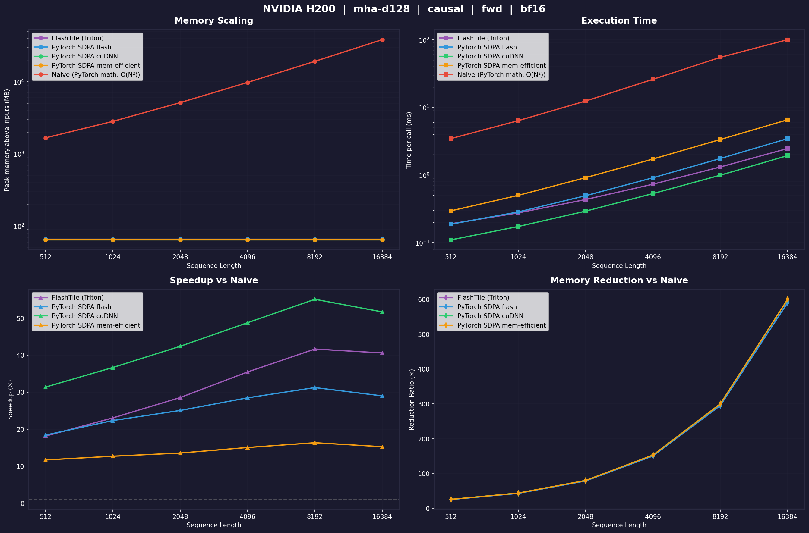
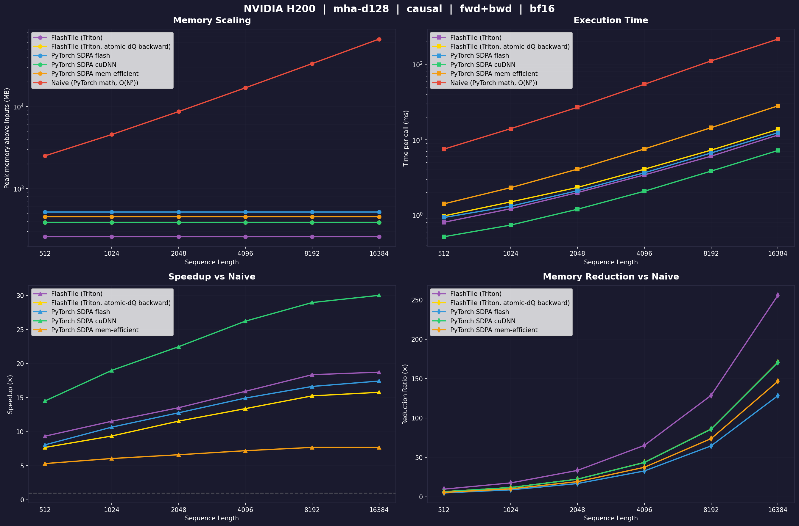
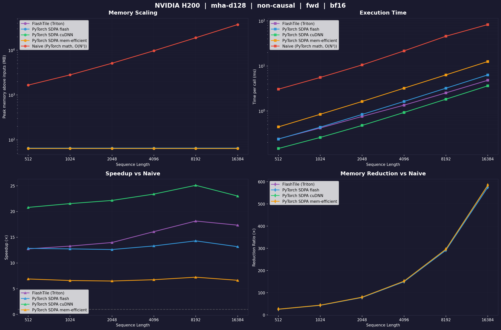
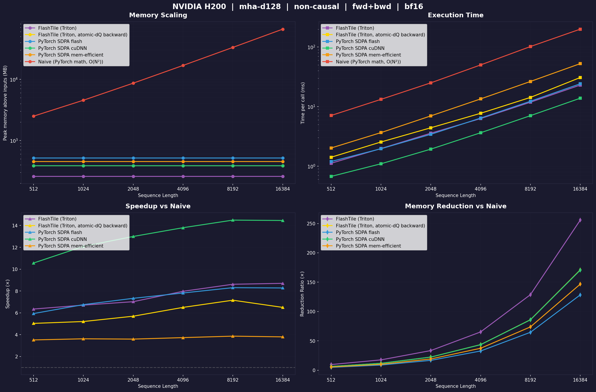
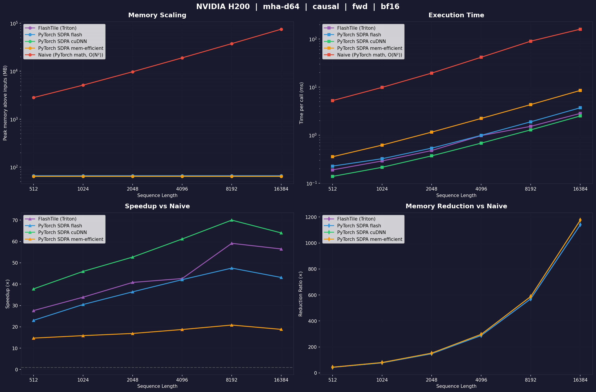
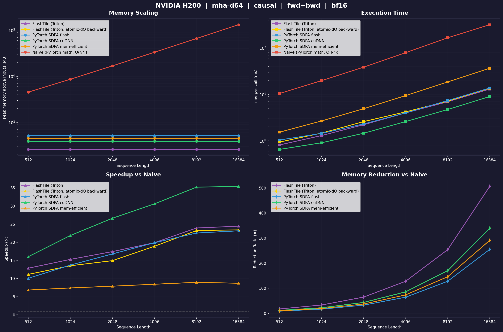
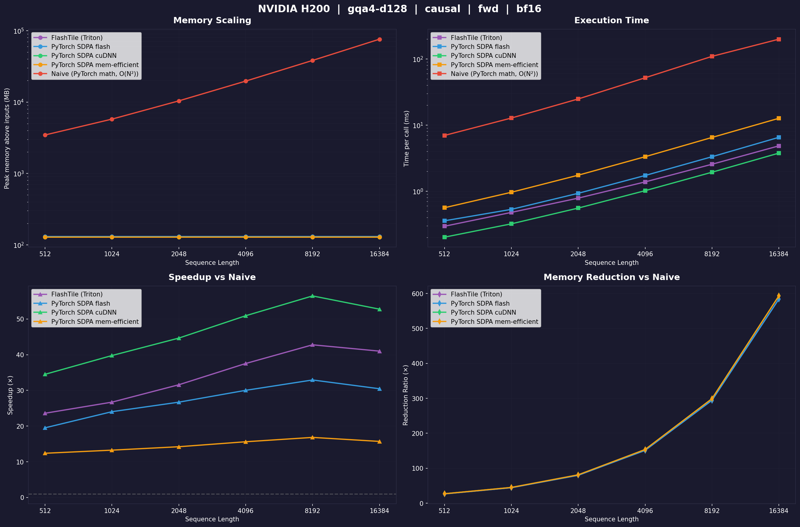
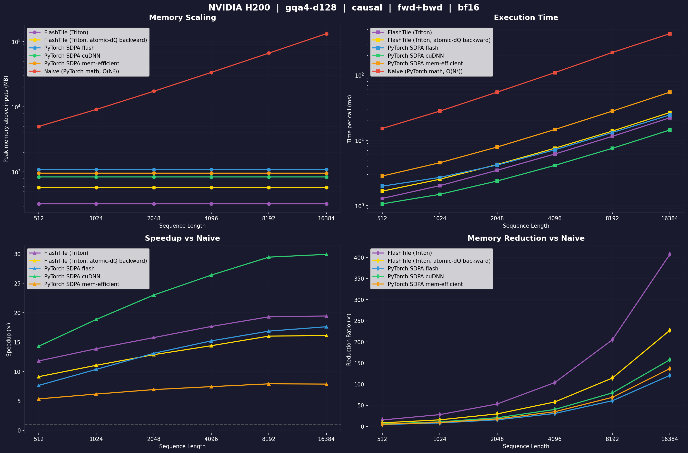
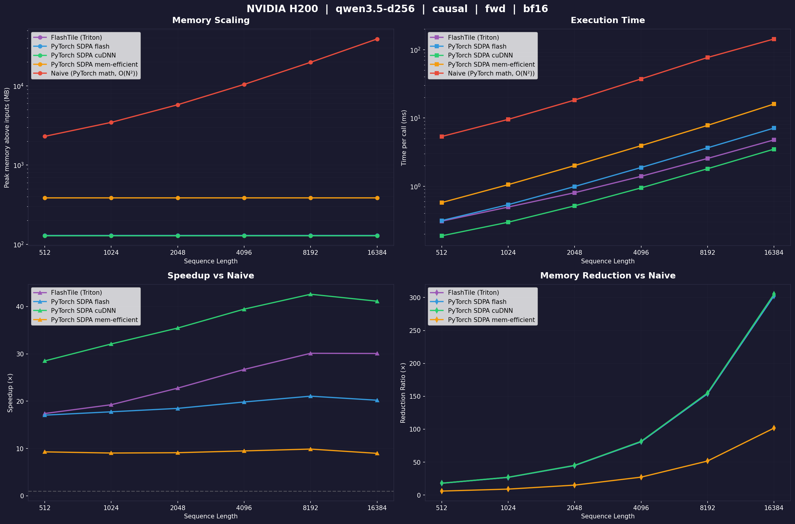
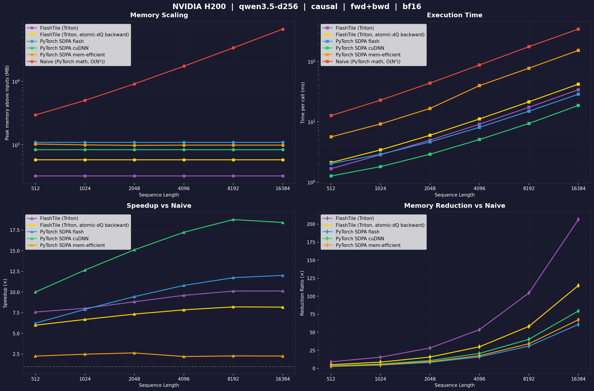

# FlashTile benchmark: NVIDIA H200

- date_utc: 2026-11-17 15:47:14
- gpu: NVIDIA H200
- compute_capability: sm_90
- gpu_memory_gib: 139.8
- sm_count: 132
- python: 3.12.10
- torch: 2.15.0+cu132
- cuda_runtime: 13.2
- cudnn: 92600
- triton: 3.9.0
- provider: Modal
- quick: False

All numbers are measured on this GPU, bf16 inputs, batch x length = 16384 tokens.
Each row passed a parity check against the fp32 dense oracle before it was timed.
Times are per-call medians of >= 20 samples; each sample is >= 2 ms of back-to-back calls between CUDA events.
TFLOP/s uses 4*B*H*L^2*d for the forward (halved, plus the diagonal, for causal) and 3.5x that for fwd+bwd.
`naive` is PyTorch's SDPA MATH backend, which materialises the L x L score table.

## mha-d128, causal=True, fwd

TFLOP/s:

| backend | L=512 | L=1024 | L=2048 | L=4096 | L=8192 | L=16384 |
|---|---:|---:|---:|---:|---:|---:|
| flashtile-triton | 180.9 | 249.4 | 316.6 | 375.8 | 418.2 | 446.1 |
| sdpa-flash | 183.5 | 241.7 | 277.9 | 301.7 | 313.6 | 318.7 |
| sdpa-cudnn | 312.8 | 396.8 | 470.2 | 516.8 | 553.2 | 568.1 |
| sdpa-efficient | 116.6 | 137.3 | 150.3 | 159.5 | 164.1 | 167.8 |
| naive | 10.0 | 10.8 | 11.1 | 10.6 | 10.0 | 11.0 |

Median ms per call:

| backend | L=512 | L=1024 | L=2048 | L=4096 | L=8192 | L=16384 |
|---|---:|---:|---:|---:|---:|---:|
| flashtile-triton | 0.190 | 0.276 | 0.434 | 0.732 | 1.315 | 2.465 |
| sdpa-flash | 0.188 | 0.285 | 0.495 | 0.911 | 1.753 | 3.450 |
| sdpa-cudnn | 0.110 | 0.173 | 0.292 | 0.532 | 0.994 | 1.936 |
| sdpa-efficient | 0.295 | 0.501 | 0.915 | 1.724 | 3.351 | 6.554 |
| naive | 3.454 | 6.361 | 12.404 | 25.956 | 54.790 | 100.098 |

Peak memory above inputs, MiB:

| backend | L=512 | L=1024 | L=2048 | L=4096 | L=8192 | L=16384 |
|---|---:|---:|---:|---:|---:|---:|
| flashtile-triton | 65.0 | 65.0 | 65.0 | 65.0 | 65.0 | 65.0 |
| sdpa-flash | 65.0 | 65.0 | 65.0 | 65.0 | 65.0 | 65.0 |
| sdpa-cudnn | 64.0 | 64.0 | 64.0 | 64.0 | 64.0 | 64.0 |
| sdpa-efficient | 64.0 | 64.0 | 64.0 | 64.0 | 64.0 | 64.0 |
| naive | 1665.3 | 2820.3 | 5136.3 | 9792.3 | 19200.3 | 38400.3 |

Autotuner choice (FlashTile):

- L=512: fwd: `BLOCK_M: 128, BLOCK_N: 64, num_warps: 8, num_ctas: 1, num_stages: 3, maxnreg: None, ir_override: None`
- L=1024: fwd: `BLOCK_M: 128, BLOCK_N: 64, num_warps: 8, num_ctas: 1, num_stages: 3, maxnreg: None, ir_override: None`
- L=2048: fwd: `BLOCK_M: 128, BLOCK_N: 64, num_warps: 8, num_ctas: 1, num_stages: 3, maxnreg: None, ir_override: None`
- L=4096: fwd: `BLOCK_M: 128, BLOCK_N: 64, num_warps: 8, num_ctas: 1, num_stages: 3, maxnreg: None, ir_override: None`
- L=8192: fwd: `BLOCK_M: 128, BLOCK_N: 64, num_warps: 8, num_ctas: 1, num_stages: 3, maxnreg: None, ir_override: None`
- L=16384: fwd: `BLOCK_M: 128, BLOCK_N: 64, num_warps: 8, num_ctas: 1, num_stages: 3, maxnreg: None, ir_override: None`

## mha-d128, causal=True, fwd+bwd

TFLOP/s:

| backend | L=512 | L=1024 | L=2048 | L=4096 | L=8192 | L=16384 |
|---|---:|---:|---:|---:|---:|---:|
| flashtile-triton | 149.9 | 198.0 | 241.8 | 281.8 | 318.2 | 333.9 |
| flashtile-atomic | 123.4 | 160.8 | 206.6 | 236.8 | 264.4 | 281.2 |
| sdpa-flash | 129.5 | 183.1 | 228.4 | 264.3 | 288.3 | 310.7 |
| sdpa-cudnn | 233.0 | 326.3 | 402.1 | 464.2 | 501.8 | 534.9 |
| sdpa-efficient | 85.3 | 104.0 | 118.2 | 127.5 | 133.2 | 136.9 |
| naive | 16.1 | 17.2 | 17.9 | 17.7 | 17.3 | 17.8 |

Median ms per call:

| backend | L=512 | L=1024 | L=2048 | L=4096 | L=8192 | L=16384 |
|---|---:|---:|---:|---:|---:|---:|
| flashtile-triton | 0.804 | 1.216 | 1.991 | 3.415 | 6.047 | 11.526 |
| flashtile-atomic | 0.977 | 1.497 | 2.330 | 4.063 | 7.279 | 13.686 |
| sdpa-flash | 0.930 | 1.315 | 2.107 | 3.641 | 6.674 | 12.388 |
| sdpa-cudnn | 0.517 | 0.738 | 1.197 | 2.073 | 3.835 | 7.195 |
| sdpa-efficient | 1.412 | 2.315 | 4.071 | 7.546 | 14.442 | 28.111 |
| naive | 7.506 | 14.023 | 26.911 | 54.382 | 111.067 | 215.974 |

Peak memory above inputs, MiB:

| backend | L=512 | L=1024 | L=2048 | L=4096 | L=8192 | L=16384 |
|---|---:|---:|---:|---:|---:|---:|
| flashtile-triton | 258.0 | 258.0 | 258.0 | 258.0 | 258.0 | 258.0 |
| flashtile-atomic | 386.0 | 386.0 | 386.0 | 386.0 | 386.0 | 386.0 |
| sdpa-flash | 514.0 | 514.0 | 514.0 | 514.0 | 514.0 | 514.0 |
| sdpa-cudnn | 387.0 | 387.0 | 387.0 | 387.0 | 387.0 | 387.0 |
| sdpa-efficient | 450.0 | 450.0 | 450.0 | 450.0 | 450.0 | 450.0 |
| naive | 2496.0 | 4544.0 | 8640.0 | 16832.0 | 33216.0 | 65984.0 |

Autotuner choice (FlashTile):

- L=512: fwd: `BLOCK_M: 128, BLOCK_N: 64, num_warps: 8, num_ctas: 1, num_stages: 3, maxnreg: None, ir_override: None`; bwd_dkdv: `BLOCK_M: 64, BLOCK_N: 64, num_warps: 4, num_ctas: 1, num_stages: 2, maxnreg: None, ir_override: None`; bwd_dq: `BLOCK_M: 64, BLOCK_N: 64, num_warps: 4, num_ctas: 1, num_stages: 2, maxnreg: None, ir_override: None`
- L=1024: fwd: `BLOCK_M: 128, BLOCK_N: 64, num_warps: 8, num_ctas: 1, num_stages: 3, maxnreg: None, ir_override: None`; bwd_dkdv: `BLOCK_M: 64, BLOCK_N: 64, num_warps: 4, num_ctas: 1, num_stages: 2, maxnreg: None, ir_override: None`; bwd_dq: `BLOCK_M: 64, BLOCK_N: 32, num_warps: 4, num_ctas: 1, num_stages: 2, maxnreg: None, ir_override: None`
- L=2048: fwd: `BLOCK_M: 128, BLOCK_N: 64, num_warps: 8, num_ctas: 1, num_stages: 3, maxnreg: None, ir_override: None`; bwd_dkdv: `BLOCK_M: 64, BLOCK_N: 64, num_warps: 4, num_ctas: 1, num_stages: 2, maxnreg: None, ir_override: None`; bwd_dq: `BLOCK_M: 64, BLOCK_N: 64, num_warps: 4, num_ctas: 1, num_stages: 2, maxnreg: None, ir_override: None`
- L=4096: fwd: `BLOCK_M: 128, BLOCK_N: 64, num_warps: 8, num_ctas: 1, num_stages: 3, maxnreg: None, ir_override: None`; bwd_dkdv: `BLOCK_M: 64, BLOCK_N: 64, num_warps: 4, num_ctas: 1, num_stages: 2, maxnreg: None, ir_override: None`; bwd_dq: `BLOCK_M: 64, BLOCK_N: 64, num_warps: 4, num_ctas: 1, num_stages: 2, maxnreg: None, ir_override: None`
- L=8192: fwd: `BLOCK_M: 128, BLOCK_N: 64, num_warps: 8, num_ctas: 1, num_stages: 3, maxnreg: None, ir_override: None`; bwd_dkdv: `BLOCK_M: 64, BLOCK_N: 64, num_warps: 4, num_ctas: 1, num_stages: 2, maxnreg: None, ir_override: None`; bwd_dq: `BLOCK_M: 64, BLOCK_N: 64, num_warps: 4, num_ctas: 1, num_stages: 2, maxnreg: None, ir_override: None`
- L=16384: fwd: `BLOCK_M: 128, BLOCK_N: 64, num_warps: 8, num_ctas: 1, num_stages: 3, maxnreg: None, ir_override: None`; bwd_dkdv: `BLOCK_M: 64, BLOCK_N: 64, num_warps: 4, num_ctas: 1, num_stages: 2, maxnreg: None, ir_override: None`; bwd_dq: `BLOCK_M: 64, BLOCK_N: 64, num_warps: 4, num_ctas: 1, num_stages: 2, maxnreg: None, ir_override: None`

## mha-d128, causal=False, fwd

TFLOP/s:

| backend | L=512 | L=1024 | L=2048 | L=4096 | L=8192 | L=16384 |
|---|---:|---:|---:|---:|---:|---:|
| flashtile-triton | 287.8 | 328.7 | 364.0 | 408.9 | 435.8 | 458.0 |
| sdpa-flash | 290.0 | 315.2 | 328.4 | 338.3 | 343.3 | 347.5 |
| sdpa-cudnn | 470.0 | 533.0 | 576.9 | 594.4 | 602.6 | 607.4 |
| sdpa-efficient | 155.6 | 163.0 | 169.0 | 171.4 | 173.7 | 175.1 |
| naive | 22.6 | 24.7 | 26.0 | 25.4 | 24.0 | 26.4 |

Median ms per call:

| backend | L=512 | L=1024 | L=2048 | L=4096 | L=8192 | L=16384 |
|---|---:|---:|---:|---:|---:|---:|
| flashtile-triton | 0.239 | 0.418 | 0.755 | 1.345 | 2.523 | 4.802 |
| sdpa-flash | 0.237 | 0.436 | 0.837 | 1.625 | 3.203 | 6.328 |
| sdpa-cudnn | 0.146 | 0.258 | 0.476 | 0.925 | 1.825 | 3.620 |
| sdpa-efficient | 0.442 | 0.843 | 1.626 | 3.208 | 6.328 | 12.560 |
| naive | 3.042 | 5.555 | 10.557 | 21.639 | 45.801 | 83.313 |

Peak memory above inputs, MiB:

| backend | L=512 | L=1024 | L=2048 | L=4096 | L=8192 | L=16384 |
|---|---:|---:|---:|---:|---:|---:|
| flashtile-triton | 65.0 | 65.0 | 65.0 | 65.0 | 65.0 | 65.0 |
| sdpa-flash | 65.0 | 65.0 | 65.0 | 65.0 | 65.0 | 65.0 |
| sdpa-cudnn | 64.0 | 64.0 | 64.0 | 64.0 | 64.0 | 64.0 |
| sdpa-efficient | 64.0 | 64.0 | 64.0 | 64.0 | 64.0 | 64.0 |
| naive | 1664.3 | 2816.3 | 5120.3 | 9728.3 | 18944.3 | 37376.3 |

Autotuner choice (FlashTile):

- L=512: fwd: `BLOCK_M: 128, BLOCK_N: 64, num_warps: 8, num_ctas: 1, num_stages: 3, maxnreg: None, ir_override: None`
- L=1024: fwd: `BLOCK_M: 128, BLOCK_N: 64, num_warps: 8, num_ctas: 1, num_stages: 3, maxnreg: None, ir_override: None`
- L=2048: fwd: `BLOCK_M: 128, BLOCK_N: 64, num_warps: 8, num_ctas: 1, num_stages: 3, maxnreg: None, ir_override: None`
- L=4096: fwd: `BLOCK_M: 128, BLOCK_N: 64, num_warps: 8, num_ctas: 1, num_stages: 3, maxnreg: None, ir_override: None`
- L=8192: fwd: `BLOCK_M: 128, BLOCK_N: 64, num_warps: 8, num_ctas: 1, num_stages: 3, maxnreg: None, ir_override: None`
- L=16384: fwd: `BLOCK_M: 128, BLOCK_N: 64, num_warps: 8, num_ctas: 1, num_stages: 3, maxnreg: None, ir_override: None`

## mha-d128, causal=False, fwd+bwd

TFLOP/s:

| backend | L=512 | L=1024 | L=2048 | L=4096 | L=8192 | L=16384 |
|---|---:|---:|---:|---:|---:|---:|
| flashtile-triton | 215.2 | 243.8 | 269.4 | 305.9 | 324.8 | 334.7 |
| flashtile-atomic | 170.6 | 189.1 | 218.4 | 249.3 | 269.7 | 249.9 |
| sdpa-flash | 201.1 | 245.4 | 281.3 | 299.9 | 313.0 | 318.4 |
| sdpa-cudnn | 358.2 | 439.4 | 498.9 | 529.4 | 546.3 | 556.2 |
| sdpa-efficient | 119.2 | 131.6 | 137.9 | 143.0 | 145.5 | 146.0 |
| naive | 33.9 | 36.4 | 38.4 | 38.4 | 37.7 | 38.5 |

Median ms per call:

| backend | L=512 | L=1024 | L=2048 | L=4096 | L=8192 | L=16384 |
|---|---:|---:|---:|---:|---:|---:|
| flashtile-triton | 1.118 | 1.973 | 3.571 | 6.291 | 11.850 | 22.998 |
| flashtile-atomic | 1.410 | 2.544 | 4.406 | 7.719 | 14.270 | 30.801 |
| sdpa-flash | 1.196 | 1.960 | 3.420 | 6.416 | 12.296 | 24.176 |
| sdpa-cudnn | 0.672 | 1.095 | 1.928 | 3.634 | 7.044 | 13.838 |
| sdpa-efficient | 2.018 | 3.656 | 6.979 | 13.456 | 26.444 | 52.709 |
| naive | 7.092 | 13.228 | 25.056 | 50.141 | 102.075 | 200.060 |

Peak memory above inputs, MiB:

| backend | L=512 | L=1024 | L=2048 | L=4096 | L=8192 | L=16384 |
|---|---:|---:|---:|---:|---:|---:|
| flashtile-triton | 258.0 | 258.0 | 258.0 | 258.0 | 258.0 | 258.0 |
| flashtile-atomic | 386.0 | 386.0 | 386.0 | 386.0 | 386.0 | 386.0 |
| sdpa-flash | 514.0 | 514.0 | 514.0 | 514.0 | 514.0 | 514.0 |
| sdpa-cudnn | 387.0 | 387.0 | 387.0 | 387.0 | 387.0 | 387.0 |
| sdpa-efficient | 450.0 | 450.0 | 450.0 | 450.0 | 450.0 | 450.0 |
| naive | 2496.0 | 4544.0 | 8640.0 | 16832.0 | 33216.0 | 65984.0 |

Autotuner choice (FlashTile):

- L=512: fwd: `BLOCK_M: 128, BLOCK_N: 64, num_warps: 8, num_ctas: 1, num_stages: 3, maxnreg: None, ir_override: None`; bwd_dkdv: `BLOCK_M: 64, BLOCK_N: 64, num_warps: 4, num_ctas: 1, num_stages: 2, maxnreg: None, ir_override: None`; bwd_dq: `BLOCK_M: 128, BLOCK_N: 64, num_warps: 8, num_ctas: 1, num_stages: 2, maxnreg: None, ir_override: None`
- L=1024: fwd: `BLOCK_M: 128, BLOCK_N: 64, num_warps: 8, num_ctas: 1, num_stages: 3, maxnreg: None, ir_override: None`; bwd_dkdv: `BLOCK_M: 64, BLOCK_N: 64, num_warps: 4, num_ctas: 1, num_stages: 2, maxnreg: None, ir_override: None`; bwd_dq: `BLOCK_M: 128, BLOCK_N: 64, num_warps: 8, num_ctas: 1, num_stages: 2, maxnreg: None, ir_override: None`
- L=2048: fwd: `BLOCK_M: 128, BLOCK_N: 64, num_warps: 8, num_ctas: 1, num_stages: 3, maxnreg: None, ir_override: None`; bwd_dkdv: `BLOCK_M: 64, BLOCK_N: 64, num_warps: 4, num_ctas: 1, num_stages: 2, maxnreg: None, ir_override: None`; bwd_dq: `BLOCK_M: 64, BLOCK_N: 64, num_warps: 4, num_ctas: 1, num_stages: 2, maxnreg: None, ir_override: None`
- L=4096: fwd: `BLOCK_M: 128, BLOCK_N: 64, num_warps: 8, num_ctas: 1, num_stages: 3, maxnreg: None, ir_override: None`; bwd_dkdv: `BLOCK_M: 64, BLOCK_N: 64, num_warps: 4, num_ctas: 1, num_stages: 2, maxnreg: None, ir_override: None`; bwd_dq: `BLOCK_M: 64, BLOCK_N: 64, num_warps: 4, num_ctas: 1, num_stages: 2, maxnreg: None, ir_override: None`
- L=8192: fwd: `BLOCK_M: 128, BLOCK_N: 64, num_warps: 8, num_ctas: 1, num_stages: 3, maxnreg: None, ir_override: None`; bwd_dkdv: `BLOCK_M: 64, BLOCK_N: 64, num_warps: 4, num_ctas: 1, num_stages: 2, maxnreg: None, ir_override: None`; bwd_dq: `BLOCK_M: 64, BLOCK_N: 64, num_warps: 4, num_ctas: 1, num_stages: 2, maxnreg: None, ir_override: None`
- L=16384: fwd: `BLOCK_M: 128, BLOCK_N: 64, num_warps: 8, num_ctas: 1, num_stages: 3, maxnreg: None, ir_override: None`; bwd_dkdv: `BLOCK_M: 64, BLOCK_N: 64, num_warps: 4, num_ctas: 1, num_stages: 2, maxnreg: None, ir_override: None`; bwd_dq: `BLOCK_M: 64, BLOCK_N: 64, num_warps: 4, num_ctas: 1, num_stages: 2, maxnreg: None, ir_override: None`

## mha-d64, causal=True, fwd

TFLOP/s:

| backend | L=512 | L=1024 | L=2048 | L=4096 | L=8192 | L=16384 |
|---|---:|---:|---:|---:|---:|---:|
| flashtile-triton | 181.8 | 236.8 | 287.6 | 281.1 | 361.1 | 388.2 |
| sdpa-flash | 151.7 | 212.8 | 256.5 | 277.7 | 290.2 | 296.3 |
| sdpa-cudnn | 248.7 | 321.2 | 371.1 | 403.3 | 427.5 | 439.8 |
| sdpa-efficient | 96.9 | 110.9 | 119.0 | 123.6 | 127.3 | 129.2 |
| naive | 6.6 | 7.0 | 7.0 | 6.6 | 6.1 | 6.9 |

Median ms per call:

| backend | L=512 | L=1024 | L=2048 | L=4096 | L=8192 | L=16384 |
|---|---:|---:|---:|---:|---:|---:|
| flashtile-triton | 0.189 | 0.290 | 0.478 | 0.978 | 1.523 | 2.833 |
| sdpa-flash | 0.227 | 0.323 | 0.536 | 0.990 | 1.895 | 3.711 |
| sdpa-cudnn | 0.138 | 0.214 | 0.370 | 0.682 | 1.286 | 2.500 |
| sdpa-efficient | 0.355 | 0.620 | 1.155 | 2.224 | 4.321 | 8.510 |
| naive | 5.227 | 9.843 | 19.513 | 41.684 | 90.023 | 159.985 |

Peak memory above inputs, MiB:

| backend | L=512 | L=1024 | L=2048 | L=4096 | L=8192 | L=16384 |
|---|---:|---:|---:|---:|---:|---:|
| flashtile-triton | 66.0 | 66.0 | 66.0 | 66.0 | 66.0 | 66.0 |
| sdpa-flash | 66.0 | 66.0 | 66.0 | 66.0 | 66.0 | 66.0 |
| sdpa-cudnn | 64.0 | 64.0 | 64.0 | 64.0 | 64.0 | 64.0 |
| sdpa-efficient | 64.0 | 64.0 | 64.0 | 64.0 | 64.0 | 64.0 |
| naive | 2817.5 | 5124.5 | 9744.5 | 19008.5 | 37632.5 | 75264.5 |

Autotuner choice (FlashTile):

- L=512: fwd: `BLOCK_M: 128, BLOCK_N: 64, num_warps: 8, num_ctas: 1, num_stages: 3, maxnreg: None, ir_override: None`
- L=1024: fwd: `BLOCK_M: 128, BLOCK_N: 64, num_warps: 8, num_ctas: 1, num_stages: 3, maxnreg: None, ir_override: None`
- L=2048: fwd: `BLOCK_M: 128, BLOCK_N: 64, num_warps: 8, num_ctas: 1, num_stages: 3, maxnreg: None, ir_override: None`
- L=4096: fwd: `BLOCK_M: 64, BLOCK_N: 64, num_warps: 4, num_ctas: 1, num_stages: 3, maxnreg: None, ir_override: None`
- L=8192: fwd: `BLOCK_M: 128, BLOCK_N: 64, num_warps: 4, num_ctas: 1, num_stages: 3, maxnreg: None, ir_override: None`
- L=16384: fwd: `BLOCK_M: 128, BLOCK_N: 64, num_warps: 8, num_ctas: 1, num_stages: 3, maxnreg: None, ir_override: None`

## mha-d64, causal=True, fwd+bwd

TFLOP/s:

| backend | L=512 | L=1024 | L=2048 | L=4096 | L=8192 | L=16384 |
|---|---:|---:|---:|---:|---:|---:|
| flashtile-triton | 148.6 | 186.3 | 217.5 | 241.8 | 278.1 | 296.1 |
| flashtile-atomic | 128.9 | 164.9 | 186.3 | 229.8 | 270.0 | 283.7 |
| sdpa-flash | 116.4 | 167.1 | 209.5 | 241.7 | 262.0 | 280.6 |
| sdpa-cudnn | 185.4 | 266.6 | 332.3 | 372.0 | 409.1 | 428.9 |
| sdpa-efficient | 78.9 | 90.2 | 98.4 | 102.4 | 104.0 | 105.3 |
| naive | 11.6 | 12.2 | 12.5 | 12.2 | 11.6 | 12.1 |

Median ms per call:

| backend | L=512 | L=1024 | L=2048 | L=4096 | L=8192 | L=16384 |
|---|---:|---:|---:|---:|---:|---:|
| flashtile-triton | 0.811 | 1.292 | 2.213 | 3.980 | 6.919 | 12.999 |
| flashtile-atomic | 0.935 | 1.460 | 2.583 | 4.188 | 7.128 | 13.564 |
| sdpa-flash | 1.036 | 1.441 | 2.298 | 3.981 | 7.345 | 13.718 |
| sdpa-cudnn | 0.650 | 0.903 | 1.448 | 2.587 | 4.704 | 8.972 |
| sdpa-efficient | 1.528 | 2.668 | 4.891 | 9.395 | 18.506 | 36.543 |
| naive | 10.415 | 19.739 | 38.553 | 79.119 | 165.576 | 317.582 |

Peak memory above inputs, MiB:

| backend | L=512 | L=1024 | L=2048 | L=4096 | L=8192 | L=16384 |
|---|---:|---:|---:|---:|---:|---:|
| flashtile-triton | 260.0 | 260.0 | 260.0 | 260.0 | 260.0 | 260.0 |
| flashtile-atomic | 388.0 | 388.0 | 388.0 | 388.0 | 388.0 | 388.0 |
| sdpa-flash | 516.0 | 516.0 | 516.0 | 516.0 | 516.0 | 516.0 |
| sdpa-cudnn | 388.0 | 388.0 | 388.0 | 388.0 | 388.0 | 388.0 |
| sdpa-efficient | 452.1 | 452.1 | 452.1 | 452.1 | 452.1 | 452.1 |
| naive | 4544.0 | 8640.0 | 16832.0 | 33216.0 | 65984.0 | 131520.0 |

Autotuner choice (FlashTile):

- L=512: fwd: `BLOCK_M: 128, BLOCK_N: 64, num_warps: 8, num_ctas: 1, num_stages: 3, maxnreg: None, ir_override: None`; bwd_dkdv: `BLOCK_M: 64, BLOCK_N: 64, num_warps: 4, num_ctas: 1, num_stages: 2, maxnreg: None, ir_override: None`; bwd_dq: `BLOCK_M: 128, BLOCK_N: 64, num_warps: 8, num_ctas: 1, num_stages: 2, maxnreg: None, ir_override: None`
- L=1024: fwd: `BLOCK_M: 128, BLOCK_N: 64, num_warps: 8, num_ctas: 1, num_stages: 3, maxnreg: None, ir_override: None`; bwd_dkdv: `BLOCK_M: 64, BLOCK_N: 64, num_warps: 4, num_ctas: 1, num_stages: 2, maxnreg: None, ir_override: None`; bwd_dq: `BLOCK_M: 128, BLOCK_N: 64, num_warps: 8, num_ctas: 1, num_stages: 2, maxnreg: None, ir_override: None`
- L=2048: fwd: `BLOCK_M: 128, BLOCK_N: 64, num_warps: 8, num_ctas: 1, num_stages: 3, maxnreg: None, ir_override: None`; bwd_dkdv: `BLOCK_M: 64, BLOCK_N: 64, num_warps: 4, num_ctas: 1, num_stages: 2, maxnreg: None, ir_override: None`; bwd_dq: `BLOCK_M: 128, BLOCK_N: 64, num_warps: 8, num_ctas: 1, num_stages: 2, maxnreg: None, ir_override: None`
- L=4096: fwd: `BLOCK_M: 64, BLOCK_N: 64, num_warps: 4, num_ctas: 1, num_stages: 3, maxnreg: None, ir_override: None`; bwd_dkdv: `BLOCK_M: 64, BLOCK_N: 64, num_warps: 4, num_ctas: 1, num_stages: 2, maxnreg: None, ir_override: None`; bwd_dq: `BLOCK_M: 64, BLOCK_N: 64, num_warps: 4, num_ctas: 1, num_stages: 2, maxnreg: None, ir_override: None`
- L=8192: fwd: `BLOCK_M: 128, BLOCK_N: 64, num_warps: 4, num_ctas: 1, num_stages: 3, maxnreg: None, ir_override: None`; bwd_dkdv: `BLOCK_M: 64, BLOCK_N: 64, num_warps: 4, num_ctas: 1, num_stages: 2, maxnreg: None, ir_override: None`; bwd_dq: `BLOCK_M: 128, BLOCK_N: 64, num_warps: 8, num_ctas: 1, num_stages: 2, maxnreg: None, ir_override: None`
- L=16384: fwd: `BLOCK_M: 128, BLOCK_N: 64, num_warps: 8, num_ctas: 1, num_stages: 3, maxnreg: None, ir_override: None`; bwd_dkdv: `BLOCK_M: 64, BLOCK_N: 64, num_warps: 4, num_ctas: 1, num_stages: 2, maxnreg: None, ir_override: None`; bwd_dq: `BLOCK_M: 128, BLOCK_N: 64, num_warps: 8, num_ctas: 1, num_stages: 2, maxnreg: None, ir_override: None`

## gqa4-d128, causal=True, fwd

TFLOP/s:

| backend | L=512 | L=1024 | L=2048 | L=4096 | L=8192 | L=16384 |
|---|---:|---:|---:|---:|---:|---:|
| flashtile-triton | 233.1 | 287.5 | 349.7 | 397.7 | 430.0 | 453.5 |
| sdpa-flash | 192.7 | 258.7 | 295.6 | 318.0 | 331.0 | 336.9 |
| sdpa-cudnn | 340.8 | 428.1 | 494.4 | 539.5 | 567.8 | 583.6 |
| sdpa-efficient | 122.3 | 142.7 | 157.4 | 165.4 | 169.2 | 173.7 |
| naive | 9.9 | 10.8 | 11.1 | 10.6 | 10.1 | 11.1 |

Median ms per call:

| backend | L=512 | L=1024 | L=2048 | L=4096 | L=8192 | L=16384 |
|---|---:|---:|---:|---:|---:|---:|
| flashtile-triton | 0.295 | 0.479 | 0.786 | 1.383 | 2.557 | 4.849 |
| sdpa-flash | 0.357 | 0.532 | 0.930 | 1.729 | 3.323 | 6.527 |
| sdpa-cudnn | 0.202 | 0.321 | 0.556 | 1.019 | 1.937 | 3.768 |
| sdpa-efficient | 0.563 | 0.964 | 1.747 | 3.325 | 6.500 | 12.659 |
| naive | 6.971 | 12.780 | 24.835 | 51.897 | 109.368 | 198.801 |

Peak memory above inputs, MiB:

| backend | L=512 | L=1024 | L=2048 | L=4096 | L=8192 | L=16384 |
|---|---:|---:|---:|---:|---:|---:|
| flashtile-triton | 130.0 | 130.0 | 130.0 | 130.0 | 130.0 | 130.0 |
| sdpa-flash | 130.0 | 130.0 | 130.0 | 130.0 | 130.0 | 130.0 |
| sdpa-cudnn | 128.0 | 128.0 | 128.0 | 128.0 | 128.0 | 128.0 |
| sdpa-efficient | 128.0 | 128.0 | 128.0 | 128.0 | 128.0 | 128.0 |
| naive | 3457.5 | 5764.5 | 10384.5 | 19648.5 | 38272.5 | 75904.5 |

Autotuner choice (FlashTile):

- L=512: fwd: `BLOCK_M: 64, BLOCK_N: 32, num_warps: 4, num_ctas: 1, num_stages: 2, maxnreg: None, ir_override: None`
- L=1024: fwd: `BLOCK_M: 64, BLOCK_N: 64, num_warps: 4, num_ctas: 1, num_stages: 3, maxnreg: None, ir_override: None`
- L=2048: fwd: `BLOCK_M: 128, BLOCK_N: 64, num_warps: 8, num_ctas: 1, num_stages: 3, maxnreg: None, ir_override: None`
- L=4096: fwd: `BLOCK_M: 128, BLOCK_N: 64, num_warps: 8, num_ctas: 1, num_stages: 3, maxnreg: None, ir_override: None`
- L=8192: fwd: `BLOCK_M: 128, BLOCK_N: 64, num_warps: 8, num_ctas: 1, num_stages: 3, maxnreg: None, ir_override: None`
- L=16384: fwd: `BLOCK_M: 128, BLOCK_N: 64, num_warps: 8, num_ctas: 1, num_stages: 3, maxnreg: None, ir_override: None`

## gqa4-d128, causal=True, fwd+bwd

TFLOP/s:

| backend | L=512 | L=1024 | L=2048 | L=4096 | L=8192 | L=16384 |
|---|---:|---:|---:|---:|---:|---:|
| flashtile-triton | 187.4 | 238.7 | 277.0 | 312.3 | 334.8 | 347.6 |
| flashtile-atomic | 145.0 | 190.3 | 226.0 | 254.5 | 277.9 | 288.4 |
| sdpa-flash | 121.5 | 178.4 | 230.1 | 269.0 | 292.6 | 315.0 |
| sdpa-cudnn | 227.1 | 324.2 | 404.0 | 466.6 | 510.8 | 534.9 |
| sdpa-efficient | 85.1 | 106.3 | 121.8 | 131.5 | 137.3 | 140.9 |
| naive | 15.9 | 17.2 | 17.6 | 17.7 | 17.3 | 17.9 |

Median ms per call:

| backend | L=512 | L=1024 | L=2048 | L=4096 | L=8192 | L=16384 |
|---|---:|---:|---:|---:|---:|---:|
| flashtile-triton | 1.286 | 2.017 | 3.475 | 6.162 | 11.496 | 22.141 |
| flashtile-atomic | 1.662 | 2.531 | 4.259 | 7.563 | 13.848 | 26.688 |
| sdpa-flash | 1.984 | 2.700 | 4.183 | 7.155 | 13.151 | 24.437 |
| sdpa-cudnn | 1.061 | 1.485 | 2.382 | 4.125 | 7.535 | 14.390 |
| sdpa-efficient | 2.833 | 4.531 | 7.900 | 14.634 | 28.022 | 54.644 |
| naive | 15.187 | 28.014 | 54.832 | 108.909 | 221.916 | 430.560 |

Peak memory above inputs, MiB:

| backend | L=512 | L=1024 | L=2048 | L=4096 | L=8192 | L=16384 |
|---|---:|---:|---:|---:|---:|---:|
| flashtile-triton | 324.0 | 324.0 | 324.0 | 324.0 | 324.0 | 324.0 |
| flashtile-atomic | 580.0 | 580.0 | 580.0 | 580.0 | 580.0 | 580.0 |
| sdpa-flash | 1092.0 | 1092.0 | 1092.0 | 1092.0 | 1092.0 | 1092.0 |
| sdpa-cudnn | 836.0 | 836.0 | 836.0 | 836.0 | 836.0 | 836.0 |
| sdpa-efficient | 964.1 | 964.1 | 964.1 | 964.1 | 964.1 | 964.1 |
| naive | 4992.0 | 9088.0 | 17280.0 | 33664.0 | 66432.0 | 131968.0 |

Autotuner choice (FlashTile):

- L=512: fwd: `BLOCK_M: 64, BLOCK_N: 32, num_warps: 4, num_ctas: 1, num_stages: 2, maxnreg: None, ir_override: None`; bwd_dkdv: `BLOCK_M: 64, BLOCK_N: 64, num_warps: 4, num_ctas: 1, num_stages: 2, maxnreg: None, ir_override: None`; bwd_dq: `BLOCK_M: 64, BLOCK_N: 64, num_warps: 4, num_ctas: 1, num_stages: 2, maxnreg: None, ir_override: None`
- L=1024: fwd: `BLOCK_M: 64, BLOCK_N: 64, num_warps: 4, num_ctas: 1, num_stages: 3, maxnreg: None, ir_override: None`; bwd_dkdv: `BLOCK_M: 64, BLOCK_N: 64, num_warps: 4, num_ctas: 1, num_stages: 2, maxnreg: None, ir_override: None`; bwd_dq: `BLOCK_M: 64, BLOCK_N: 64, num_warps: 4, num_ctas: 1, num_stages: 2, maxnreg: None, ir_override: None`
- L=2048: fwd: `BLOCK_M: 128, BLOCK_N: 64, num_warps: 8, num_ctas: 1, num_stages: 3, maxnreg: None, ir_override: None`; bwd_dkdv: `BLOCK_M: 64, BLOCK_N: 64, num_warps: 4, num_ctas: 1, num_stages: 2, maxnreg: None, ir_override: None`; bwd_dq: `BLOCK_M: 64, BLOCK_N: 64, num_warps: 4, num_ctas: 1, num_stages: 2, maxnreg: None, ir_override: None`
- L=4096: fwd: `BLOCK_M: 128, BLOCK_N: 64, num_warps: 8, num_ctas: 1, num_stages: 3, maxnreg: None, ir_override: None`; bwd_dkdv: `BLOCK_M: 64, BLOCK_N: 64, num_warps: 4, num_ctas: 1, num_stages: 2, maxnreg: None, ir_override: None`; bwd_dq: `BLOCK_M: 64, BLOCK_N: 64, num_warps: 4, num_ctas: 1, num_stages: 2, maxnreg: None, ir_override: None`
- L=8192: fwd: `BLOCK_M: 128, BLOCK_N: 64, num_warps: 8, num_ctas: 1, num_stages: 3, maxnreg: None, ir_override: None`; bwd_dkdv: `BLOCK_M: 64, BLOCK_N: 64, num_warps: 4, num_ctas: 1, num_stages: 2, maxnreg: None, ir_override: None`; bwd_dq: `BLOCK_M: 64, BLOCK_N: 64, num_warps: 4, num_ctas: 1, num_stages: 2, maxnreg: None, ir_override: None`
- L=16384: fwd: `BLOCK_M: 128, BLOCK_N: 64, num_warps: 8, num_ctas: 1, num_stages: 3, maxnreg: None, ir_override: None`; bwd_dkdv: `BLOCK_M: 64, BLOCK_N: 64, num_warps: 4, num_ctas: 1, num_stages: 2, maxnreg: None, ir_override: None`; bwd_dq: `BLOCK_M: 64, BLOCK_N: 64, num_warps: 4, num_ctas: 1, num_stages: 2, maxnreg: None, ir_override: None`

## qwen3.5-d256, causal=True, fwd

TFLOP/s:

| backend | L=512 | L=1024 | L=2048 | L=4096 | L=8192 | L=16384 |
|---|---:|---:|---:|---:|---:|---:|
| flashtile-triton | 223.9 | 278.0 | 342.3 | 394.0 | 431.1 | 460.7 |
| sdpa-flash | 219.5 | 256.4 | 277.9 | 292.6 | 301.4 | 309.4 |
| sdpa-cudnn | 367.0 | 463.5 | 533.3 | 582.1 | 609.7 | 630.0 |
| sdpa-efficient | 119.6 | 130.6 | 137.0 | 140.0 | 141.3 | 137.5 |
| naive | 12.9 | 14.4 | 15.0 | 14.8 | 14.3 | 15.3 |

Median ms per call:

| backend | L=512 | L=1024 | L=2048 | L=4096 | L=8192 | L=16384 |
|---|---:|---:|---:|---:|---:|---:|
| flashtile-triton | 0.308 | 0.495 | 0.803 | 1.396 | 2.551 | 4.773 |
| sdpa-flash | 0.314 | 0.537 | 0.990 | 1.879 | 3.649 | 7.108 |
| sdpa-cudnn | 0.188 | 0.297 | 0.516 | 0.945 | 1.804 | 3.491 |
| sdpa-efficient | 0.576 | 1.054 | 2.007 | 3.927 | 7.781 | 15.999 |
| naive | 5.350 | 9.527 | 18.287 | 37.276 | 76.846 | 143.586 |

Peak memory above inputs, MiB:

| backend | L=512 | L=1024 | L=2048 | L=4096 | L=8192 | L=16384 |
|---|---:|---:|---:|---:|---:|---:|
| flashtile-triton | 129.0 | 129.0 | 129.0 | 129.0 | 129.0 | 129.0 |
| sdpa-flash | 129.0 | 129.0 | 129.0 | 129.0 | 129.0 | 129.0 |
| sdpa-cudnn | 128.0 | 128.0 | 128.0 | 128.0 | 128.0 | 128.0 |
| sdpa-efficient | 384.0 | 384.0 | 384.0 | 384.0 | 384.0 | 384.0 |
| naive | 2305.3 | 3460.3 | 5776.3 | 10432.3 | 19840.3 | 39040.3 |

Autotuner choice (FlashTile):

- L=512: fwd: `BLOCK_M: 64, BLOCK_N: 32, num_warps: 4, num_ctas: 1, num_stages: 2, maxnreg: None, ir_override: None`
- L=1024: fwd: `BLOCK_M: 64, BLOCK_N: 64, num_warps: 4, num_ctas: 1, num_stages: 3, maxnreg: None, ir_override: None`
- L=2048: fwd: `BLOCK_M: 64, BLOCK_N: 64, num_warps: 4, num_ctas: 1, num_stages: 3, maxnreg: None, ir_override: None`
- L=4096: fwd: `BLOCK_M: 64, BLOCK_N: 64, num_warps: 4, num_ctas: 1, num_stages: 3, maxnreg: None, ir_override: None`
- L=8192: fwd: `BLOCK_M: 64, BLOCK_N: 64, num_warps: 4, num_ctas: 1, num_stages: 3, maxnreg: None, ir_override: None`
- L=16384: fwd: `BLOCK_M: 64, BLOCK_N: 64, num_warps: 4, num_ctas: 1, num_stages: 3, maxnreg: None, ir_override: None`

## qwen3.5-d256, causal=True, fwd+bwd

TFLOP/s:

| backend | L=512 | L=1024 | L=2048 | L=4096 | L=8192 | L=16384 |
|---|---:|---:|---:|---:|---:|---:|
| flashtile-triton | 144.4 | 169.2 | 193.8 | 211.0 | 221.2 | 226.3 |
| flashtile-atomic | 114.0 | 140.7 | 161.0 | 172.5 | 179.3 | 182.6 |
| sdpa-flash | 118.8 | 166.5 | 207.4 | 237.5 | 256.5 | 268.5 |
| sdpa-cudnn | 190.4 | 266.6 | 331.7 | 378.9 | 410.2 | 411.3 |
| sdpa-efficient | 42.8 | 52.3 | 57.8 | 48.4 | 49.7 | 50.4 |
| naive | 19.0 | 21.1 | 22.0 | 22.0 | 21.9 | 22.3 |

Median ms per call:

| backend | L=512 | L=1024 | L=2048 | L=4096 | L=8192 | L=16384 |
|---|---:|---:|---:|---:|---:|---:|
| flashtile-triton | 1.669 | 2.846 | 4.968 | 9.119 | 17.397 | 34.013 |
| flashtile-atomic | 2.114 | 3.421 | 5.980 | 11.154 | 21.462 | 42.147 |
| sdpa-flash | 2.029 | 2.891 | 4.641 | 8.105 | 15.007 | 28.670 |
| sdpa-cudnn | 1.266 | 1.806 | 2.902 | 5.079 | 9.382 | 18.712 |
| sdpa-efficient | 5.629 | 9.207 | 16.652 | 39.804 | 77.401 | 152.766 |
| naive | 12.658 | 22.858 | 43.845 | 87.529 | 176.096 | 344.552 |

Peak memory above inputs, MiB:

| backend | L=512 | L=1024 | L=2048 | L=4096 | L=8192 | L=16384 |
|---|---:|---:|---:|---:|---:|---:|
| flashtile-triton | 322.0 | 322.0 | 322.0 | 322.0 | 322.0 | 322.0 |
| flashtile-atomic | 578.0 | 578.0 | 578.0 | 578.0 | 578.0 | 578.0 |
| sdpa-flash | 1090.0 | 1090.0 | 1090.0 | 1090.0 | 1090.0 | 1090.0 |
| sdpa-cudnn | 835.0 | 835.0 | 835.0 | 835.0 | 835.0 | 834.0 |
| sdpa-efficient | 1026.1 | 994.1 | 978.1 | 986.1 | 986.1 | 986.1 |
| naive | 2944.0 | 4992.0 | 9088.0 | 17280.0 | 33664.0 | 66432.0 |

Autotuner choice (FlashTile):

- L=512: fwd: `BLOCK_M: 64, BLOCK_N: 32, num_warps: 4, num_ctas: 1, num_stages: 2, maxnreg: None, ir_override: None`; bwd_dkdv: `BLOCK_M: 32, BLOCK_N: 32, num_warps: 4, num_ctas: 1, num_stages: 1, maxnreg: None, ir_override: None`; bwd_dq: `BLOCK_M: 128, BLOCK_N: 32, num_warps: 8, num_ctas: 1, num_stages: 2, maxnreg: None, ir_override: None`
- L=1024: fwd: `BLOCK_M: 64, BLOCK_N: 64, num_warps: 4, num_ctas: 1, num_stages: 3, maxnreg: None, ir_override: None`; bwd_dkdv: `BLOCK_M: 32, BLOCK_N: 32, num_warps: 4, num_ctas: 1, num_stages: 1, maxnreg: None, ir_override: None`; bwd_dq: `BLOCK_M: 128, BLOCK_N: 32, num_warps: 8, num_ctas: 1, num_stages: 2, maxnreg: None, ir_override: None`
- L=2048: fwd: `BLOCK_M: 64, BLOCK_N: 64, num_warps: 4, num_ctas: 1, num_stages: 3, maxnreg: None, ir_override: None`; bwd_dkdv: `BLOCK_M: 32, BLOCK_N: 32, num_warps: 4, num_ctas: 1, num_stages: 1, maxnreg: None, ir_override: None`; bwd_dq: `BLOCK_M: 64, BLOCK_N: 64, num_warps: 4, num_ctas: 1, num_stages: 2, maxnreg: None, ir_override: None`
- L=4096: fwd: `BLOCK_M: 64, BLOCK_N: 64, num_warps: 4, num_ctas: 1, num_stages: 3, maxnreg: None, ir_override: None`; bwd_dkdv: `BLOCK_M: 32, BLOCK_N: 32, num_warps: 4, num_ctas: 1, num_stages: 1, maxnreg: None, ir_override: None`; bwd_dq: `BLOCK_M: 64, BLOCK_N: 64, num_warps: 4, num_ctas: 1, num_stages: 2, maxnreg: None, ir_override: None`
- L=8192: fwd: `BLOCK_M: 64, BLOCK_N: 64, num_warps: 4, num_ctas: 1, num_stages: 3, maxnreg: None, ir_override: None`; bwd_dkdv: `BLOCK_M: 32, BLOCK_N: 32, num_warps: 4, num_ctas: 1, num_stages: 1, maxnreg: None, ir_override: None`; bwd_dq: `BLOCK_M: 64, BLOCK_N: 64, num_warps: 4, num_ctas: 1, num_stages: 2, maxnreg: None, ir_override: None`
- L=16384: fwd: `BLOCK_M: 64, BLOCK_N: 64, num_warps: 4, num_ctas: 1, num_stages: 3, maxnreg: None, ir_override: None`; bwd_dkdv: `BLOCK_M: 32, BLOCK_N: 32, num_warps: 4, num_ctas: 1, num_stages: 1, maxnreg: None, ir_override: None`; bwd_dq: `BLOCK_M: 64, BLOCK_N: 64, num_warps: 4, num_ctas: 1, num_stages: 2, maxnreg: None, ir_override: None`

