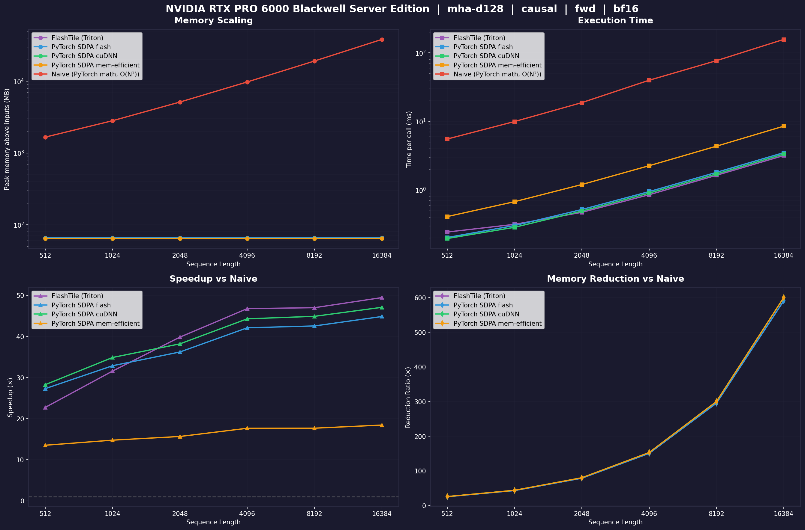
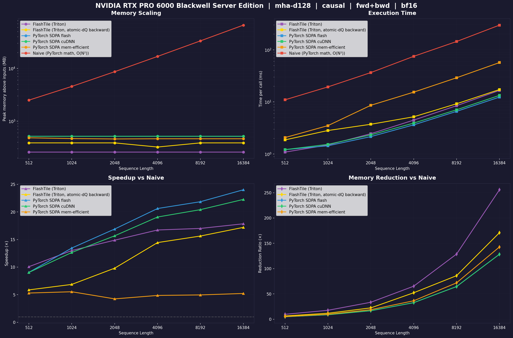
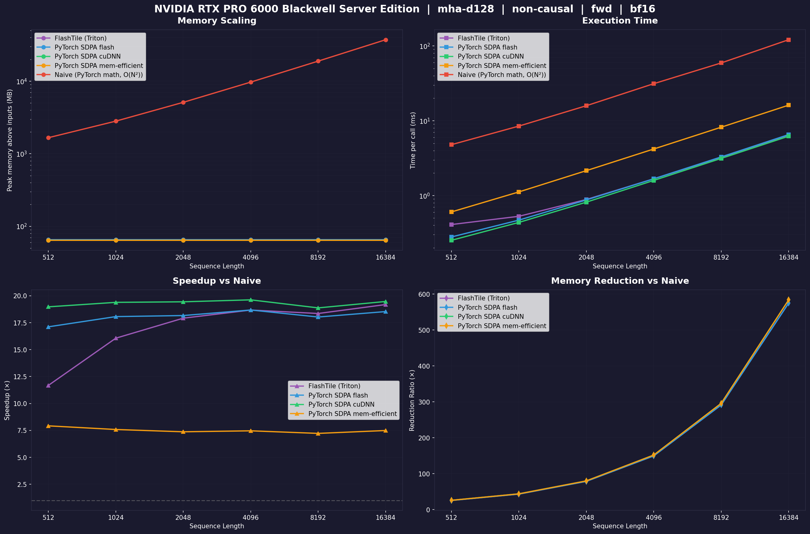
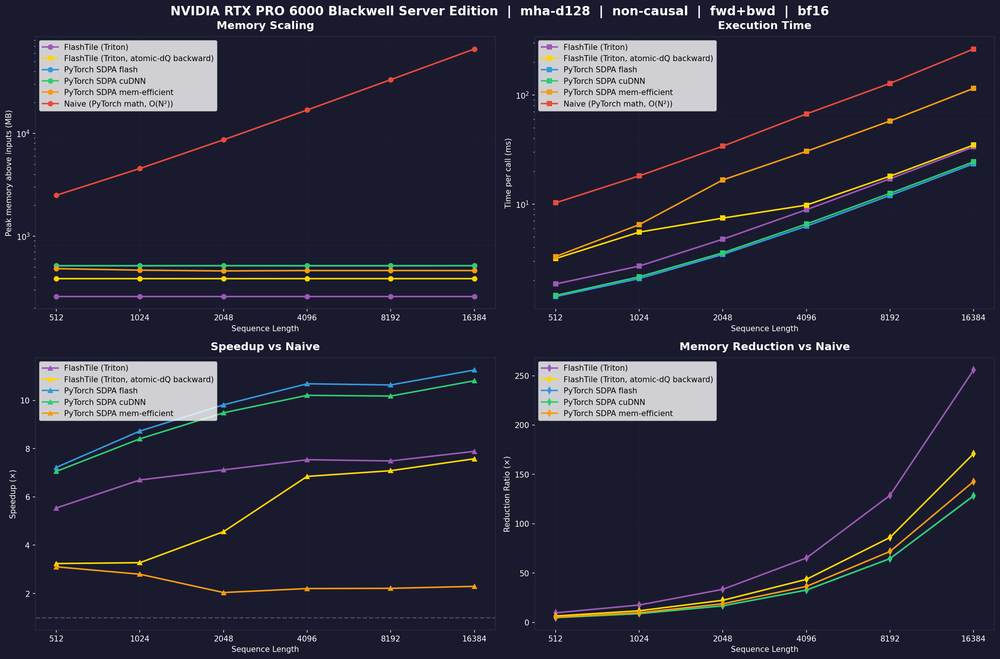
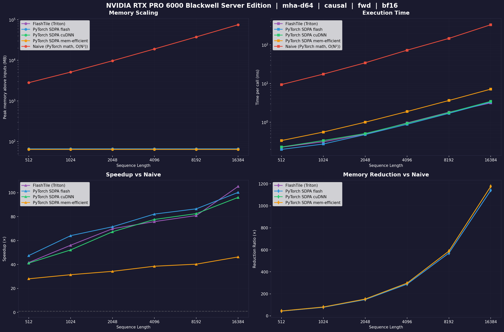
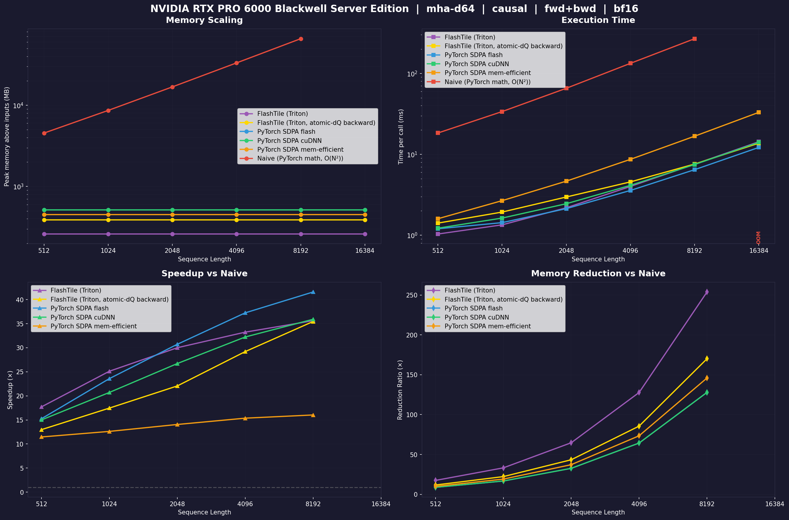
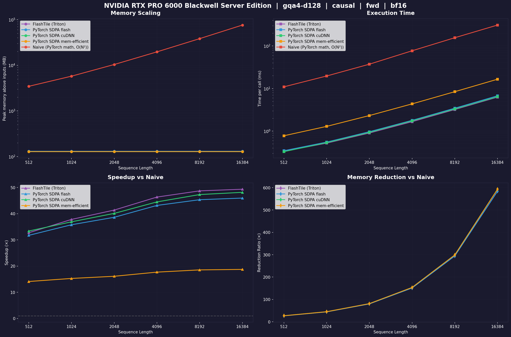
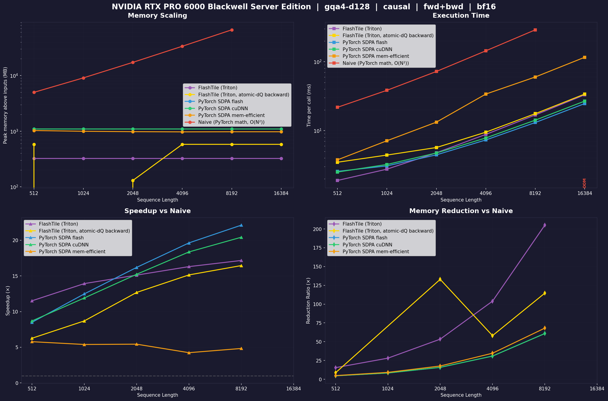
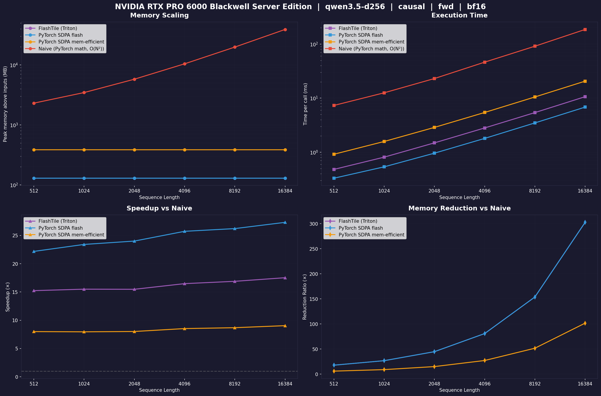
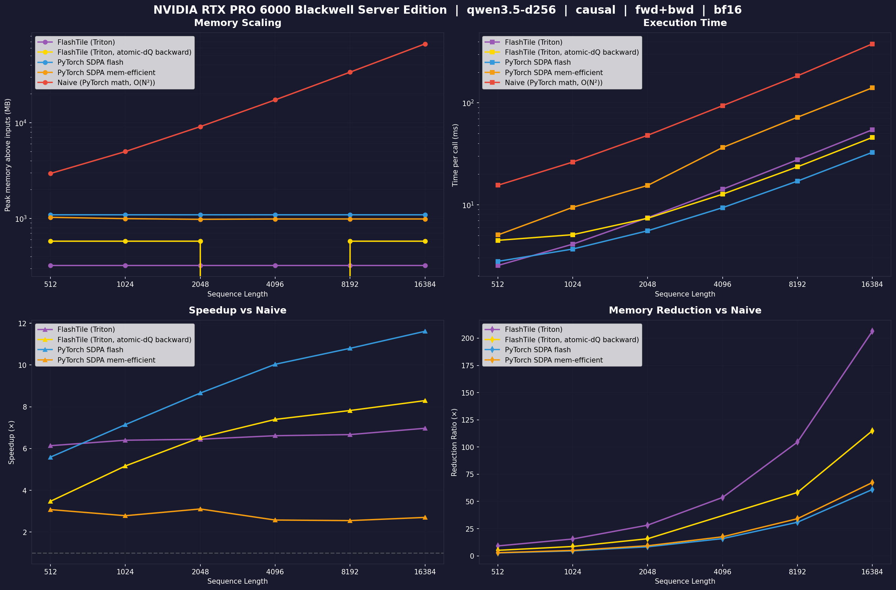

# FlashTile benchmark: NVIDIA RTX PRO 6000 Blackwell Server Edition

- date_utc: 2026-11-17 14:57:15
- gpu: NVIDIA RTX PRO 6000 Blackwell Server Edition
- compute_capability: sm_120
- gpu_memory_gib: 95.0
- sm_count: 188
- python: 3.12.10
- torch: 2.15.0+cu132
- cuda_runtime: 13.2
- cudnn: 92600
- triton: 3.9.0
- provider: Modal
- quick: False

All numbers are measured on this GPU, bf16 inputs, batch x length = 16384 tokens.
Each row passed a parity check against the fp32 dense oracle before it was timed.
Times are per-call medians of >= 20 samples; each sample is >= 2 ms of back-to-back calls between CUDA events.
TFLOP/s uses 4*B*H*L^2*d for the forward (halved, plus the diagonal, for causal) and 3.5x that for fwd+bwd.
`naive` is PyTorch's SDPA MATH backend, which materialises the L x L score table.

## mha-d128, causal=True, fwd

TFLOP/s:

| backend | L=512 | L=1024 | L=2048 | L=4096 | L=8192 | L=16384 |
|---|---:|---:|---:|---:|---:|---:|
| flashtile-triton | 141.7 | 218.6 | 292.0 | 323.2 | 336.7 | 347.0 |
| sdpa-flash | 170.1 | 227.5 | 265.5 | 291.0 | 304.9 | 314.6 |
| sdpa-cudnn | 176.2 | 241.4 | 280.0 | 306.1 | 321.6 | 330.3 |
| sdpa-efficient | 84.3 | 102.2 | 114.8 | 122.0 | 126.6 | 129.3 |
| naive | 6.2 | 6.9 | 7.3 | 6.9 | 7.2 | 7.0 |

Median ms per call:

| backend | L=512 | L=1024 | L=2048 | L=4096 | L=8192 | L=16384 |
|---|---:|---:|---:|---:|---:|---:|
| flashtile-triton | 0.243 | 0.315 | 0.471 | 0.851 | 1.633 | 3.169 |
| sdpa-flash | 0.202 | 0.302 | 0.518 | 0.945 | 1.804 | 3.495 |
| sdpa-cudnn | 0.195 | 0.285 | 0.491 | 0.898 | 1.710 | 3.329 |
| sdpa-efficient | 0.409 | 0.673 | 1.198 | 2.254 | 4.342 | 8.503 |
| naive | 5.526 | 9.941 | 18.762 | 39.787 | 76.762 | 156.742 |

Peak memory above inputs, MiB:

| backend | L=512 | L=1024 | L=2048 | L=4096 | L=8192 | L=16384 |
|---|---:|---:|---:|---:|---:|---:|
| flashtile-triton | 65.0 | 65.0 | 65.0 | 65.0 | 65.0 | 65.0 |
| sdpa-flash | 65.0 | 65.0 | 65.0 | 65.0 | 65.0 | 65.0 |
| sdpa-cudnn | 64.0 | 64.0 | 64.0 | 64.0 | 64.0 | 64.0 |
| sdpa-efficient | 64.0 | 64.0 | 64.0 | 64.0 | 64.0 | 64.0 |
| naive | 1665.3 | 2820.3 | 5136.3 | 9792.3 | 19200.3 | 38400.3 |

Autotuner choice (FlashTile):

- L=512: fwd: `BLOCK_M: 128, BLOCK_N: 32, num_warps: 4, num_ctas: 1, num_stages: 2, maxnreg: None, ir_override: None`
- L=1024: fwd: `BLOCK_M: 128, BLOCK_N: 32, num_warps: 4, num_ctas: 1, num_stages: 2, maxnreg: None, ir_override: None`
- L=2048: fwd: `BLOCK_M: 128, BLOCK_N: 32, num_warps: 4, num_ctas: 1, num_stages: 2, maxnreg: None, ir_override: None`
- L=4096: fwd: `BLOCK_M: 128, BLOCK_N: 32, num_warps: 4, num_ctas: 1, num_stages: 2, maxnreg: None, ir_override: None`
- L=8192: fwd: `BLOCK_M: 128, BLOCK_N: 64, num_warps: 8, num_ctas: 1, num_stages: 3, maxnreg: None, ir_override: None`
- L=16384: fwd: `BLOCK_M: 128, BLOCK_N: 64, num_warps: 8, num_ctas: 1, num_stages: 3, maxnreg: None, ir_override: None`

## mha-d128, causal=True, fwd+bwd

TFLOP/s:

| backend | L=512 | L=1024 | L=2048 | L=4096 | L=8192 | L=16384 |
|---|---:|---:|---:|---:|---:|---:|
| flashtile-triton | 110.5 | 161.2 | 195.9 | 214.9 | 227.2 | 231.1 |
| flashtile-atomic | 64.4 | 85.1 | 129.1 | 185.6 | 208.8 | 222.8 |
| sdpa-flash | 99.2 | 166.9 | 222.6 | 264.9 | 291.9 | 311.0 |
| sdpa-cudnn | 99.1 | 156.9 | 206.4 | 245.1 | 272.7 | 288.4 |
| sdpa-efficient | 58.2 | 68.6 | 55.9 | 62.5 | 66.2 | 67.7 |
| naive | 11.0 | 12.4 | 13.2 | 12.8 | 13.4 | 13.0 |

Median ms per call:

| backend | L=512 | L=1024 | L=2048 | L=4096 | L=8192 | L=16384 |
|---|---:|---:|---:|---:|---:|---:|
| flashtile-triton | 1.090 | 1.493 | 2.456 | 4.478 | 8.470 | 16.650 |
| flashtile-atomic | 1.871 | 2.828 | 3.727 | 5.186 | 9.216 | 17.277 |
| sdpa-flash | 1.214 | 1.443 | 2.162 | 3.633 | 6.593 | 12.375 |
| sdpa-cudnn | 1.216 | 1.534 | 2.332 | 3.926 | 7.057 | 13.346 |
| sdpa-efficient | 2.072 | 3.509 | 8.614 | 15.399 | 29.049 | 56.881 |
| naive | 10.984 | 19.415 | 36.544 | 74.903 | 144.060 | 297.139 |

Peak memory above inputs, MiB:

| backend | L=512 | L=1024 | L=2048 | L=4096 | L=8192 | L=16384 |
|---|---:|---:|---:|---:|---:|---:|
| flashtile-triton | 258.0 | 258.0 | 258.0 | 258.0 | 258.0 | 258.0 |
| flashtile-atomic | 386.0 | 386.0 | 386.0 | 322.0 | 386.0 | 386.0 |
| sdpa-flash | 514.0 | 514.0 | 514.0 | 514.0 | 514.0 | 514.0 |
| sdpa-cudnn | 515.0 | 515.0 | 515.0 | 515.0 | 515.0 | 514.0 |
| sdpa-efficient | 482.1 | 466.1 | 458.1 | 462.1 | 462.1 | 462.1 |
| naive | 2496.0 | 4544.0 | 8640.0 | 16832.0 | 33216.0 | 65984.0 |

Autotuner choice (FlashTile):

- L=512: fwd: `BLOCK_M: 128, BLOCK_N: 32, num_warps: 4, num_ctas: 1, num_stages: 2, maxnreg: None, ir_override: None`; bwd_dkdv: `BLOCK_M: 32, BLOCK_N: 32, num_warps: 4, num_ctas: 1, num_stages: 1, maxnreg: None, ir_override: None`; bwd_dq: `BLOCK_M: 128, BLOCK_N: 32, num_warps: 8, num_ctas: 1, num_stages: 2, maxnreg: None, ir_override: None`
- L=1024: fwd: `BLOCK_M: 128, BLOCK_N: 32, num_warps: 4, num_ctas: 1, num_stages: 2, maxnreg: None, ir_override: None`; bwd_dkdv: `BLOCK_M: 32, BLOCK_N: 32, num_warps: 4, num_ctas: 1, num_stages: 1, maxnreg: None, ir_override: None`; bwd_dq: `BLOCK_M: 128, BLOCK_N: 32, num_warps: 8, num_ctas: 1, num_stages: 2, maxnreg: None, ir_override: None`
- L=2048: fwd: `BLOCK_M: 128, BLOCK_N: 32, num_warps: 4, num_ctas: 1, num_stages: 2, maxnreg: None, ir_override: None`; bwd_dkdv: `BLOCK_M: 32, BLOCK_N: 32, num_warps: 4, num_ctas: 1, num_stages: 1, maxnreg: None, ir_override: None`; bwd_dq: `BLOCK_M: 128, BLOCK_N: 32, num_warps: 8, num_ctas: 1, num_stages: 2, maxnreg: None, ir_override: None`
- L=4096: fwd: `BLOCK_M: 128, BLOCK_N: 32, num_warps: 4, num_ctas: 1, num_stages: 2, maxnreg: None, ir_override: None`; bwd_dkdv: `BLOCK_M: 32, BLOCK_N: 32, num_warps: 4, num_ctas: 1, num_stages: 1, maxnreg: None, ir_override: None`; bwd_dq: `BLOCK_M: 128, BLOCK_N: 32, num_warps: 8, num_ctas: 1, num_stages: 2, maxnreg: None, ir_override: None`
- L=8192: fwd: `BLOCK_M: 128, BLOCK_N: 64, num_warps: 8, num_ctas: 1, num_stages: 3, maxnreg: None, ir_override: None`; bwd_dkdv: `BLOCK_M: 32, BLOCK_N: 32, num_warps: 4, num_ctas: 1, num_stages: 1, maxnreg: None, ir_override: None`; bwd_dq: `BLOCK_M: 128, BLOCK_N: 32, num_warps: 8, num_ctas: 1, num_stages: 2, maxnreg: None, ir_override: None`
- L=16384: fwd: `BLOCK_M: 128, BLOCK_N: 64, num_warps: 8, num_ctas: 1, num_stages: 3, maxnreg: None, ir_override: None`; bwd_dkdv: `BLOCK_M: 32, BLOCK_N: 32, num_warps: 4, num_ctas: 1, num_stages: 1, maxnreg: None, ir_override: None`; bwd_dq: `BLOCK_M: 128, BLOCK_N: 32, num_warps: 8, num_ctas: 1, num_stages: 2, maxnreg: None, ir_override: None`

## mha-d128, causal=False, fwd

TFLOP/s:

| backend | L=512 | L=1024 | L=2048 | L=4096 | L=8192 | L=16384 |
|---|---:|---:|---:|---:|---:|---:|
| flashtile-triton | 167.7 | 260.2 | 310.4 | 328.1 | 340.6 | 348.5 |
| sdpa-flash | 245.8 | 292.7 | 314.6 | 328.2 | 334.5 | 336.7 |
| sdpa-cudnn | 272.4 | 314.2 | 336.7 | 344.7 | 350.3 | 353.7 |
| sdpa-efficient | 113.8 | 122.9 | 127.7 | 131.1 | 134.1 | 136.1 |
| naive | 14.4 | 16.2 | 17.3 | 17.6 | 18.6 | 18.2 |

Median ms per call:

| backend | L=512 | L=1024 | L=2048 | L=4096 | L=8192 | L=16384 |
|---|---:|---:|---:|---:|---:|---:|
| flashtile-triton | 0.410 | 0.528 | 0.886 | 1.676 | 3.228 | 6.309 |
| sdpa-flash | 0.280 | 0.470 | 0.874 | 1.675 | 3.287 | 6.532 |
| sdpa-cudnn | 0.252 | 0.437 | 0.816 | 1.595 | 3.139 | 6.217 |
| sdpa-efficient | 0.604 | 1.118 | 2.152 | 4.192 | 8.201 | 16.156 |
| naive | 4.786 | 8.483 | 15.870 | 31.292 | 59.252 | 121.053 |

Peak memory above inputs, MiB:

| backend | L=512 | L=1024 | L=2048 | L=4096 | L=8192 | L=16384 |
|---|---:|---:|---:|---:|---:|---:|
| flashtile-triton | 65.0 | 65.0 | 65.0 | 65.0 | 65.0 | 65.0 |
| sdpa-flash | 65.0 | 65.0 | 65.0 | 65.0 | 65.0 | 65.0 |
| sdpa-cudnn | 64.0 | 64.0 | 64.0 | 64.0 | 64.0 | 64.0 |
| sdpa-efficient | 64.0 | 64.0 | 64.0 | 64.0 | 64.0 | 64.0 |
| naive | 1664.3 | 2816.3 | 5120.3 | 9728.3 | 18944.3 | 37376.3 |

Autotuner choice (FlashTile):

- L=512: fwd: `BLOCK_M: 128, BLOCK_N: 32, num_warps: 4, num_ctas: 1, num_stages: 2, maxnreg: None, ir_override: None`
- L=1024: fwd: `BLOCK_M: 128, BLOCK_N: 64, num_warps: 8, num_ctas: 1, num_stages: 3, maxnreg: None, ir_override: None`
- L=2048: fwd: `BLOCK_M: 128, BLOCK_N: 32, num_warps: 4, num_ctas: 1, num_stages: 2, maxnreg: None, ir_override: None`
- L=4096: fwd: `BLOCK_M: 128, BLOCK_N: 64, num_warps: 8, num_ctas: 1, num_stages: 3, maxnreg: None, ir_override: None`
- L=8192: fwd: `BLOCK_M: 128, BLOCK_N: 64, num_warps: 8, num_ctas: 1, num_stages: 3, maxnreg: None, ir_override: None`
- L=16384: fwd: `BLOCK_M: 128, BLOCK_N: 64, num_warps: 8, num_ctas: 1, num_stages: 3, maxnreg: None, ir_override: None`

## mha-d128, causal=False, fwd+bwd

TFLOP/s:

| backend | L=512 | L=1024 | L=2048 | L=4096 | L=8192 | L=16384 |
|---|---:|---:|---:|---:|---:|---:|
| flashtile-triton | 129.9 | 178.0 | 202.0 | 216.7 | 226.0 | 230.6 |
| flashtile-atomic | 76.0 | 87.0 | 129.4 | 196.9 | 213.8 | 221.6 |
| sdpa-flash | 169.4 | 231.9 | 278.6 | 307.1 | 321.0 | 329.1 |
| sdpa-cudnn | 165.5 | 223.3 | 269.2 | 293.4 | 307.1 | 316.1 |
| sdpa-efficient | 72.8 | 74.3 | 57.8 | 63.3 | 66.8 | 67.1 |
| naive | 23.4 | 26.6 | 28.4 | 28.7 | 30.2 | 29.2 |

Median ms per call:

| backend | L=512 | L=1024 | L=2048 | L=4096 | L=8192 | L=16384 |
|---|---:|---:|---:|---:|---:|---:|
| flashtile-triton | 1.851 | 2.702 | 4.762 | 8.878 | 17.028 | 33.377 |
| flashtile-atomic | 3.167 | 5.529 | 7.435 | 9.775 | 17.998 | 34.733 |
| sdpa-flash | 1.420 | 2.075 | 3.454 | 6.265 | 11.989 | 23.388 |
| sdpa-cudnn | 1.453 | 2.154 | 3.574 | 6.558 | 12.531 | 24.349 |
| sdpa-efficient | 3.305 | 6.475 | 16.631 | 30.393 | 57.648 | 114.745 |
| naive | 10.258 | 18.111 | 33.904 | 66.953 | 127.550 | 263.287 |

Peak memory above inputs, MiB:

| backend | L=512 | L=1024 | L=2048 | L=4096 | L=8192 | L=16384 |
|---|---:|---:|---:|---:|---:|---:|
| flashtile-triton | 258.0 | 258.0 | 258.0 | 258.0 | 258.0 | 258.0 |
| flashtile-atomic | 386.0 | 386.0 | 386.0 | 386.0 | 386.0 | 386.0 |
| sdpa-flash | 514.0 | 514.0 | 514.0 | 514.0 | 514.0 | 514.0 |
| sdpa-cudnn | 514.0 | 514.0 | 515.0 | 514.0 | 514.0 | 515.0 |
| sdpa-efficient | 482.1 | 466.1 | 458.1 | 462.1 | 462.1 | 462.1 |
| naive | 2496.0 | 4544.0 | 8640.0 | 16832.0 | 33216.0 | 65984.0 |

Autotuner choice (FlashTile):

- L=512: fwd: `BLOCK_M: 128, BLOCK_N: 32, num_warps: 4, num_ctas: 1, num_stages: 2, maxnreg: None, ir_override: None`; bwd_dkdv: `BLOCK_M: 32, BLOCK_N: 64, num_warps: 4, num_ctas: 1, num_stages: 2, maxnreg: None, ir_override: None`; bwd_dq: `BLOCK_M: 128, BLOCK_N: 32, num_warps: 8, num_ctas: 1, num_stages: 2, maxnreg: None, ir_override: None`
- L=1024: fwd: `BLOCK_M: 128, BLOCK_N: 64, num_warps: 8, num_ctas: 1, num_stages: 3, maxnreg: None, ir_override: None`; bwd_dkdv: `BLOCK_M: 32, BLOCK_N: 64, num_warps: 4, num_ctas: 1, num_stages: 2, maxnreg: None, ir_override: None`; bwd_dq: `BLOCK_M: 128, BLOCK_N: 32, num_warps: 8, num_ctas: 1, num_stages: 2, maxnreg: None, ir_override: None`
- L=2048: fwd: `BLOCK_M: 128, BLOCK_N: 32, num_warps: 4, num_ctas: 1, num_stages: 2, maxnreg: None, ir_override: None`; bwd_dkdv: `BLOCK_M: 32, BLOCK_N: 32, num_warps: 4, num_ctas: 1, num_stages: 1, maxnreg: None, ir_override: None`; bwd_dq: `BLOCK_M: 128, BLOCK_N: 64, num_warps: 8, num_ctas: 1, num_stages: 2, maxnreg: None, ir_override: None`
- L=4096: fwd: `BLOCK_M: 128, BLOCK_N: 64, num_warps: 8, num_ctas: 1, num_stages: 3, maxnreg: None, ir_override: None`; bwd_dkdv: `BLOCK_M: 32, BLOCK_N: 32, num_warps: 4, num_ctas: 1, num_stages: 1, maxnreg: None, ir_override: None`; bwd_dq: `BLOCK_M: 128, BLOCK_N: 64, num_warps: 8, num_ctas: 1, num_stages: 2, maxnreg: None, ir_override: None`
- L=8192: fwd: `BLOCK_M: 128, BLOCK_N: 64, num_warps: 8, num_ctas: 1, num_stages: 3, maxnreg: None, ir_override: None`; bwd_dkdv: `BLOCK_M: 32, BLOCK_N: 32, num_warps: 4, num_ctas: 1, num_stages: 1, maxnreg: None, ir_override: None`; bwd_dq: `BLOCK_M: 128, BLOCK_N: 64, num_warps: 8, num_ctas: 1, num_stages: 2, maxnreg: None, ir_override: None`
- L=16384: fwd: `BLOCK_M: 128, BLOCK_N: 64, num_warps: 8, num_ctas: 1, num_stages: 3, maxnreg: None, ir_override: None`; bwd_dkdv: `BLOCK_M: 32, BLOCK_N: 32, num_warps: 4, num_ctas: 1, num_stages: 1, maxnreg: None, ir_override: None`; bwd_dq: `BLOCK_M: 128, BLOCK_N: 64, num_warps: 8, num_ctas: 1, num_stages: 2, maxnreg: None, ir_override: None`

## mha-d64, causal=True, fwd

TFLOP/s:

| backend | L=512 | L=1024 | L=2048 | L=4096 | L=8192 | L=16384 |
|---|---:|---:|---:|---:|---:|---:|
| flashtile-triton | 152.2 | 219.8 | 279.5 | 286.4 | 302.7 | 348.1 |
| sdpa-flash | 173.4 | 251.2 | 286.0 | 310.3 | 323.7 | 331.7 |
| sdpa-cudnn | 150.5 | 204.4 | 269.4 | 293.2 | 308.7 | 317.8 |
| sdpa-efficient | 102.4 | 123.3 | 137.1 | 145.6 | 150.7 | 153.2 |
| naive | 3.7 | 3.9 | 4.0 | 3.8 | 3.7 | 3.3 |

Median ms per call:

| backend | L=512 | L=1024 | L=2048 | L=4096 | L=8192 | L=16384 |
|---|---:|---:|---:|---:|---:|---:|
| flashtile-triton | 0.226 | 0.313 | 0.492 | 0.960 | 1.817 | 3.159 |
| sdpa-flash | 0.199 | 0.274 | 0.481 | 0.886 | 1.699 | 3.315 |
| sdpa-cudnn | 0.229 | 0.336 | 0.510 | 0.938 | 1.781 | 3.460 |
| sdpa-efficient | 0.336 | 0.558 | 1.003 | 1.888 | 3.649 | 7.180 |
| naive | 9.425 | 17.563 | 34.398 | 72.805 | 146.985 | 332.501 |

Peak memory above inputs, MiB:

| backend | L=512 | L=1024 | L=2048 | L=4096 | L=8192 | L=16384 |
|---|---:|---:|---:|---:|---:|---:|
| flashtile-triton | 66.0 | 66.0 | 66.0 | 66.0 | 66.0 | 66.0 |
| sdpa-flash | 66.0 | 66.0 | 66.0 | 66.0 | 66.0 | 66.0 |
| sdpa-cudnn | 64.0 | 64.0 | 64.0 | 64.0 | 64.0 | 64.0 |
| sdpa-efficient | 64.0 | 64.0 | 64.0 | 64.0 | 64.0 | 64.0 |
| naive | 2817.5 | 5124.5 | 9744.5 | 19008.5 | 37632.5 | 75264.5 |

Autotuner choice (FlashTile):

- L=512: fwd: `BLOCK_M: 64, BLOCK_N: 32, num_warps: 4, num_ctas: 1, num_stages: 2, maxnreg: None, ir_override: None`
- L=1024: fwd: `BLOCK_M: 128, BLOCK_N: 32, num_warps: 4, num_ctas: 1, num_stages: 2, maxnreg: None, ir_override: None`
- L=2048: fwd: `BLOCK_M: 128, BLOCK_N: 64, num_warps: 4, num_ctas: 1, num_stages: 3, maxnreg: None, ir_override: None`
- L=4096: fwd: `BLOCK_M: 64, BLOCK_N: 64, num_warps: 4, num_ctas: 1, num_stages: 3, maxnreg: None, ir_override: None`
- L=8192: fwd: `BLOCK_M: 64, BLOCK_N: 64, num_warps: 4, num_ctas: 1, num_stages: 3, maxnreg: None, ir_override: None`
- L=16384: fwd: `BLOCK_M: 128, BLOCK_N: 64, num_warps: 4, num_ctas: 1, num_stages: 3, maxnreg: None, ir_override: None`

## mha-d64, causal=True, fwd+bwd

TFLOP/s:

| backend | L=512 | L=1024 | L=2048 | L=4096 | L=8192 | L=16384 |
|---|---:|---:|---:|---:|---:|---:|
| flashtile-triton | 116.4 | 179.1 | 220.4 | 239.9 | 255.0 | 268.8 |
| flashtile-atomic | 85.3 | 124.5 | 162.1 | 210.7 | 253.8 | 280.0 |
| sdpa-flash | 100.2 | 168.2 | 225.6 | 268.8 | 297.7 | 316.1 |
| sdpa-cudnn | 98.6 | 147.7 | 196.2 | 232.7 | 257.1 | 273.5 |
| sdpa-efficient | 75.3 | 90.0 | 103.2 | 110.9 | 114.8 | 116.5 |
| naive | 6.6 | 7.1 | 7.3 | 7.2 | 7.2 | oom |

Median ms per call:

| backend | L=512 | L=1024 | L=2048 | L=4096 | L=8192 | L=16384 |
|---|---:|---:|---:|---:|---:|---:|
| flashtile-triton | 1.035 | 1.344 | 2.184 | 4.011 | 7.547 | 14.318 |
| flashtile-atomic | 1.413 | 1.934 | 2.969 | 4.566 | 7.583 | 13.744 |
| sdpa-flash | 1.202 | 1.431 | 2.133 | 3.579 | 6.465 | 12.174 |
| sdpa-cudnn | 1.222 | 1.630 | 2.453 | 4.136 | 7.486 | 14.073 |
| sdpa-efficient | 1.600 | 2.676 | 4.661 | 8.675 | 16.765 | 33.040 |
| naive | 18.347 | 33.769 | 65.517 | 133.304 | 268.780 | oom |

Peak memory above inputs, MiB:

| backend | L=512 | L=1024 | L=2048 | L=4096 | L=8192 | L=16384 |
|---|---:|---:|---:|---:|---:|---:|
| flashtile-triton | 260.0 | 260.0 | 260.0 | 260.0 | 260.0 | 260.0 |
| flashtile-atomic | 388.0 | 388.0 | 388.0 | 388.0 | 388.0 | 388.0 |
| sdpa-flash | 516.0 | 516.0 | 516.0 | 516.0 | 516.0 | 516.0 |
| sdpa-cudnn | 516.0 | 516.0 | 516.0 | 516.0 | 516.0 | 516.0 |
| sdpa-efficient | 452.1 | 452.1 | 452.1 | 452.1 | 452.1 | 452.1 |
| naive | 4544.0 | 8640.0 | 16832.0 | 33216.0 | 65984.0 | oom |

Autotuner choice (FlashTile):

- L=512: fwd: `BLOCK_M: 64, BLOCK_N: 32, num_warps: 4, num_ctas: 1, num_stages: 2, maxnreg: None, ir_override: None`; bwd_dkdv: `BLOCK_M: 64, BLOCK_N: 64, num_warps: 4, num_ctas: 1, num_stages: 2, maxnreg: None, ir_override: None`; bwd_dq: `BLOCK_M: 64, BLOCK_N: 32, num_warps: 4, num_ctas: 1, num_stages: 2, maxnreg: None, ir_override: None`
- L=1024: fwd: `BLOCK_M: 128, BLOCK_N: 32, num_warps: 4, num_ctas: 1, num_stages: 2, maxnreg: None, ir_override: None`; bwd_dkdv: `BLOCK_M: 64, BLOCK_N: 64, num_warps: 4, num_ctas: 1, num_stages: 2, maxnreg: None, ir_override: None`; bwd_dq: `BLOCK_M: 64, BLOCK_N: 64, num_warps: 4, num_ctas: 1, num_stages: 2, maxnreg: None, ir_override: None`
- L=2048: fwd: `BLOCK_M: 128, BLOCK_N: 64, num_warps: 4, num_ctas: 1, num_stages: 3, maxnreg: None, ir_override: None`; bwd_dkdv: `BLOCK_M: 64, BLOCK_N: 64, num_warps: 4, num_ctas: 1, num_stages: 2, maxnreg: None, ir_override: None`; bwd_dq: `BLOCK_M: 64, BLOCK_N: 32, num_warps: 4, num_ctas: 1, num_stages: 2, maxnreg: None, ir_override: None`
- L=4096: fwd: `BLOCK_M: 64, BLOCK_N: 64, num_warps: 4, num_ctas: 1, num_stages: 3, maxnreg: None, ir_override: None`; bwd_dkdv: `BLOCK_M: 64, BLOCK_N: 64, num_warps: 4, num_ctas: 1, num_stages: 2, maxnreg: None, ir_override: None`; bwd_dq: `BLOCK_M: 64, BLOCK_N: 64, num_warps: 4, num_ctas: 1, num_stages: 2, maxnreg: None, ir_override: None`
- L=8192: fwd: `BLOCK_M: 64, BLOCK_N: 64, num_warps: 4, num_ctas: 1, num_stages: 3, maxnreg: None, ir_override: None`; bwd_dkdv: `BLOCK_M: 64, BLOCK_N: 64, num_warps: 4, num_ctas: 1, num_stages: 2, maxnreg: None, ir_override: None`; bwd_dq: `BLOCK_M: 64, BLOCK_N: 32, num_warps: 4, num_ctas: 1, num_stages: 2, maxnreg: None, ir_override: None`
- L=16384: fwd: `BLOCK_M: 128, BLOCK_N: 64, num_warps: 4, num_ctas: 1, num_stages: 3, maxnreg: None, ir_override: None`; bwd_dkdv: `BLOCK_M: 64, BLOCK_N: 64, num_warps: 4, num_ctas: 1, num_stages: 2, maxnreg: None, ir_override: None`; bwd_dq: `BLOCK_M: 64, BLOCK_N: 32, num_warps: 4, num_ctas: 1, num_stages: 2, maxnreg: None, ir_override: None`

## gqa4-d128, causal=True, fwd

TFLOP/s:

| backend | L=512 | L=1024 | L=2048 | L=4096 | L=8192 | L=16384 |
|---|---:|---:|---:|---:|---:|---:|
| flashtile-triton | 205.5 | 264.1 | 305.3 | 330.7 | 342.9 | 350.1 |
| sdpa-flash | 199.3 | 249.9 | 284.9 | 307.9 | 319.1 | 326.2 |
| sdpa-cudnn | 209.6 | 257.8 | 295.9 | 317.5 | 333.0 | 341.7 |
| sdpa-efficient | 88.6 | 106.7 | 118.8 | 126.2 | 130.5 | 132.9 |
| naive | 6.3 | 7.0 | 7.4 | 7.1 | 7.0 | 7.1 |

Median ms per call:

| backend | L=512 | L=1024 | L=2048 | L=4096 | L=8192 | L=16384 |
|---|---:|---:|---:|---:|---:|---:|
| flashtile-triton | 0.335 | 0.521 | 0.901 | 1.663 | 3.207 | 6.282 |
| sdpa-flash | 0.346 | 0.550 | 0.965 | 1.786 | 3.446 | 6.743 |
| sdpa-cudnn | 0.328 | 0.534 | 0.929 | 1.732 | 3.303 | 6.436 |
| sdpa-efficient | 0.777 | 1.289 | 2.315 | 4.357 | 8.427 | 16.550 |
| naive | 10.965 | 19.696 | 37.289 | 77.078 | 156.257 | 309.965 |

Peak memory above inputs, MiB:

| backend | L=512 | L=1024 | L=2048 | L=4096 | L=8192 | L=16384 |
|---|---:|---:|---:|---:|---:|---:|
| flashtile-triton | 130.0 | 130.0 | 130.0 | 130.0 | 130.0 | 130.0 |
| sdpa-flash | 130.0 | 130.0 | 130.0 | 130.0 | 130.0 | 130.0 |
| sdpa-cudnn | 128.0 | 128.0 | 128.0 | 128.0 | 128.0 | 128.0 |
| sdpa-efficient | 128.0 | 128.0 | 128.0 | 128.0 | 128.0 | 128.0 |
| naive | 3457.5 | 5764.5 | 10384.5 | 19648.5 | 38272.5 | 75904.5 |

Autotuner choice (FlashTile):

- L=512: fwd: `BLOCK_M: 128, BLOCK_N: 32, num_warps: 4, num_ctas: 1, num_stages: 2, maxnreg: None, ir_override: None`
- L=1024: fwd: `BLOCK_M: 128, BLOCK_N: 32, num_warps: 4, num_ctas: 1, num_stages: 2, maxnreg: None, ir_override: None`
- L=2048: fwd: `BLOCK_M: 128, BLOCK_N: 32, num_warps: 4, num_ctas: 1, num_stages: 2, maxnreg: None, ir_override: None`
- L=4096: fwd: `BLOCK_M: 128, BLOCK_N: 32, num_warps: 4, num_ctas: 1, num_stages: 2, maxnreg: None, ir_override: None`
- L=8192: fwd: `BLOCK_M: 128, BLOCK_N: 32, num_warps: 4, num_ctas: 1, num_stages: 2, maxnreg: None, ir_override: None`
- L=16384: fwd: `BLOCK_M: 128, BLOCK_N: 32, num_warps: 4, num_ctas: 1, num_stages: 2, maxnreg: None, ir_override: None`

## gqa4-d128, causal=True, fwd+bwd

TFLOP/s:

| backend | L=512 | L=1024 | L=2048 | L=4096 | L=8192 | L=16384 |
|---|---:|---:|---:|---:|---:|---:|
| flashtile-triton | 127.2 | 174.3 | 201.5 | 218.1 | 227.8 | 232.6 |
| flashtile-atomic | 69.2 | 108.9 | 169.2 | 202.5 | 218.3 | 226.7 |
| sdpa-flash | 93.9 | 156.2 | 216.0 | 262.5 | 293.4 | 311.4 |
| sdpa-cudnn | 96.0 | 149.1 | 203.1 | 245.6 | 271.0 | 286.7 |
| sdpa-efficient | 63.9 | 67.5 | 72.5 | 56.7 | 64.1 | 66.3 |
| naive | 11.1 | 12.5 | 13.3 | 13.4 | 13.3 | oom |

Median ms per call:

| backend | L=512 | L=1024 | L=2048 | L=4096 | L=8192 | L=16384 |
|---|---:|---:|---:|---:|---:|---:|
| flashtile-triton | 1.894 | 2.763 | 4.776 | 8.826 | 16.898 | 33.085 |
| flashtile-atomic | 3.481 | 4.423 | 5.690 | 9.504 | 17.634 | 33.954 |
| sdpa-flash | 2.566 | 3.082 | 4.457 | 7.331 | 13.117 | 24.718 |
| sdpa-cudnn | 2.509 | 3.230 | 4.739 | 7.837 | 14.204 | 26.849 |
| sdpa-efficient | 3.772 | 7.134 | 13.285 | 33.928 | 60.036 | 116.061 |
| naive | 21.804 | 38.460 | 72.163 | 143.868 | 289.996 | oom |

Peak memory above inputs, MiB:

| backend | L=512 | L=1024 | L=2048 | L=4096 | L=8192 | L=16384 |
|---|---:|---:|---:|---:|---:|---:|
| flashtile-triton | 324.0 | 324.0 | 324.0 | 324.0 | 324.0 | 324.0 |
| flashtile-atomic | 580.0 | 0.0 | 130.0 | 580.0 | 580.0 | 580.0 |
| sdpa-flash | 1092.0 | 1092.0 | 1092.0 | 1092.0 | 1092.0 | 1092.0 |
| sdpa-cudnn | 1092.0 | 1092.0 | 1092.0 | 1092.0 | 1092.0 | 1092.0 |
| sdpa-efficient | 1028.3 | 996.3 | 980.3 | 972.3 | 976.3 | 976.3 |
| naive | 4992.0 | 9088.0 | 17280.0 | 33664.0 | 66432.0 | oom |

Autotuner choice (FlashTile):

- L=512: fwd: `BLOCK_M: 128, BLOCK_N: 32, num_warps: 4, num_ctas: 1, num_stages: 2, maxnreg: None, ir_override: None`; bwd_dkdv: `BLOCK_M: 32, BLOCK_N: 64, num_warps: 4, num_ctas: 1, num_stages: 2, maxnreg: None, ir_override: None`; bwd_dq: `BLOCK_M: 32, BLOCK_N: 32, num_warps: 4, num_ctas: 1, num_stages: 1, maxnreg: None, ir_override: None`
- L=1024: fwd: `BLOCK_M: 128, BLOCK_N: 32, num_warps: 4, num_ctas: 1, num_stages: 2, maxnreg: None, ir_override: None`; bwd_dkdv: `BLOCK_M: 32, BLOCK_N: 32, num_warps: 4, num_ctas: 1, num_stages: 1, maxnreg: None, ir_override: None`; bwd_dq: `BLOCK_M: 128, BLOCK_N: 32, num_warps: 8, num_ctas: 1, num_stages: 2, maxnreg: None, ir_override: None`
- L=2048: fwd: `BLOCK_M: 128, BLOCK_N: 32, num_warps: 4, num_ctas: 1, num_stages: 2, maxnreg: None, ir_override: None`; bwd_dkdv: `BLOCK_M: 32, BLOCK_N: 32, num_warps: 4, num_ctas: 1, num_stages: 1, maxnreg: None, ir_override: None`; bwd_dq: `BLOCK_M: 128, BLOCK_N: 32, num_warps: 8, num_ctas: 1, num_stages: 2, maxnreg: None, ir_override: None`
- L=4096: fwd: `BLOCK_M: 128, BLOCK_N: 32, num_warps: 4, num_ctas: 1, num_stages: 2, maxnreg: None, ir_override: None`; bwd_dkdv: `BLOCK_M: 32, BLOCK_N: 32, num_warps: 4, num_ctas: 1, num_stages: 1, maxnreg: None, ir_override: None`; bwd_dq: `BLOCK_M: 128, BLOCK_N: 32, num_warps: 8, num_ctas: 1, num_stages: 2, maxnreg: None, ir_override: None`
- L=8192: fwd: `BLOCK_M: 128, BLOCK_N: 32, num_warps: 4, num_ctas: 1, num_stages: 2, maxnreg: None, ir_override: None`; bwd_dkdv: `BLOCK_M: 32, BLOCK_N: 32, num_warps: 4, num_ctas: 1, num_stages: 1, maxnreg: None, ir_override: None`; bwd_dq: `BLOCK_M: 128, BLOCK_N: 32, num_warps: 8, num_ctas: 1, num_stages: 2, maxnreg: None, ir_override: None`
- L=16384: fwd: `BLOCK_M: 128, BLOCK_N: 32, num_warps: 4, num_ctas: 1, num_stages: 2, maxnreg: None, ir_override: None`; bwd_dkdv: `BLOCK_M: 32, BLOCK_N: 32, num_warps: 4, num_ctas: 1, num_stages: 1, maxnreg: None, ir_override: None`; bwd_dq: `BLOCK_M: 128, BLOCK_N: 32, num_warps: 8, num_ctas: 1, num_stages: 2, maxnreg: None, ir_override: None`

## qwen3.5-d256, causal=True, fwd

TFLOP/s:

| backend | L=512 | L=1024 | L=2048 | L=4096 | L=8192 | L=16384 |
|---|---:|---:|---:|---:|---:|---:|
| flashtile-triton | 143.2 | 169.8 | 184.8 | 195.7 | 203.5 | 206.7 |
| sdpa-flash | 208.4 | 256.5 | 286.6 | 305.6 | 315.9 | 322.2 |
| sdpa-cudnn | unsupported | unsupported | unsupported | unsupported | unsupported | unsupported |
| sdpa-efficient | 75.1 | 87.1 | 95.6 | 101.3 | 104.6 | 106.7 |
| naive | 9.4 | 11.0 | 11.9 | 11.9 | 12.0 | 11.8 |

Median ms per call:

| backend | L=512 | L=1024 | L=2048 | L=4096 | L=8192 | L=16384 |
|---|---:|---:|---:|---:|---:|---:|
| flashtile-triton | 0.481 | 0.810 | 1.489 | 2.810 | 5.404 | 10.638 |
| sdpa-flash | 0.330 | 0.536 | 0.960 | 1.799 | 3.481 | 6.825 |
| sdpa-cudnn | unsupported | unsupported | unsupported | unsupported | unsupported | unsupported |
| sdpa-efficient | 0.917 | 1.579 | 2.875 | 5.431 | 10.512 | 20.615 |
| naive | 7.328 | 12.556 | 23.037 | 46.306 | 91.267 | 186.441 |

Peak memory above inputs, MiB:

| backend | L=512 | L=1024 | L=2048 | L=4096 | L=8192 | L=16384 |
|---|---:|---:|---:|---:|---:|---:|
| flashtile-triton | 129.0 | 129.0 | 129.0 | 129.0 | 129.0 | 129.0 |
| sdpa-flash | 129.0 | 129.0 | 129.0 | 129.0 | 129.0 | 129.0 |
| sdpa-cudnn | unsupported | unsupported | unsupported | unsupported | unsupported | unsupported |
| sdpa-efficient | 384.0 | 384.0 | 384.0 | 384.0 | 384.0 | 384.0 |
| naive | 2305.3 | 3460.3 | 5776.3 | 10432.3 | 19840.3 | 39040.3 |

Autotuner choice (FlashTile):

- L=512: fwd: `BLOCK_M: 64, BLOCK_N: 32, num_warps: 4, num_ctas: 1, num_stages: 2, maxnreg: None, ir_override: None`
- L=1024: fwd: `BLOCK_M: 64, BLOCK_N: 32, num_warps: 4, num_ctas: 1, num_stages: 2, maxnreg: None, ir_override: None`
- L=2048: fwd: `BLOCK_M: 64, BLOCK_N: 32, num_warps: 4, num_ctas: 1, num_stages: 2, maxnreg: None, ir_override: None`
- L=4096: fwd: `BLOCK_M: 64, BLOCK_N: 32, num_warps: 4, num_ctas: 1, num_stages: 2, maxnreg: None, ir_override: None`
- L=8192: fwd: `BLOCK_M: 64, BLOCK_N: 32, num_warps: 4, num_ctas: 1, num_stages: 2, maxnreg: None, ir_override: None`
- L=16384: fwd: `BLOCK_M: 64, BLOCK_N: 32, num_warps: 4, num_ctas: 1, num_stages: 2, maxnreg: None, ir_override: None`

## qwen3.5-d256, causal=True, fwd+bwd

TFLOP/s:

| backend | L=512 | L=1024 | L=2048 | L=4096 | L=8192 | L=16384 |
|---|---:|---:|---:|---:|---:|---:|
| flashtile-triton | 95.3 | 117.4 | 129.2 | 135.7 | 139.4 | 141.3 |
| flashtile-atomic | 53.9 | 94.8 | 130.8 | 151.7 | 163.5 | 168.2 |
| sdpa-flash | 86.8 | 131.2 | 173.5 | 205.9 | 225.7 | 235.5 |
| sdpa-cudnn | unsupported | unsupported | unsupported | unsupported | unsupported | unsupported |
| sdpa-efficient | 47.7 | 51.1 | 62.2 | 52.8 | 53.3 | 54.8 |
| naive | 15.5 | 18.4 | 20.0 | 20.5 | 20.9 | 20.3 |

Median ms per call:

| backend | L=512 | L=1024 | L=2048 | L=4096 | L=8192 | L=16384 |
|---|---:|---:|---:|---:|---:|---:|
| flashtile-triton | 2.530 | 4.100 | 7.451 | 14.183 | 27.619 | 54.456 |
| flashtile-atomic | 4.469 | 5.078 | 7.361 | 12.684 | 23.546 | 45.756 |
| sdpa-flash | 2.777 | 3.671 | 5.549 | 9.347 | 17.054 | 32.678 |
| sdpa-cudnn | unsupported | unsupported | unsupported | unsupported | unsupported | unsupported |
| sdpa-efficient | 5.048 | 9.426 | 15.467 | 36.424 | 72.267 | 140.515 |
| naive | 15.525 | 26.236 | 48.041 | 93.813 | 184.191 | 379.599 |

Peak memory above inputs, MiB:

| backend | L=512 | L=1024 | L=2048 | L=4096 | L=8192 | L=16384 |
|---|---:|---:|---:|---:|---:|---:|
| flashtile-triton | 322.0 | 322.0 | 322.0 | 322.0 | 322.0 | 322.0 |
| flashtile-atomic | 578.0 | 578.0 | 578.0 | 0.0 | 578.0 | 578.0 |
| sdpa-flash | 1090.0 | 1090.0 | 1090.0 | 1090.0 | 1090.0 | 1090.0 |
| sdpa-cudnn | unsupported | unsupported | unsupported | unsupported | unsupported | unsupported |
| sdpa-efficient | 1026.1 | 994.1 | 978.1 | 986.1 | 986.1 | 986.1 |
| naive | 2944.0 | 4992.0 | 9088.0 | 17280.0 | 33664.0 | 66432.0 |

Autotuner choice (FlashTile):

- L=512: fwd: `BLOCK_M: 64, BLOCK_N: 32, num_warps: 4, num_ctas: 1, num_stages: 2, maxnreg: None, ir_override: None`; bwd_dkdv: `BLOCK_M: 32, BLOCK_N: 32, num_warps: 4, num_ctas: 1, num_stages: 1, maxnreg: None, ir_override: None`; bwd_dq: `BLOCK_M: 32, BLOCK_N: 32, num_warps: 4, num_ctas: 1, num_stages: 1, maxnreg: None, ir_override: None`
- L=1024: fwd: `BLOCK_M: 64, BLOCK_N: 32, num_warps: 4, num_ctas: 1, num_stages: 2, maxnreg: None, ir_override: None`; bwd_dkdv: `BLOCK_M: 32, BLOCK_N: 32, num_warps: 4, num_ctas: 1, num_stages: 1, maxnreg: None, ir_override: None`; bwd_dq: `BLOCK_M: 32, BLOCK_N: 32, num_warps: 4, num_ctas: 1, num_stages: 1, maxnreg: None, ir_override: None`
- L=2048: fwd: `BLOCK_M: 64, BLOCK_N: 32, num_warps: 4, num_ctas: 1, num_stages: 2, maxnreg: None, ir_override: None`; bwd_dkdv: `BLOCK_M: 32, BLOCK_N: 32, num_warps: 4, num_ctas: 1, num_stages: 1, maxnreg: None, ir_override: None`; bwd_dq: `BLOCK_M: 32, BLOCK_N: 32, num_warps: 4, num_ctas: 1, num_stages: 1, maxnreg: None, ir_override: None`
- L=4096: fwd: `BLOCK_M: 64, BLOCK_N: 32, num_warps: 4, num_ctas: 1, num_stages: 2, maxnreg: None, ir_override: None`; bwd_dkdv: `BLOCK_M: 32, BLOCK_N: 32, num_warps: 4, num_ctas: 1, num_stages: 1, maxnreg: None, ir_override: None`; bwd_dq: `BLOCK_M: 32, BLOCK_N: 32, num_warps: 4, num_ctas: 1, num_stages: 1, maxnreg: None, ir_override: None`
- L=8192: fwd: `BLOCK_M: 64, BLOCK_N: 32, num_warps: 4, num_ctas: 1, num_stages: 2, maxnreg: None, ir_override: None`; bwd_dkdv: `BLOCK_M: 32, BLOCK_N: 32, num_warps: 4, num_ctas: 1, num_stages: 1, maxnreg: None, ir_override: None`; bwd_dq: `BLOCK_M: 32, BLOCK_N: 32, num_warps: 4, num_ctas: 1, num_stages: 1, maxnreg: None, ir_override: None`
- L=16384: fwd: `BLOCK_M: 64, BLOCK_N: 32, num_warps: 4, num_ctas: 1, num_stages: 2, maxnreg: None, ir_override: None`; bwd_dkdv: `BLOCK_M: 32, BLOCK_N: 32, num_warps: 4, num_ctas: 1, num_stages: 1, maxnreg: None, ir_override: None`; bwd_dq: `BLOCK_M: 32, BLOCK_N: 32, num_warps: 4, num_ctas: 1, num_stages: 1, maxnreg: None, ir_override: None`

## Rows that did not run

| workload | causal | mode | L | backend | status | note |
|---|---|---|---:|---|---|---|
| mha-d64 | True | fwd+bwd | 16384 | naive | oom | CUDA out of memory. Tried to allocate 32.00 GiB. GPU 0 has a total capacity of 95.01 GiB of which 29.37 GiB is free. Process 1 has 65.63 GiB memory in use. Of t |
| gqa4-d128 | True | fwd+bwd | 16384 | naive | oom | CUDA out of memory. Tried to allocate 32.00 GiB. GPU 0 has a total capacity of 95.01 GiB of which 24.32 GiB is free. Process 1 has 70.68 GiB memory in use. Of t |
| qwen3.5-d256 | True | fwd | 512 | sdpa-cudnn | unsupported | No available kernel. Aborting execution. |
| qwen3.5-d256 | True | fwd | 1024 | sdpa-cudnn | unsupported | No available kernel. Aborting execution. |
| qwen3.5-d256 | True | fwd | 2048 | sdpa-cudnn | unsupported | No available kernel. Aborting execution. |
| qwen3.5-d256 | True | fwd | 4096 | sdpa-cudnn | unsupported | No available kernel. Aborting execution. |
| qwen3.5-d256 | True | fwd | 8192 | sdpa-cudnn | unsupported | No available kernel. Aborting execution. |
| qwen3.5-d256 | True | fwd | 16384 | sdpa-cudnn | unsupported | No available kernel. Aborting execution. |
| qwen3.5-d256 | True | fwd+bwd | 512 | sdpa-cudnn | unsupported | No available kernel. Aborting execution. |
| qwen3.5-d256 | True | fwd+bwd | 1024 | sdpa-cudnn | unsupported | No available kernel. Aborting execution. |
| qwen3.5-d256 | True | fwd+bwd | 2048 | sdpa-cudnn | unsupported | No available kernel. Aborting execution. |
| qwen3.5-d256 | True | fwd+bwd | 4096 | sdpa-cudnn | unsupported | No available kernel. Aborting execution. |
| qwen3.5-d256 | True | fwd+bwd | 8192 | sdpa-cudnn | unsupported | No available kernel. Aborting execution. |
| qwen3.5-d256 | True | fwd+bwd | 16384 | sdpa-cudnn | unsupported | No available kernel. Aborting execution. |
